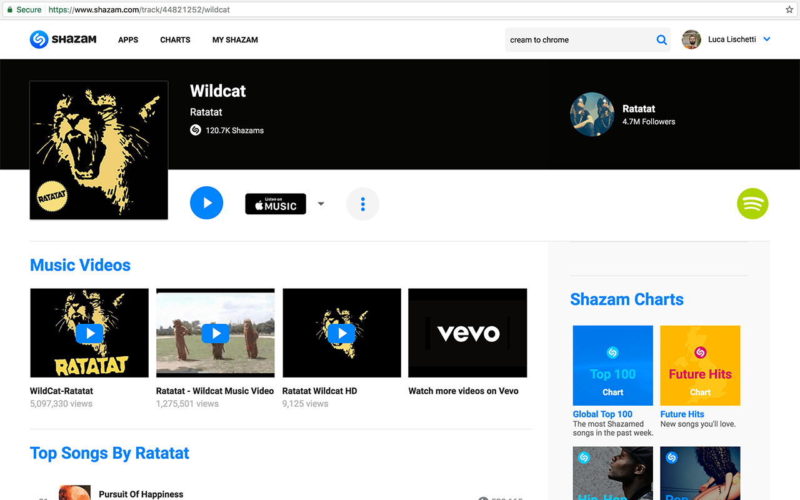
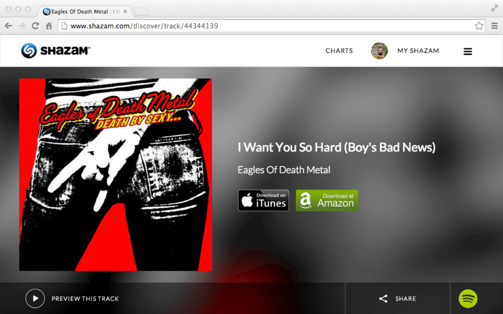

> [!WARNING]
> **Discontinued.** I stopped maintaining Shazamify when I moved away from Google and its ecosystem. Spotify had also blocked unauthenticated API calls in 2017, which broke the user script.

Shazamify adds a small Spotify icon to every [Shazam](https://www.shazam.com) track page and allows you to play that track directly on [Spotify](https://www.spotify.com).

### History

- Released as a Chrome extension and a [user script](/blog/how-to-install-user-scripts).
- Google took the extension down over a copyright issue with the Shazam name, even though I worked at Shazam at the time. I published it again as **Zamify**.
- Google took Zamify down too, without any notice.
- In mid-2017 Spotify blocked unauthenticated API calls, and the user script stopped working.
- I published a new extension, but it kept being taken down without any explanation.

### Older version

