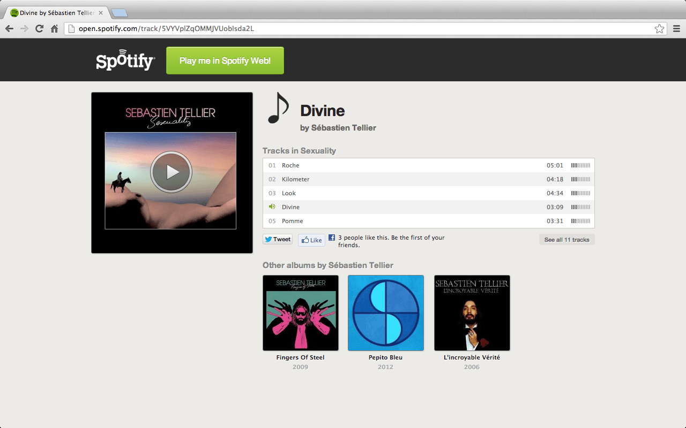
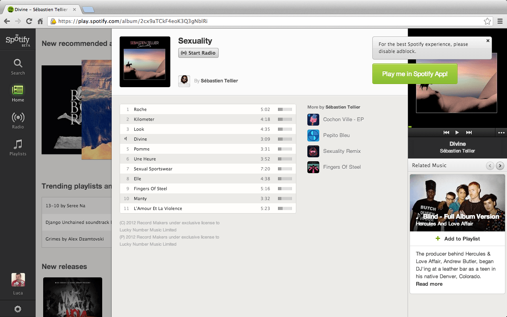
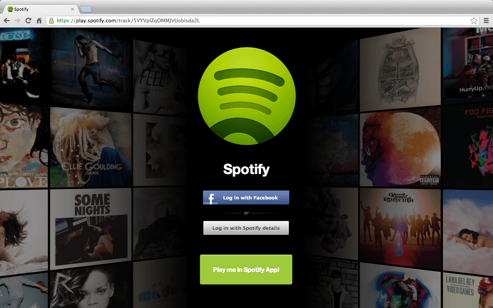

> [!WARNING]
> **Discontinued.** I stopped maintaining Sproxify when I moved away from Google and its ecosystem. The Chrome extension is no longer available.

Recently [Spotify](https://www.spotify.com) released a web app to listen to music in the browser. Finally, Linux users can use the service too.

The only issue? Sharing links between the web app and the desktop app is painful. When you click on a shared Spotify link, you would expect to land in your favourite Spotify app straight away, but that does not happen.

Every time a friend sent me a link, I had to open it, read the name of the track, album or artist, and then search for it again in the app. A clumsy process.

How cool would it be to click on a link and choose where to play the music? With this in mind, I created a little script to fix this problem: **Sproxify**.

Sproxify was available as a Chrome extension and a [user script](/blog/how-to-install-user-scripts). The code is open source on [GitHub](https://github.com/sirlisko/sproxify).

## In a nutshell

It does not matter if you use the Spotify web app or the desktop one: Sproxify shows a button that takes you to the app you prefer, where you can play your music.

## Screenshots

