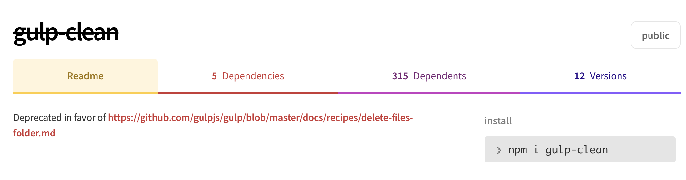
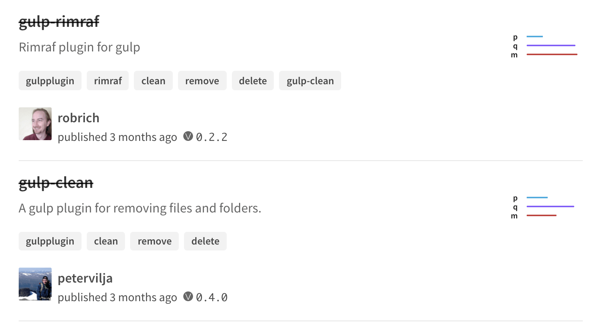
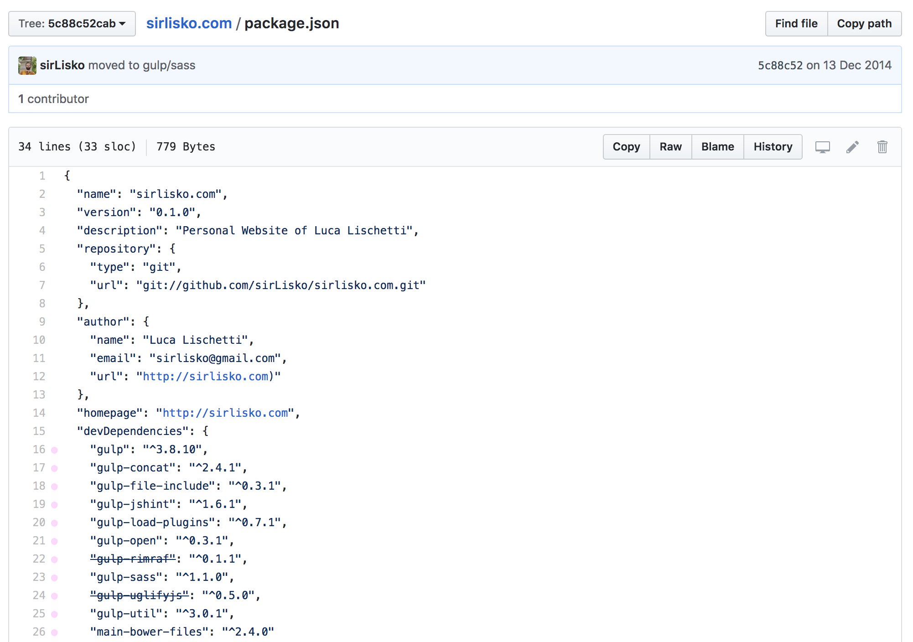
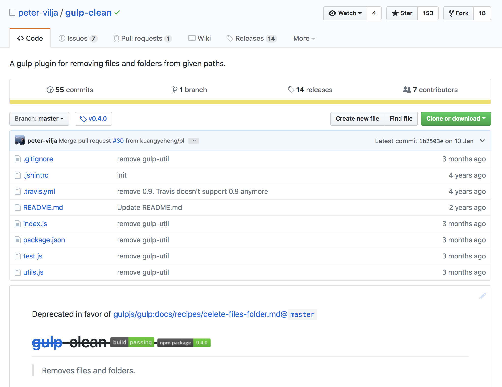

> [!WARNING]
> This project is no longer maintained. Gulp's plugin blacklist system was removed in Gulp v5, and the Chrome extension no longer works due to the Manifest V2 deprecation.

> Chrome extension that marks blacklisted Gulp modules when browsing NPM and GitHub.

## A bit of history

It has been a while since I moved from **Grunt** to **Gulp** in my day-to-day build routine. When I first switched, I tried to port my Grunt process one to one. I searched for all the equivalent Gulp plugins and ended up building a kind of Gulp Frankenstein. This was not the best way to migrate, but in the end everything was faster (thanks to streams) and worked without problems.

I was happy with it, so I did not spend much time learning how Gulp really worked. That changed when I wanted to add Browserify to the Gulp pipeline. The first thing I did was search NPM (or GitHub) for something like "gulp browserify", and I found it. The problem was that the package description had a confusing note: _"THIS PLUGIN IS NO LONGER MAINTAINED , check out the recipes by gulp team for reference on using Browserify with Gulp."_

After searching around, I found out that the Gulp community keeps a pretty long blacklist of plugins that do not follow the Gulp guidelines or that are just duplicates.

I really like the idea of keeping the Gulp plugin ecosystem clean. What I find annoying is that every time I search for a plugin, I have to check the list to be sure I am picking the right one. In an ideal world, the maintainer would remove the plugin from NPM or at least, as with gulp-browserify, add a note saying it has been blacklisted.

We do not live in an ideal world, so on a lazy Sunday afternoon I created a little Chrome extension that shows you all the blacklisted plugins at first glance.

## In action

Gulp Blacklist Marker works on module pages and on search results.

NPM module page:

NPM search result:

GitHub package:

GitHub repo:

## Where to get it

The extension no longer works, but the source code is still on [GitHub](https://github.com/sirlisko/gulp-blacklist-marker).
