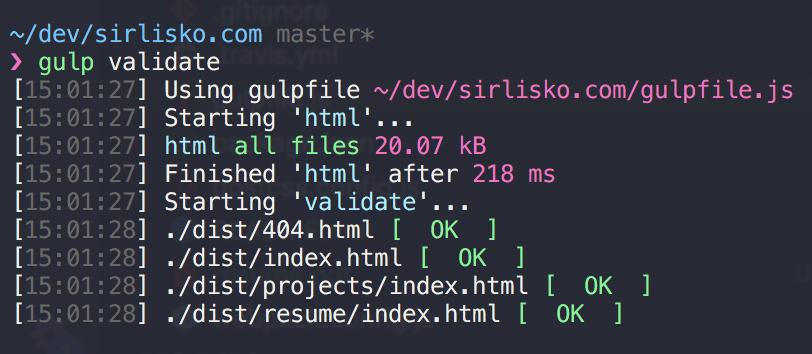
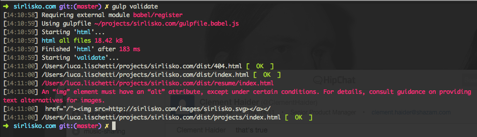
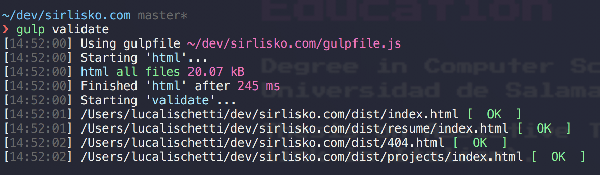

> [!WARNING]
> This post references deprecated packages. `gulp-util` has been officially deprecated by the Gulp team, and `w3cjs` is no longer maintained.



Ever since I wrote my university thesis on _assistive technology_, I have been a bit obsessed with validating my [HTML](https://validator.w3.org/nu/?doc=http%3A%2F%2Fsirlisko.com%2F) (and CSS) with the **W3C tools**, and proudly showing the now old-fashioned _W3C badges_:


Now that front-end build tools (e.g. [Gulp](https://gulpjs.com/)) are part of almost every build process or CI, I spent some time automating the validation.

To validate, I used [`w3cjs`](https://github.com/thomasdavis/w3cjs), `gulp-util` for logging and `map-stream` to loop over the files matched by the glob.

Here is what I ended up with.

```js
import gulp from "gulp";
import util from "gulp-util";
import w3cjs from "w3cjs";
import mapStream from "map-stream";

function validationFeedback(file) {
  return result => {
    const messages = result.messages.filter(message => message.type !== "info");
    if (messages.length) {
      util.log(util.colors.red(file.path));
      messages.forEach(message => {
        util.log(util.colors.red(message.message));
        util.log(message.extract);
      });
    } else {
      util.log(file.path + util.colors.green(" [  OK  ]"));
    }
  };
}

function validate(file) {
  w3cjs.validate({
    input: file.contents,
    callback: validationFeedback(file),
  });
}

gulp.task("validate", () =>
  gulp.src(["./dist/**/*.html"]).pipe(mapStream(validate))
);
```

## In action

With errors:


Without errors:

