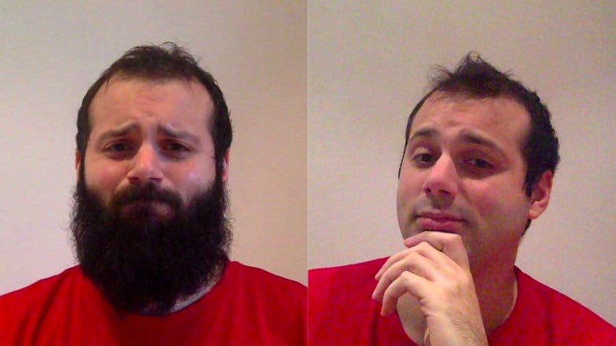
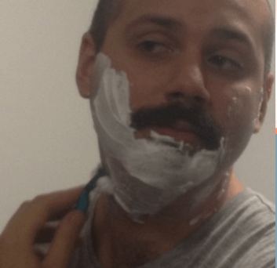

> I want to get MOassive!

Like every year since 2012, this November I covered myself in shame to support the [**Movember**](https://uk.movember.com) cause. This included random people stopping me in the street to ask if I was the [actor starring in Narcos](https://en.wikipedia.org/wiki/Wagner_Moura). Even after they found out the truth, they still wanted a couple of photos.

Anyway, the important thing is that I reached my £300[^1] target.

## What is Movember?

Movember is an annual event where people grow moustaches during November to raise awareness of men's health issues, such as prostate cancer (source: [Wikipedia](https://en.wikipedia.org/wiki/Movember)).

## My Movembers in stats

I updated this table after Movember 2016.

| Year      | £       | Donors |
| --------- | ------- | ------ |
| 2012      | 20      | 2      |
| 2013      | 55      | 6      |
| 2014      | 275     | 17     |
| 2015      | 300     | 17     |
| 2016      | 342     | 26     |
| **Total** | **992** | **68** |

A special thanks to all the donors (_Rui, Cristiano, Flavian, Adrian, Sara, Sandra, Gianluca & Viola, Mirko, Ornella & Rudi, Ling Ling, Veronica, Piero, Lillo, Attilio, Paolo, Mirocle, Suchema_)!

---

[^1]: £249.75, yes, I have a lot of funny friends.
