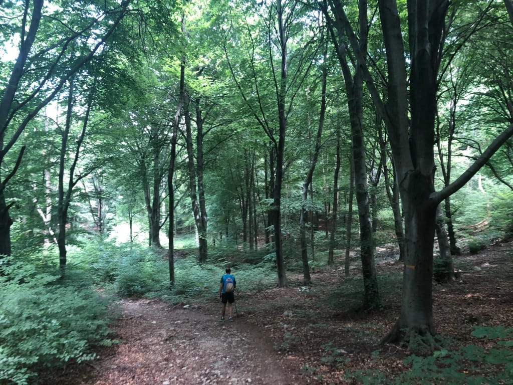

> Da mio padre avevo imparato, molto tempo dopo avere smesso di seguirlo sui sentieri, che in certe vite esistono montagne a cui non è possibile tornare. Che nelle vite come la mia e la sua non si può tornare alla montagna che sta al centro di tutte le altre, e all'inizio della propria storia. E che non resta che vagare per le otto montagne per chi, come noi, sulla prima e più alta ha perso un amico.

Paolo Cognetti, Le Otto Montagne

> From my father I had learned, long after I had stopped following him along the paths, that in certain lives there are mountains to which we may never return. That in lives like his and mine, you cannot go back to the mountain that is in the center of all the rest, and at the beginning of your own story. And that wandering around the eight mountains is all that remains for those who, like us, on the first and highest, have lost a friend.

Paolo Cognetti, The Eight Mountains
