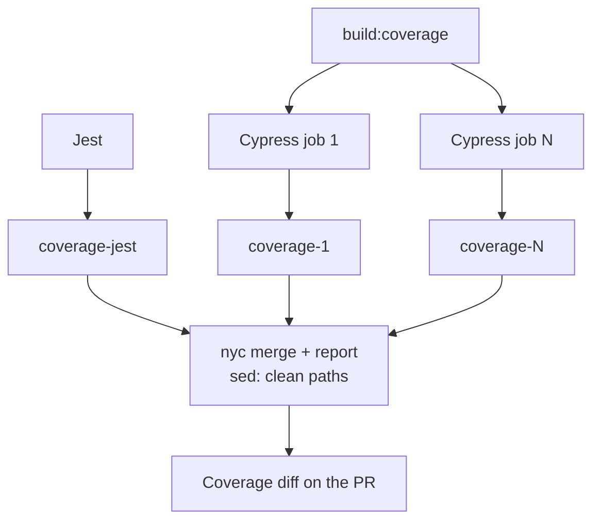

## Introduction

At our workplace, one of the business requirements is to provide a unified coverage report that merges results from all our test sources, in our case, unit/integration (using [Jest](https://jestjs.io/)) and end-to-end (with [Cypress](https://cypress.io/)). We even have a _KPI_: our total code coverage needs to be more than 85%[^1]. While combining these metrics in a single view can be handy, it's important to recognise that unit and E2E tests serve different purposes.

### Why merge coverage?

**Pros:**

- Provides a consolidated view of test coverage across the application.
- It helps ensure that integration tests, which sometimes overlap with unit and E2E tests, contribute to a unified quality metric.
- Satisfies business requirements for a common coverage report, simplifying compliance and reporting.

**Why it might not be the best idea:**

- Unit tests and E2E tests inherently target different aspects of the codebase. Unit tests focus on isolated logic, while E2E tests simulate real user interactions.
- Merging these can mask important differences in test scope and lead to misleading conclusions about overall coverage.

Despite these concerns, and given the business requirements, we needed a way to find a combined coverage metric and engineer our pipeline to meet that need.

## Current State of the System

Before diving into our solution, it's important to understand the current landscape:

- **CI Infrastructure:** We are using GitHub Actions for continuous integration.
- **Framework and Build Tool:** Our application is built using [Next.js](https://nextjs.org/), which utilises _SWC_ for building and transpiling. Consequently, our Jest configuration also relies on _SWC_ for running the tests.
- **Jest for Unit Tests:** Runs unit tests and produces coverage reports.
- **Cypress for E2E Tests:** Executes tests in parallel across multiple containers. Cypress coverage is powered by _Babel_ through the [`@cypress/code-coverage`](https://github.com/cypress-io/code-coverage) package. Each parallel test generates its own coverage report.

## Challenges

We need to find a way to collect the coverage generated by the parallel runs of Cypress and merge them along with the coverage generated by Jest.

Another challenge arises from the tooling: _Jest_ is using **SWC**, but _Cypress_ requires **Babel**. This creates inconsistencies in the coverage data between unit and E2E tests.

After a few attempts, we realised that the numbers didn't add up. We tried running our unit tests both with SWC and Babel as transpilers, obtaining the following results.

Coverage with _SWC_:

```bash
=============================== Coverage summary ===============================
Statements   : 85.66% ( 7812/9119 )
Branches     : 65.4% ( 2091/3197 )
Functions    : 79.63% ( 1756/2205 )
Lines        : 85.54% ( 7077/8273 )
================================================================================
```

Coverage with _Babel_:

```bash
=============================== Coverage summary ===============================
Statements   : 79.57% ( 5030/6321 )
Branches     : 63.48% ( 2191/3451 )
Functions    : 79.01% ( 1747/2211 )
Lines        : 79.64% ( 4874/6120 )
================================================================================
```

As seen in the numbers above, _Babel_ tends to report lower overall coverage than _SWC_, particularly in statements and lines. One key issue is that _SWC_ considers imports as covered statements, inflating the overall metrics.

Moreover, while there is an open issue in the _Cypress_ coverage repository regarding _SWC_ support ([issue #583](https://github.com/cypress-io/code-coverage/issues/583)), it has been stale for a long time. There's also an effort to support _Istanbul_ for _SWC_ ([swc-plugin-coverage-instrument](https://github.com/kwonoj/swc-plugin-coverage-instrument)), but it is currently not working as expected.

This divergence means we must carefully manage configurations to use _SWC_ for performance in _Next.js_ while switching to _Babel_ when generating coverage reports for _Cypress_.

## Overview of the workflow

To ensure accurate test coverage reports across both _Jest_ and _Cypress_, we decided to stick to _Babel_ for the code coverage, but keep _SWC_ for everything else. We use a temporary _Babel_ configuration along with a set of _npm scripts_ to apply and clean up the necessary changes.

### Key Components

#### Separate Babel Config for Coverage

We use `coverage.babel.config.js` specifically for test coverage. This prevents unwanted instrumentation from affecting the main development and production build. This config extends `next/babel` and enables the `istanbul` plugin only when `BABEL_ENV=component` is set.

The file looks like this:

```js
module.exports = {
  presets: ["next/babel"],
  env: {
    component: {
      plugins: ["istanbul"],
    },
  },
};
```

#### Updated `jest.config.js`

Here’s how you can modify your **jest.config.js** to dynamically switch between `babel-jest` (when coverage is enabled) and `@swc/jest` (for faster test execution when coverage is not needed):

```js
const useBabel = process.env.BABEL_ENV === "true";

module.exports = {
  transform: {
    "\\.[jt]sx?$": useBabel
      ? "babel-jest"
      : [
          "@swc/jest",
          {
            jsc: {
              transform: {
                react: {
                  runtime: "automatic",
                },
              },
            },
          },
        ],
  },
  // ... rest of the configuration
};
```

#### How It Works

- The `useBabel` flag checks if `BABEL_ENV` is set to `"true"`, which happens during coverage testing.
- If `BABEL_ENV=true`, Jest uses **`babel-jest`** to enable the **Istanbul** instrumentation for coverage.
- Otherwise, it uses **`@swc/jest`**, which is much faster because _SWC_ is a compiler written in _Rust_.

This ensures that the coverage reports are accurate when needed and the tests run much faster when coverage is not required.

```json
"test:coverage": "cross-env BABEL_ENV=true jest --coverage"
```

When running normal tests (`jest` without `BABEL_ENV=true`), it will use `@swc/jest` for improved performance.

### NPM Scripts to Automate the Process

Before running tests or building for coverage, we **swap the Babel config** using a temporary setup:

- `coverage:setup`: Copies `coverage.babel.config.js` to `babel.config.js`, overriding the default config.
- `coverage:teardown`: Removes the temporary `babel.config.js` after the process.

The following scripts ensure proper execution:

```json
"pretest:coverage": "npm run coverage:setup",
"test:coverage": "cross-env BABEL_ENV=true jest --coverage",
"posttest:coverage": "npm run coverage:teardown",
"prebuild:coverage": "npm run coverage:setup",
"build:coverage": "cross-env BABEL_ENV=component next build",
"postbuild:coverage": "npm run coverage:teardown",
"coverage:setup": "cp coverage.babel.config.js babel.config.js",
"coverage:teardown": "rm babel.config.js"
```

The **pre/post hooks** guarantee that no `babel.config.js` is present outside of coverage testing.

## Merging coverage from Jest and Cypress

To get a complete test coverage report, we need to combine results from **Jest** and **Cypress**.

### How it works

1. **Jest Coverage**

   - Running `npm run test:coverage` executes _Jest_ with `BABEL_ENV=true`, ensuring that _Istanbul_ (enabled via _Babel_) collects coverage.
   - _Jest_ generates a coverage report in `jest-coverage/`.

2. **Cypress Coverage**

   - Cypress requires the `istanbul` plugin in _Babel_ to instrument the code during execution.
   - Since `coverage.babel.config.js` includes `istanbul` under the `component` environment, running `npm run build:coverage` ensures that the built application includes coverage tracking.
   - Cypress tests then generate coverage reports in `coverage/`.

3. **Consolidating Cypress coverage:**

   Each parallel Cypress job generates a `coverage/coverage-final.json` file, which is renamed to `coverage-<job_number>.json` and uploaded as an artifact.

4. **Merging Reports**
   - We download the coverage artifacts and merge them using `nyc`.
   - We generate reports based on the merged coverages.
   - We sanitise the file paths contained in the coverage using `sed` (otherwise they are absolute paths on the runner, like `/home/runner/actions-runner/_work/...`).



With this approach, unit and end-to-end coverage are measured with the same tool, so the merged numbers are consistent.

### Jest Testing Workflow

The `sanity-jest` job is responsible for running unit tests using Jest:

```yml
sanity-jest:
  name: Jest
  runs-on: ubuntu-latest
  steps:
    - uses: actions/checkout@v4

    - uses: actions/setup-node@v4
      with:
        node-version-file: ".nvmrc"
        cache: "npm"

    - name: Install dependencies
      run: npm install
      env:
        CI: true

    - run: npm run test:coverage -- --silent --colors

    - uses: actions/upload-artifact@v4
      with:
        name: coverage-jest
        path: "jest-coverage/coverage-final.json"
```

#### Key points

- **Same coverage numbers as Cypress:** Jest uses Babel instead of SWC when collecting coverage.
- **Pre and post hooks for the Babel config:** Coverage is instrumented correctly without affecting the normal build.
- **Artifact upload:** Stores Jest coverage for merging.

### Parallelised Cypress E2E Testing

The `sanity-e2e` job is designed to distribute Cypress E2E tests across multiple containers:

```yml
sanity-e2e:
  name: End to End Tests
  runs-on: ubuntu-latest
  strategy:
    fail-fast: false
    matrix:
      containers: [1, 2, 3, 4, 5, 6, 7, 8, 9, 10]
  env:
    BASE_PATH: ""
  steps:
    - uses: actions/checkout@v4

    - uses: actions/setup-node@v4
      with:
        node-version-file: ".nvmrc"
        cache: "npm"

    - name: Cypress run
      uses: cypress-io/github-action@v6
      with:
        build: npm run build:coverage
        start: npm run start:ci
        wait-on: "http://localhost:3000/"
        parallel: true
        record: true
      env:
        CYPRESS_PROJECT_ID: ${{ secrets.CYPRESS_PROJECT_ID }}
        CYPRESS_RECORD_KEY: ${{ secrets.CYPRESS_RECORD_KEY }}
        GITHUB_TOKEN: ${{ secrets.GITHUB_TOKEN }}

    - name: Check file existence
      id: check_files
      uses: andstor/file-existence-action@v3
      with:
        files: "coverage/coverage-final.json"

    - name: Rename coverage
      if: steps.check_files.outputs.files_exists == 'true'
      run: mv coverage/coverage-final.json coverage/coverage-${{ matrix.containers }}.json

    - name: Upload coverage
      uses: actions/upload-artifact@v4
      if: steps.check_files.outputs.files_exists == 'true'
      with:
        name: coverage-${{ matrix.containers }}
        path: "coverage/coverage-${{ matrix.containers }}.json"
```

#### Key points

- **Coverage files per parallel job:** Cypress generates individual coverage files, renamed to avoid overriding on upload of the artifacts.
- **File existence check:** Uploads the coverage only if the job produced it, using `andstor/file-existence-action`.
- **Artifact upload:** Stored as `coverage-<job_number>.json`.

### Merging and Validating Coverage Reports

Finally, the `coverage` job consolidates all coverage reports:

```yml
coverage:
  name: Coverage
  runs-on: ubuntu-latest
  needs: [sanity-e2e, sanity-jest]
  steps:
    - uses: actions/checkout@v4

    - name: Download and move artifacts
      uses: actions/download-artifact@v4
      with:
        merge-multiple: true
        path: coverage
        pattern: coverage-*

    - name: Merge coverage
      run: |
        mkdir .nyc_output
        npx nyc merge coverage
        mv coverage.json .nyc_output/out.json
        npx nyc report --reporter text --reporter json-summary --report-dir coverage --exclude-after-remap false
        sed -i -e 's/\/home\/runner\/actions-runner\/_work\/my-repo\/my-repo\///g' coverage/coverage-summary.json

    - name: Coverage Diff
      uses: greatwizard/coverage-diff-action@v1
      with:
        github-token: ${{ secrets.GITHUB_TOKEN }}
        allowed-to-fail: "true"
```

#### Key points

- **Artifact download and merge:** Get all the coverage artifacts and create one coverage output.
- **Absolute path sanitisation:** Uses `sed` to clean file paths in reports. Replace `my-repo/my-repo` with your repository's path on the runner.
- **Coverage diff:** Comments on the PR with the change in combined coverage.

## Gotchas

- `.nycrc` works locally for `cypress run` but not in the GitHub Action using `cypress-io/github-action@v6`.
- The generated file names of the report are created with the absolute path, using `sed` to sanitise them.
- Sometimes, not all parallel Cypress jobs execute tests, which prevents coverage files from being generated. To avoid breaking the job, we ensure that the files exist before proceeding (using [`andstor/file-existence-action`](https://github.com/andstor/file-existence-action)).
- A _Babel_ environment is needed; otherwise, _Jest_ complains about duplicate entries.

## Conclusion

Using _SWC_ in _Next.js_ and _Babel_ in _Cypress_ adds complexity. Our solution keeps _SWC_ for speed in day-to-day builds and tests, and switches to _Babel_ only when we need coverage.

It is more setup than I would like, but it gives us one coverage number that matches the business requirement, without slowing down the normal test runs.

---

[^1]: I will never get tired of saying that high code coverage does not necessarily mean good code or a good test strategy, but that topic deserves its own post.
