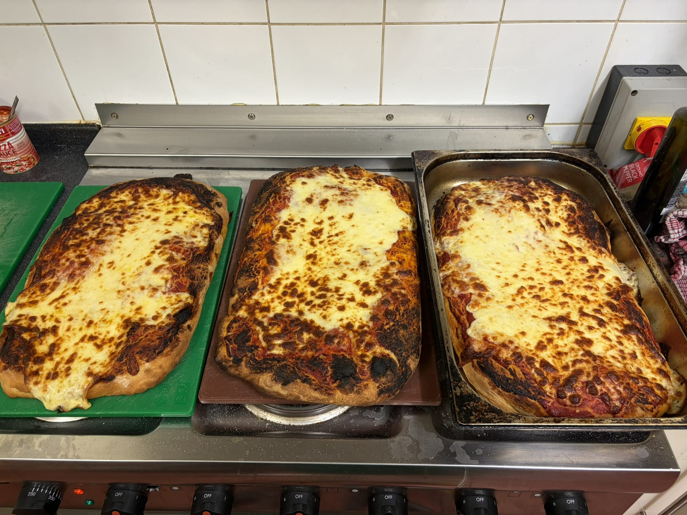
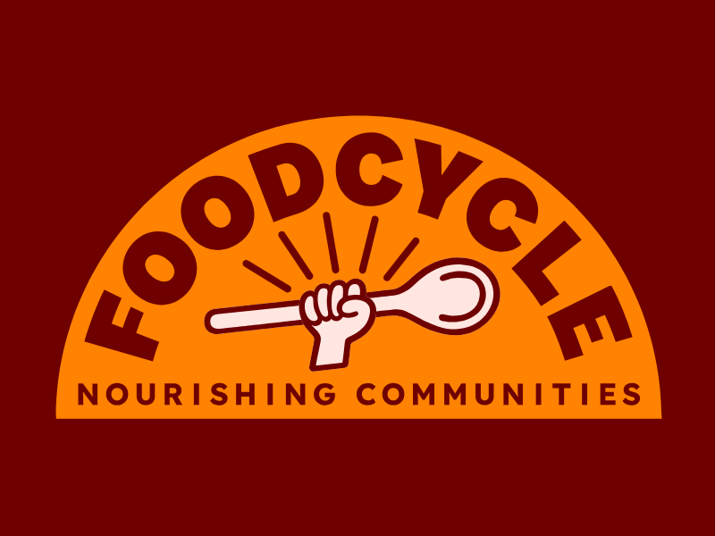

Today marks exactly one year since I first walked into a [FoodCycle](https://foodcycle.org.uk/) session. I didn't expect it to become such a fixed part of my week, and yet here I am, feeling like something is genuinely missing whenever I skip a Saturday morning.

Volunteering in London is harder than it sounds. Even when you're giving up your free time for free, there's always a queue (in perfect British fashion).

## Stumbling Across FoodCycle

The real nudge came from a friend. We were chatting and she mentioned she'd been cooking in a soup kitchen. When I got home that evening I searched online and found FoodCycle. I did a short online course and questionnaire, and joined the waiting list. I didn't have much hope, given my past experience of trying to volunteer with other organisations without much success, but I got lucky: a couple of days later someone cancelled and I was in.

The concept is simple: use surplus food that would otherwise go to waste to cook free community meals. Anyone is welcome to come and enjoy the meal, no questions asked. It hit three things I actually care about in one go: cooking, preventing food waste, and supporting the local community.

## From Finsbury Park to Walthamstow (and more)

I started going to the Finsbury Park sessions on Saturday mornings. Part of what makes it interesting, and slightly nerve-wracking, is that when you arrive, you don't know what ingredients you'll find or how many guests will turn up. The numbers vary quite a bit, sessions usually hover around fifty people, but I've been there when seventy walked through the door, and other times barely thirty showed up because it was pouring with rain. You figure it out together on the spot: what to do for a starter, a main, a dessert. It's part cooking challenge, part improvisation exercise.

After a while I started volunteering at the Walthamstow hub too, on Thursday evenings for dinner, and eventually at Old Street as well. Spreading across a few hubs made the week feel full in a way it hadn't before.

Then, after a couple of months in Walthamstow, I was asked if I'd like to become a Project Lead. I was genuinely surprised. I said yes, went through the training, and have now been leading sessions for almost five months. It's a different kind of responsibility: coordinating the kitchen, briefing volunteers, keeping an eye on the timing, making sure everyone gets fed at the end of it all.

At Christmas, the organisation turned the tables, the FoodCycle team cooked for the Project Leads. After months of being the one making sure everyone else eats, sitting down and being cooked for was a genuinely lovely gesture.

## The Pizza Session

One Wednesday evening I got a message: we'd received a donation of five kilograms of mozzarella. That's not the kind of ingredient you sit on. So that evening I made 7.5 kilograms of pizza dough, proper dough, left to prove overnight.

The next day we turned the Walthamstow session into a pizza party. It worked beautifully. Those are the sessions that remind you how much fun this can be.

## Always Something New to Learn

Beyond the regular sessions, we also did a day out, a guided mushroom foraging course. It sounds like a small thing, but it was genuinely fascinating: walking through green spaces, learning to identify what's edible and what definitely isn't, engaging with something about the natural world that most of us in cities rarely think about. FoodCycle seems to attract people who share that kind of curiosity, always up for trying something new, always happy to be surprised.

## What a Year Feels Like

In twelve months I've cooked things I wouldn't have attempted on my own: dishes I had no idea how to make, ingredients I'd never bought, flavour combinations I'd never have thought to try. The people who show up to volunteer are, without exception, the kind who like to experiment, who will suggest something unexpected and then actually pull it off.

The responsibility side is real, though. Feeding fifty people sounds straightforward until you're actually doing it: juggling multiple dishes, coordinating volunteers who've never worked together before, keeping the timing so that everything lands at once. It's genuinely challenging, especially when things don't go to plan, and things always eventually don't go to plan. You learn to adapt under pressure, and each session you come out slightly better equipped for the next.

The level of satisfaction I get from it is something I hadn't quite expected. It sounds dramatic, but if I skip a Saturday I feel like I haven't really had a weekend. The sessions take up a good chunk of the morning and yes, they can be tiring, but they are always, always worth it.

One year in, I'm not planning on stopping any time soon.

