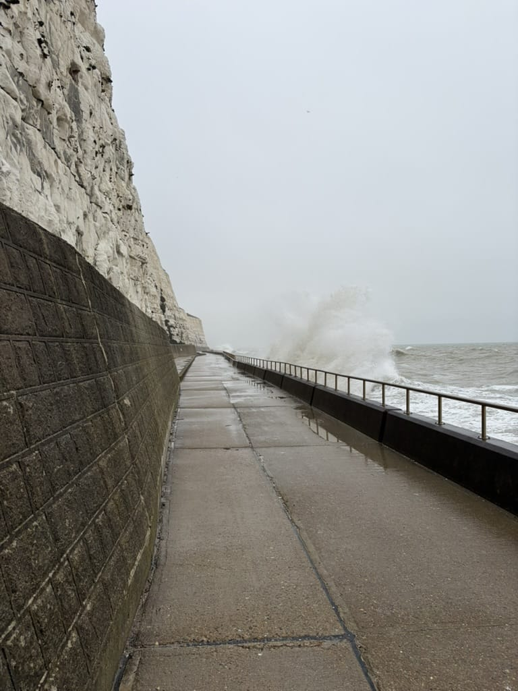
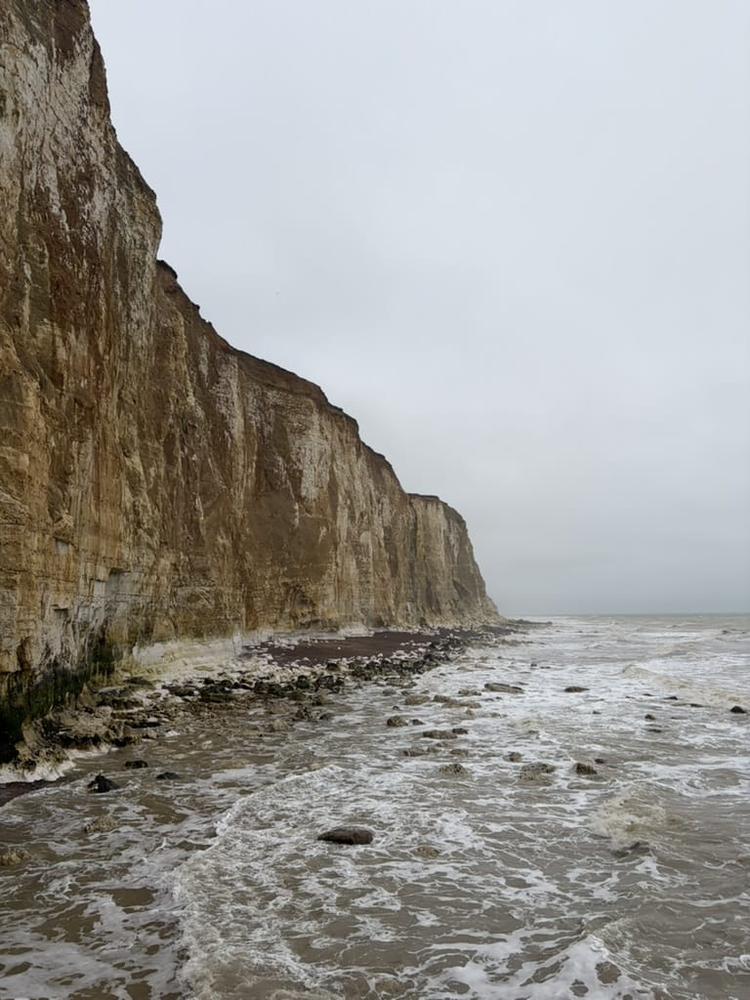
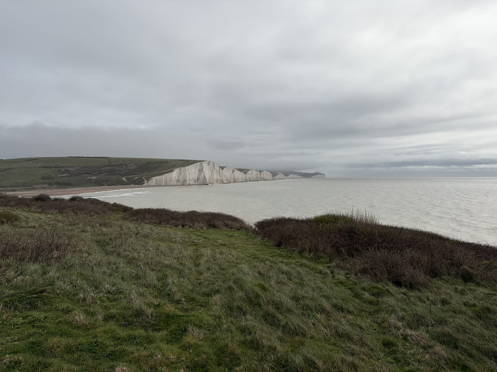
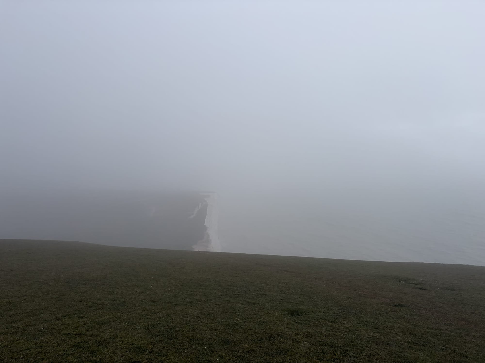
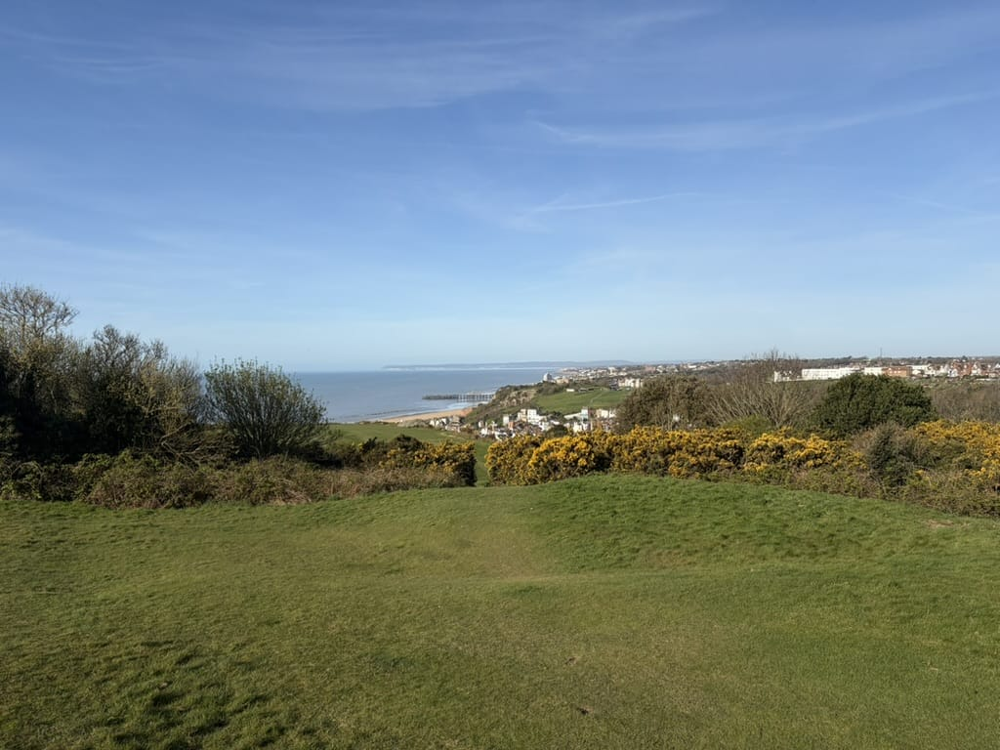

I've been walking a lot for over a year and a half now. About 20km on days I go into the office and ~10km on average the other days. At some point that stops being a commute and starts feeling like a habit worth keeping up. So I started looking for something bigger. Also influenced by some conversation with a [friend](https://cedmax.net), [more on that later](https://sirlisko.com/blog/100km).

That's how I found the _England Coast Path_.[^1] Browsing through a hiking app, the Seven Sisters caught my eye. I zoomed out, saw Brighton to the west and Hastings to the east, and did the rough arithmetic: ~80km, three days, Easter weekend. I proposed it to [Ana](https://untepid.com). She said yes immediately, then spent the next two weeks researching kit, buying hiking poles, and a new waterproof jacket. I had some new trail shoes. What could go wrong.

## Day 1: Brighton to Seaford

### Departure in the rain

We left London on Good Friday. It was overcast, as London (too often) tends to be, but I delivered my reassuring speech: every time I've left London under grey skies and arrived at the coast, it's been sunny. Brighton gets more sunshine than London. The coast does its own thing.

Two stops from Brighton, it started raining. Hard. By the time we got off the train it was a proper downpour.

To be fair, the waterproofs held and the mood held with them. We walked down to the front, briefly failed to appreciate the top of the _Brighton i360_[^2] through the rain, and headed east past the pier into territory I'd never explored before.

### Along the cliffs

Once past the pier, the walk runs along the undercliff below the chalk faces, with the sea right alongside. The waves were massive. At one point a wave cleared the sea wall and soaked us both. Then it happened again.

Scenic, dramatic, thoroughly wet. I have no complaints about that stretch.

### Newhaven and Seaford

To get past the mouth of the River Ouse the path forces you inland, up through Newhaven. Newhaven is a port town and it shows. We moved through it quickly.

On the other side the path drops back toward the coast and into Seaford. From there we could already see the Seven Sisters in the distance: a white line of chalk headlands on the horizon. Knowing they were tomorrow's walk made the tired legs feel like a reasonable investment.

We stayed in a room above a pub. Seaford in April is cold, windy, and not particularly lively, but a room above a pub is always the right call. I felt a bit like a medieval pilgrim resting in a tavern.

## Day 2: The Seven Sisters

### Morning climb and the tide problem

Left Seaford early and got a steep climb almost immediately, which made it clear what kind of day it was going to be. But the views were worth it.

We tried to cross the River Cuckmere at the valley bottom but the tide was already too high. We had to double back and follow the river upstream to find a crossing, adding extra distance to a day that already had plenty.

### Into the fog

By the time we reached the top of the Sisters, visibility had dropped to maybe 30 metres. Cloud and drizzle had come in and the whole thing felt genuinely strange, like walking on another planet. You could see the first headland clearly enough. The rest dissolved into grey.

In a way it was a charming experience. The walk across the top is all ascent and descent, each sister a separate chalk headland, and the rhythm of it carried us through. By the time we reached the last one, the sun had broken through.

### Beer at Birling Gap, then Eastbourne

There's a pub at Birling Gap, right at the end of the Sisters before the final descent toward Eastbourne. We sat outside in the sun with a pint. After everything that had come before, it was genuinely one of the better beers I've had.

From there, Eastbourne was straightforward. We arrived in the afternoon and found a place to stay. I had a plan to eat only traditional English food for the entire trip. Ana had walked two days and wanted pizza. I couldn't say no. It was actually very good.

## Day 3: Eastbourne to Hastings

### The road stretch

The first section out of Eastbourne toward Bexhill-on-Sea is the weakest part of the three days. A lot of it runs along roads with not much to look at.

### Pebbles and wind

Things improved about halfway through Bexhill. A long section of pebble beach with strong wind off the sea and flat grey water. After the drama of the Sisters the day before it felt straightforward. Just walking.

We pushed on through Bexhill to Hastings without stopping.

### Hastings

Hastings was a good surprise. Lively, a bit rough around the edges in an appealing way, with a proper old town. We stayed in the St Leonard's end where there were plenty of pubs and fewer tourists. That evening we found a sunday roast. After more than 70 kilometres on the legs, it was the best nut roast I have ever eaten. Not sure if that context had something to do with it.

The next morning we walked the hill above Hastings before catching the train back.

We visited the Fishermen's Museum down on the stade, found a small shark stranded on the beach,[^3] and I lost my mind entirely over a patch of woodland absolutely carpeted in wild garlic. I spend considerable effort tracking down wild garlic in London. Down there it was growing in quintal.

## Final Thoughts

If you have three days, do the whole route. But if you only have one, go from Seaford to Eastbourne. Take the train to Seaford, walk the Seven Sisters, finish in Eastbourne. That's the best section by a long distance and it's entirely doable in a day. The first and third days have their moments, but they're more a connection rather than destinations.

Brighton is always worth a stop. Hastings exceeded my expectations. Both deserve at least a night.

One practical note: I wore new trail shoes I had only tested for a few kilometres around London. I knew it wasn't ideal. One turned out to have a defect in the tongue that rubbed for all three days.[^4] The shoes went back.

[^1]: A waymarked walking route following the entire coastline of England, with signage and designated paths for most of its several-thousand-kilometre length.

[^2]: The Brighton i360, a modern observation tower and gondola ride offering panoramic views over Brighton and the English Channel. Worth a proper look on a dry day.

[^3]: A small species I couldn't identify on the spot. Worth knowing that the Hastings seafront is apparently not an unusual place to find one washed up.

[^4]: Accepted as defective and refunded. Small consolation at the time.
