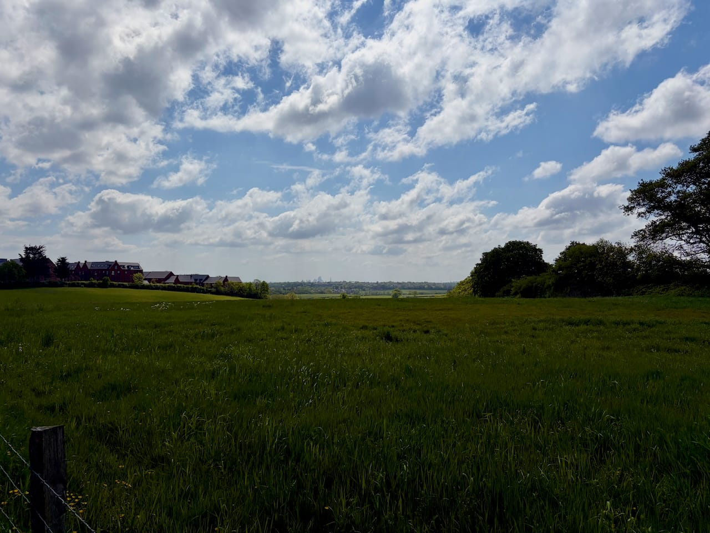
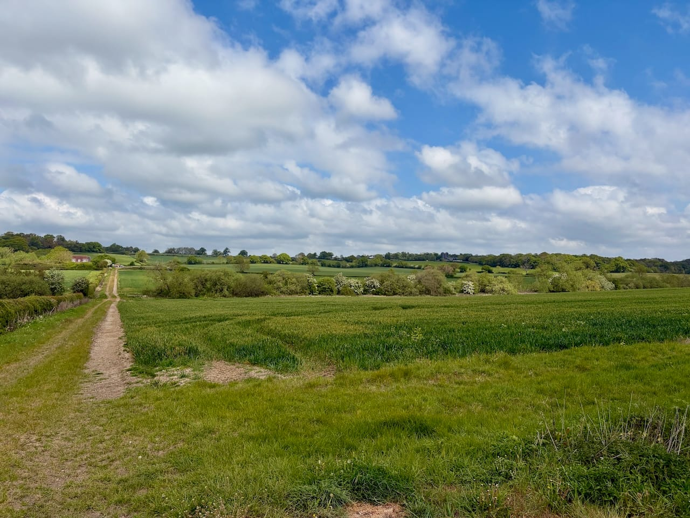
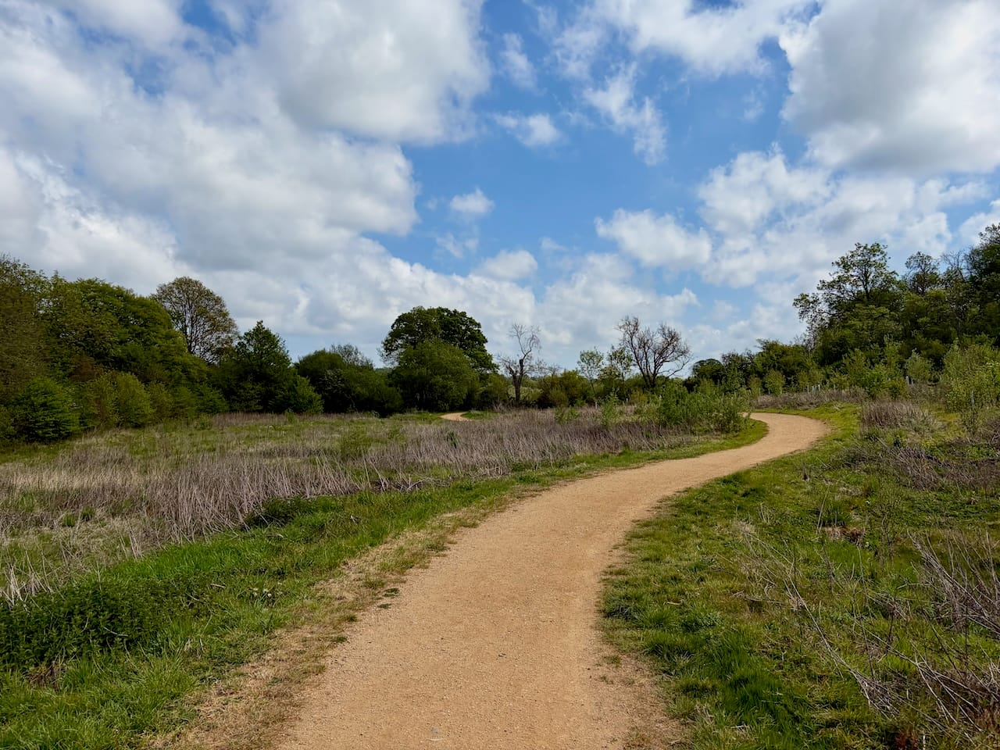
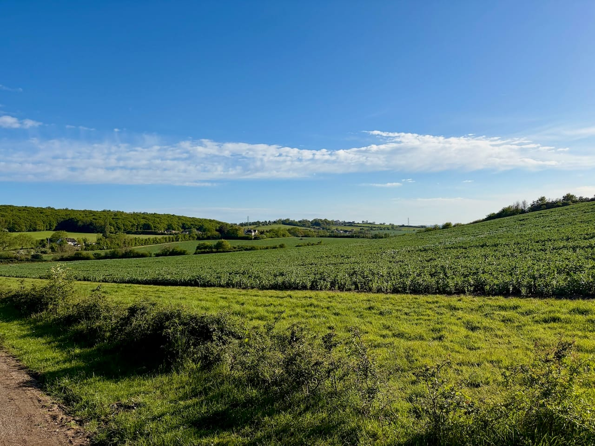
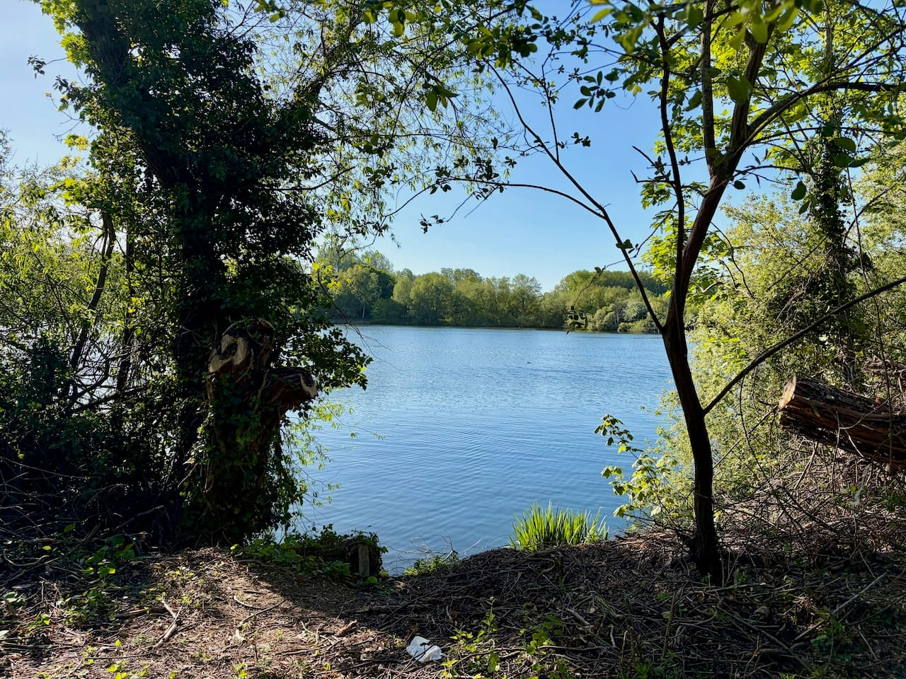
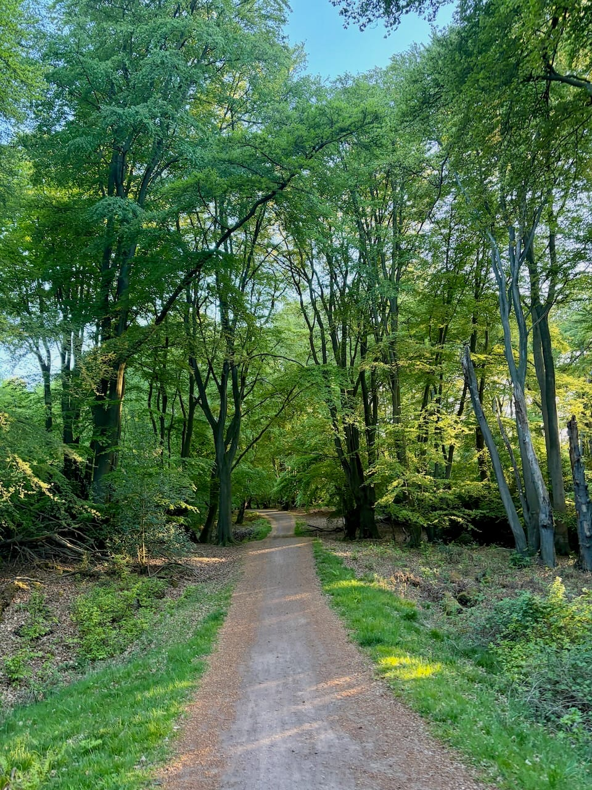
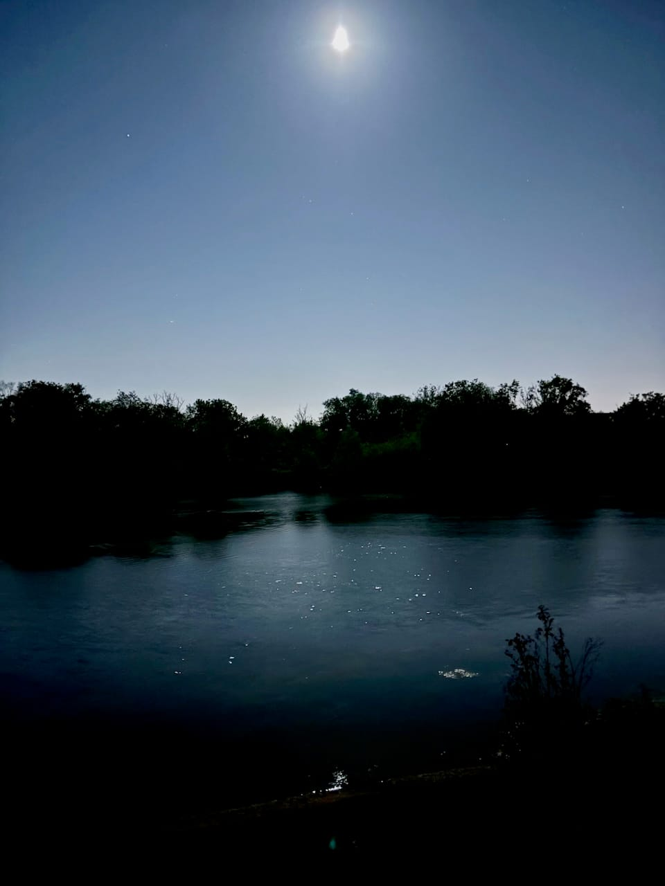

The idea came from a [friend](https://cedmax.net) I'd apparently infected with the walking habit. We were both between jobs for a few weeks, I'd chosen not to renew my contract, he was moving on elsewhere, and he proposed walking from London to Brighton on foot. I said yes before I'd looked at a map.

When I did look, the numbers were fine: around 80-90km. But the route itself was more complicated. The obvious option follows an old road south (the [Socratic Trail](https://www.alltrails.com/lists/socratic-trail)), but reports described stretches with unclear waymarking through open countryside and a steep climb near the end. The plan was to start at dawn and arrive by evening. Getting stuck after dark in the middle of the Downs, without energy or with a pulled muscle, in a place unreachable by public transport, that was a prospect we didn't fancy.

So we changed the approach. Stay within the city, always close enough to a tube or bus to bail if needed. That constraint pointed us toward a loop: a cycling route circling North London, starting and ending at Archway, covering the outer boroughs to the north and coming back in through the east. Around 100km.

Before committing properly, we did a night test. About 30km through Epping Forest, south through Walthamstow, on to Stratford, finishing at King's Cross around 11pm. Everything seemed manageable. We picked a date.

The week before, he injured his foot. We postponed.

---

## The Walk

We started early on a Tuesday, 28th April, my second week without a job to go to, from Archway, heading north.

The first section is where the city quietly turns into something else. North London has more greenery than it gets credit for. Past Highgate, along the edge of the park below Alexandra Palace, then out through Barnet and Enfield. At some point you turn around and London is just a smudge on the horizon behind you.

Past Enfield the route pushes further north into Hertfordshire, around Broxbourne, where it stops feeling like London entirely - proper countryside, fields, patches of woodland, no city noise.

From there the route turns south along the Lea Valley. The valley is long and quiet up in its northern section.

Then Epping Forest begins. This is where night fell properly, the trees closed in and the temperature dropped a few degrees. A long stretch in the dark from the forest's northern edge all the way down through to Wanstead and Stratford.

Coming out the other side, we passed the lakes in Wanstead Park in the dark.

I'd gone in expecting the hardest part to fall somewhere around 60-65km. My logic: for the first 50 you can say you're approaching halfway, and from 50 onwards you can say you're approaching the end. The gap between those two stories, the early sixties, seemed like where morale would sag. I was wrong about the location, if not the feeling.

I held up reasonably well until around 75km. Then it got dark. The temperature dropped. By the time I got home it was past 4am and the apparent temperature was 2°C. The last 20km were the hardest part, not just physically, but mentally in a specific way. I'd gone too far to contemplate stopping, and the idea of coming back another day to cover the remaining stretch felt genuinely worse than just continuing. So I continued. There's probably a more dignified framing of that decision. I can't find one.

I got home, sat down on the sofa, and didn't move or say anything for about ten minutes. Then I stood up and immediately started shaking, with the kind of cold that comes from the inside. What followed was a night of sweating through what felt like a high fever. This is apparently normal after an ultra-marathon effort, the body's response to sustained extreme exertion. Good to know in retrospect.[^1]

## The Numbers

109.3km in 19h 32m, across 3 counties: Greater London, Hertfordshire, and Essex. That's 100km of loop plus 9.3km of walking there and back (strictly to make sure the watch hit the target 😅). Food consumed: 5 hard-boiled eggs, 7 flapjack bars (around 200 calories each), 4 bananas, 2 energy drinks, and about 5 electrolyte tablets (roughly 2,000 calories in total). The watch estimated approximately 8,000 calories burned. 2 days of recovery.

## What Went Well

**Company.** I'd done long walks alone before. They're fine. But having someone to talk to for ~100km was a game-changer. When one of us was flagging, the other wasn't, and that asymmetry is useful over a full day. We talked more or less continuously for about 90km. The last 10, neither of us said much, but that was fine too. He [wrote about the walk too](https://cedmax.net/blog/100km/).

**The shoes.** After the foot problem on the Seven Sisters I'd bought a new pair of trail shoes, same model but slightly different version, before this walk.[^2] Not a single foot issue across 109km. I genuinely don't think I appreciated how much that would matter until it didn't hurt.

**The route.** Epping Forest and the Lea Valley are the highlights. The countryside around Broxbourne is genuinely surprising, you are still technically close to London and yet there is nothing around you. The urban sections through Wanstead and Stratford on the way back feel earned by the time you reach them.

## What Didn't

**Food.** The calorie deficit was significant. I kept saying I was hungry, but my friend wasn't, maybe it was my body trying to tell me something. This was incorrect.

**Water.** I'd gone light, which made sense at the start and became less sensible as the day wore on. We refilled at shops when we passed through built-up areas. Water fountains were nowhere to be found. At one point, deep in a wooded section, I spotted what looked like a drinking fountain ahead. It was a white fence post.

**The watch.** My Apple Watch S3 handled about 13 hours of GPS tracking before the battery started failing. When I plugged it in to charge, the GPS turned off, a design choice I'd like to discuss with someone at Apple. I lost around half an hour of tracking and at the door of my house it died completely, and when I managed to turn it on again, it showed "workout completed".

**The aftermath.** The fever-like episode after arriving home. Probably unavoidable given the distance, but it was a surprise at the time.

## What to Improve

**Eat more, earlier.** The calorie plan needs a proper revision. More real food, scheduled stops to actually eat it, and listening when someone tells you to eat.

**Plan water.** Map out the refill points in advance rather than relying on shops appearing when needed. Carry slightly more than feels necessary at the start.

**Better GPS.** The Apple Watch S3 was not the right tool for this. A dedicated GPS device, or at minimum a watch that keeps tracking while charging, would make a real difference, mainly for not getting crazy with the data afterwards.

**Consider an organised event.** There's a Thames Path 100 in September, with checkpoints every 10-20km, food and electrolytes at each stop, navigation already sorted, and other people around if something goes wrong. London to Brighton exists too, but clashes with something this year. The self-organised version has its appeal, but a lot of the stress came from logistics that someone else could handle.

## Final Thoughts

The route itself was good. Would I do this exact loop again? Probably not. Would I do 100km again? Yes.

The round number was the point. Because the watch had lost GPS data during the charging gap, it wasn't showing 100km at the end of the loop. So I walked home from Archway instead of taking the tube, and added the walk from home to the start that morning to the total, and ended up at 109.3km. The fact that this seemed like a reasonable decision at 3am, after nineteen hours of walking, tells you something about the state I was in.

[^1]: The body apparently struggles to regulate temperature and metabolism after sustained ultra-endurance effort. Common enough that it has a name. Less common to discover this while sitting on your sofa in the dark at 4am.

[^2]: Covered in the [Brighton to Hastings post](/blog/brighton-to-hastings). The original pair had a tongue defect that rubbed for three days. They went back.
