I'd been to both Prague and Vienna before, on separate trips about fifteen years ago, both times in the depths of winter, and both times so cold I never really enjoyed either city properly. [Ana](https://untepid.com) had been to Prague once too, though we hadn't been there together, and we'd both wanted to go back. So this time we picked early May instead, gave ourselves three nights in Prague, and figured out the rest from there.

## Prague, without the cold this time

Prague's centrepiece is _Charles Bridge_, and it's genuinely beautiful both day and night, if anything more so after dark, fully lit up with its row of statues casting long shadows across the stone. Fans of _Bloodborne_ (one of my favourite games ever) will probably recognise its shape right away: one of the game's areas is clearly a twist on this exact bridge.

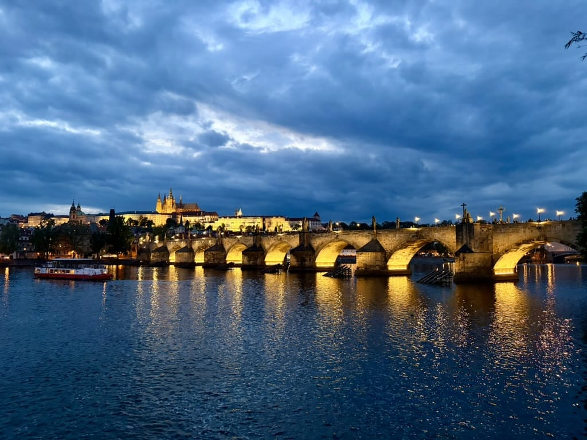

Last time the cold had kept me from exploring much, so this time I made up for it, crossing the bridge more times than strictly necessary and just wandering the centre on foot, getting properly lost in the side streets more than once. We also timed a visit to the _Old Town Square_ to catch the astronomical clock's hourly show, the small procession of moving figures above the clock face, worth seeing once even if it's over quickly.

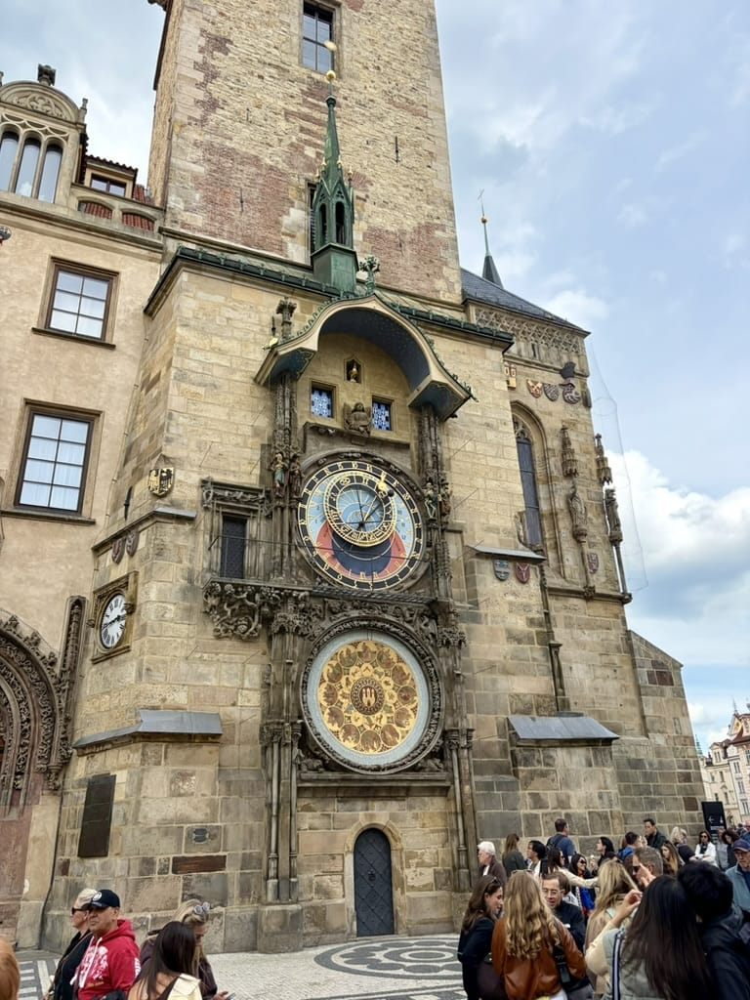

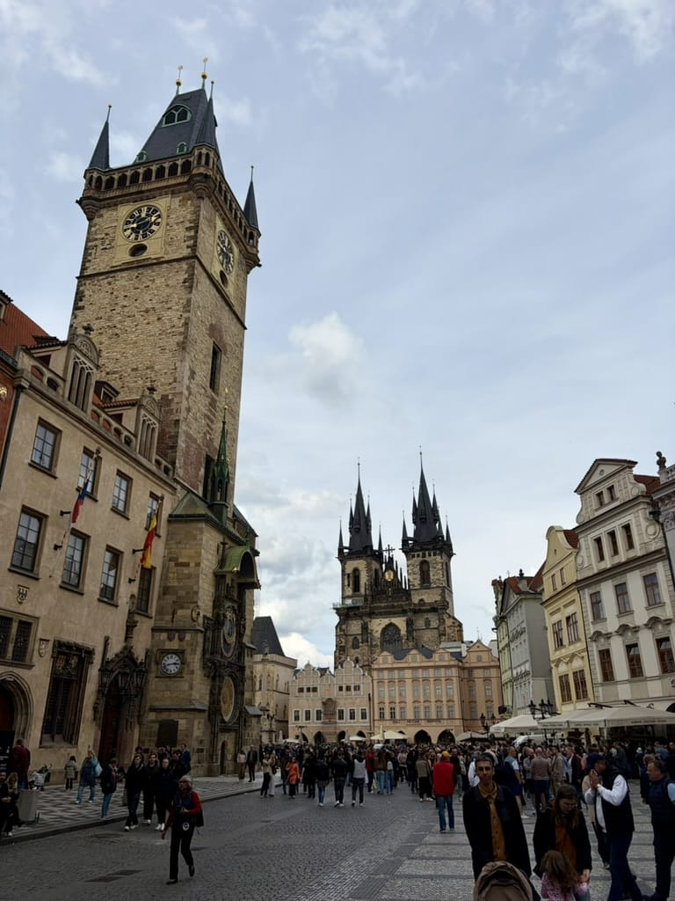

Ana wanted to see the _Mucha Museum_, and I'm glad we went. I already knew a good number of his prints, but had never really looked into his life and career beyond that, and the museum does a good job of filling in the gaps.

Strolling on the other side of the river we came across a set of modern sculptures, giant faceless babies crawling on the ground, all bronze and unsettling in a way that reminded me of _Silent Hill_.[^1]

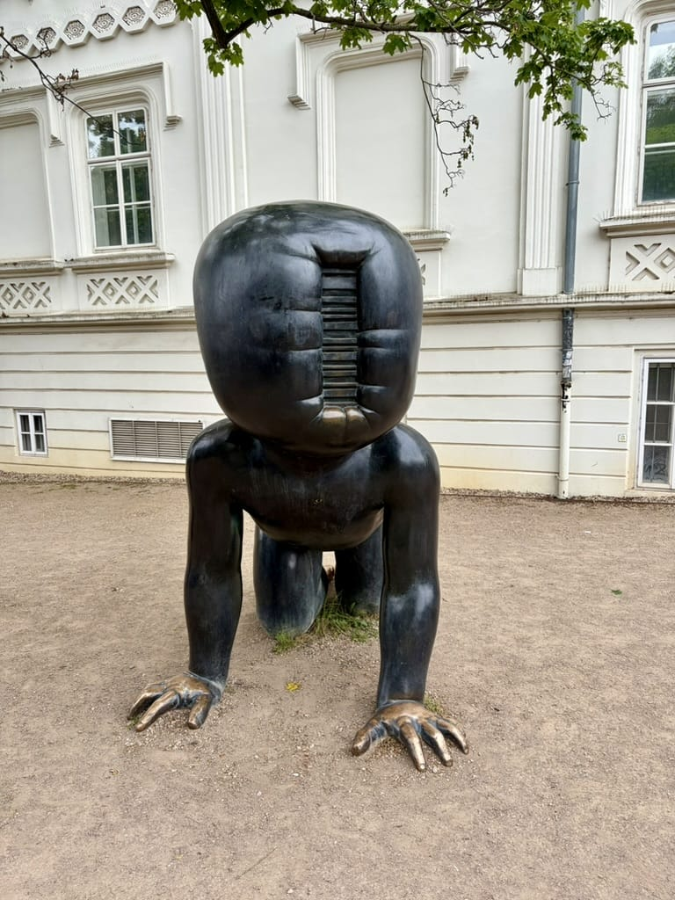

We spent an afternoon doing the _Prague Castle_ complex, the walls, the _Great South Tower_, the Old Royal Palace, and _St Vitus Cathedral_. I had big expectations for the whole complex, but came away less impressed than I'd hoped, aside from the view over the city from there. The stained glass, though, was genuinely striking, less like traditional rose windows and more like large mosaics of colour, one of them reportedly designed by Mucha himself.[^2] It feels a little less special once you know it's less than a hundred years old, not medieval, but it's still one of the most memorable windows I've seen in a cathedral.

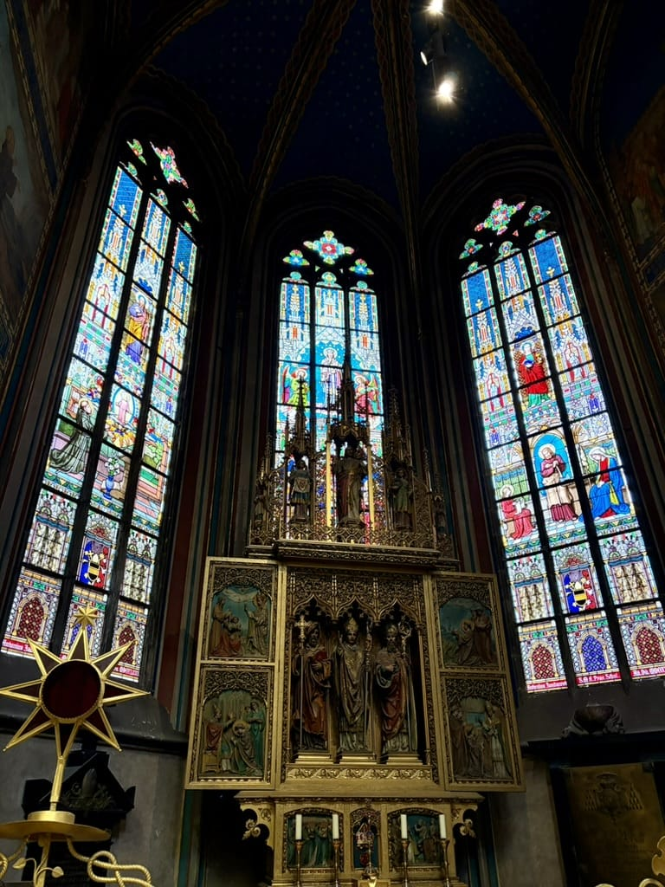

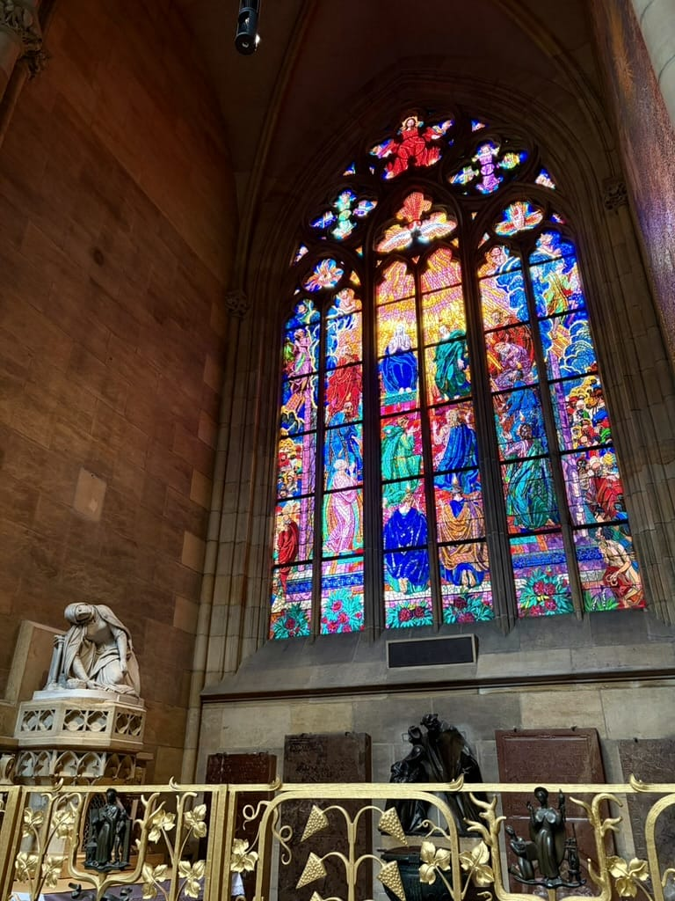

Prague also gave us more beer than either of us expected to drink. At one point we ended up at a place a friend who'd lived there had recommended, a fairly touristy chain by local standards but a fun one, where you get handed a paper slip printed with rows of little beer mugs, and the waiter ticks one off every time you order another, I don't know how many they expected us to drink.

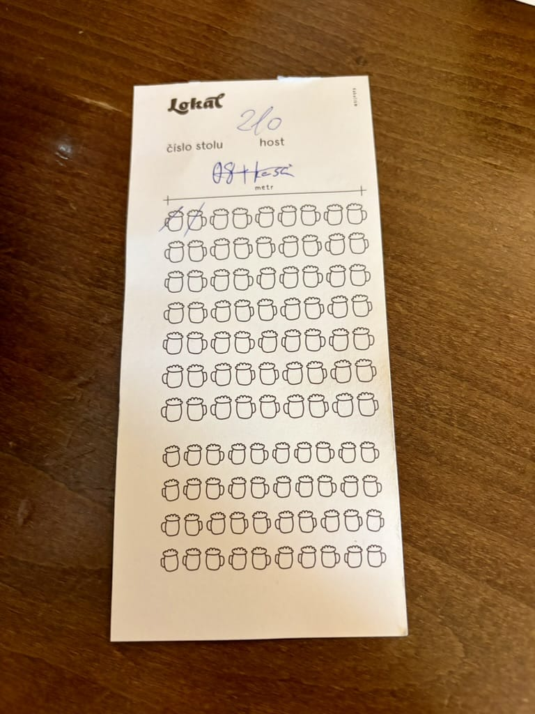

Food-wise, vegetarian options weren't as plentiful as I'd have liked, but fried cheese more than made up for it, especially served in a bun with plenty of tartar sauce, best not to think too hard about the resulting cholesterol.

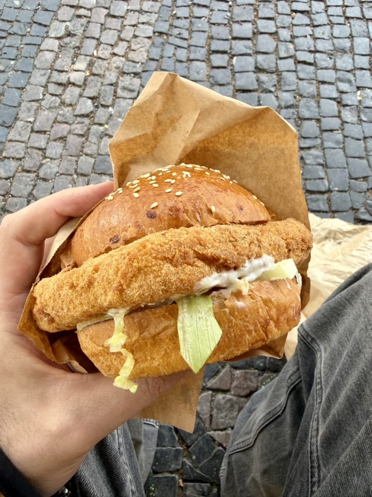

I'd also wanted to visit the _Speculum Alchemiae_, a small alchemy museum in the old town, but it needed booking ahead and we couldn't make the times fit.

Prague is also said to be one point of a so-called _triangle of magic_, together with Turin and Lyon. Nobody really knows where the legend comes from, but it's a fun one to hear about in a city with such a strong reputation for magic and mystery.[^3]

## Brno, a pleasant surprise

The original plan had been Prague and then either Germany or Vienna. Ana settled on Vienna, since she'd never been, and looking at the map I noticed Brno sat conveniently on the way, well connected by train and cheap to get to. I didn't research anything about it myself, and as the Czech Republic's second city I wasn't expecting a great deal, so instead I just heavily relied on _Atlas Obscura_ and made a rough plan starting from there. It's become one of my favourite habits when travelling, it tends to surface the odd, half-forgotten spots a normal guidebook wouldn't bother with, and nearly everything below came from that list.

We caught its own astronomical clock in the morning, a black monolith with three openings near its base. Every day at 11am a small glass ball drops through the mechanism and rolls out of one of the three, apparently at random, while a small crowd waits to see which one it'll be. The 11am is not a coincidence, either: during a Swedish siege in the Thirty Years' War, the Swedish general said he'd lift the siege if the city didn't fall by noon, so the citizens of Brno rang noon an hour early to trick him into leaving. It worked, and it's such a good story that the city never dropped it. To this day, the bells of Petrov Cathedral across town still ring out "noon" at 11 o'clock instead of 12, every single day.

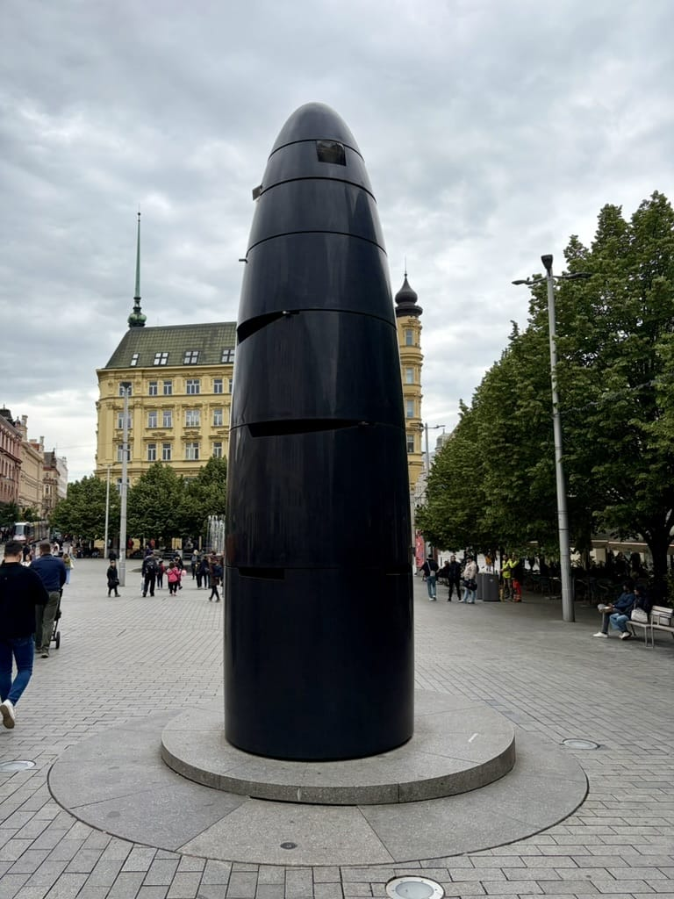

We toured a Cold War bunker built deep under the hill by Špilberk Castle, originally meant to shelter the city's officials in the event of a nuclear strike. The tour walks you through both the bunker's own history and a good chunk of Czechoslovak history more broadly.[^4]

We visited Brno's own ossuary, a crypt with walls stacked from floor to ceiling with skulls and bones, one of the largest of its kind in Europe, and stumbled on a couple of local curiosities in the passage under the Old Town Hall. The first is a stuffed crocodile hanging from the ceiling, known locally as the _Brno Dragon_, said to have once terrorised the town until someone finally killed it by feeding it a hide stuffed with lime.[^5] The wheel mounted on the wall next to it has its own, unrelated legend: a carpenter is said to have won a bet by cutting down a tree, turning it into a wheel, and rolling it all the way from a town over 40km away in a single day, a feat so unbelievable that people decided he must have had help from the devil.

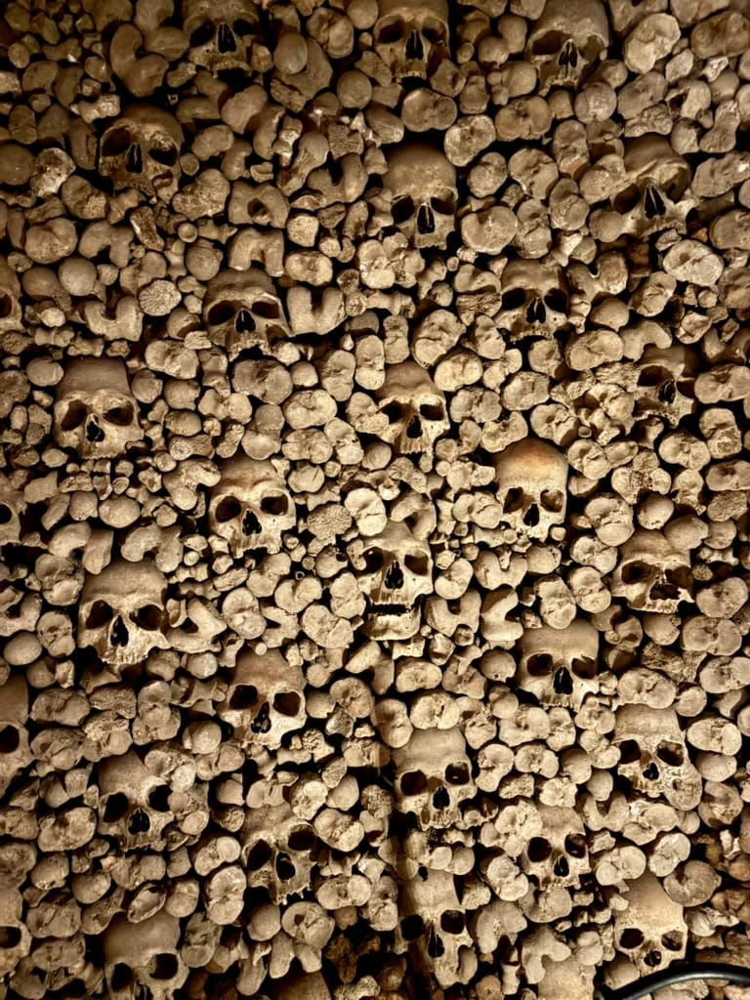

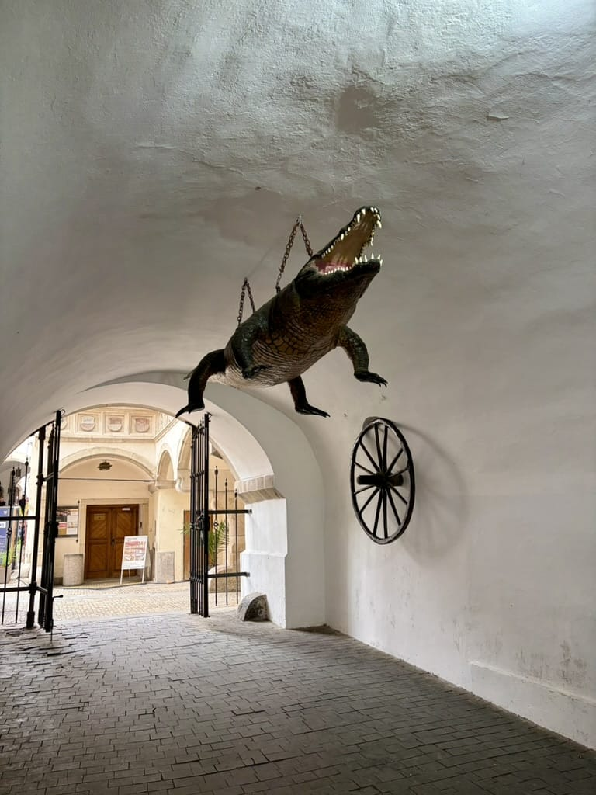

We also spent some time sketching out a puzzle idea based on Brno's landmarks, a side project that may or may not ever see daylight. Two nights turned out to be exactly the right amount of time for the city.

## Vienna, more than I expected

Vienna, it turned out, coincided with that year's Eurovision, hosted there after Austria's win the previous year. I've never been much of a fan myself, but Ana is, so it was fun all the same, with public watch parties set up around the city for the occasion.

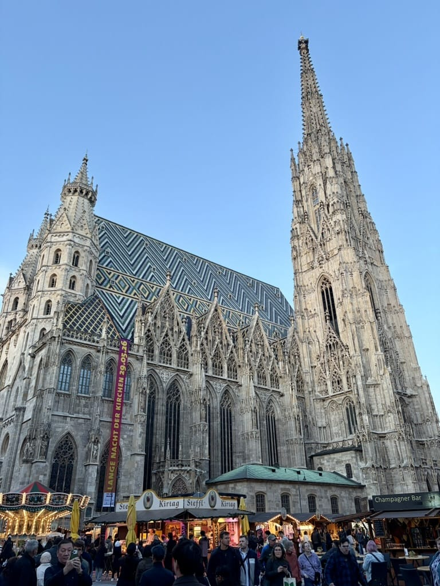

We spent most of our four days there in museums. The _Leopold Museum_ took up a full afternoon, and the _Belvedere_ gave me a chance to see Klimt's _The Kiss_ again, one of my favourite paintings, and this time I could actually photograph it, unlike on my last visit years ago when photos weren't allowed.

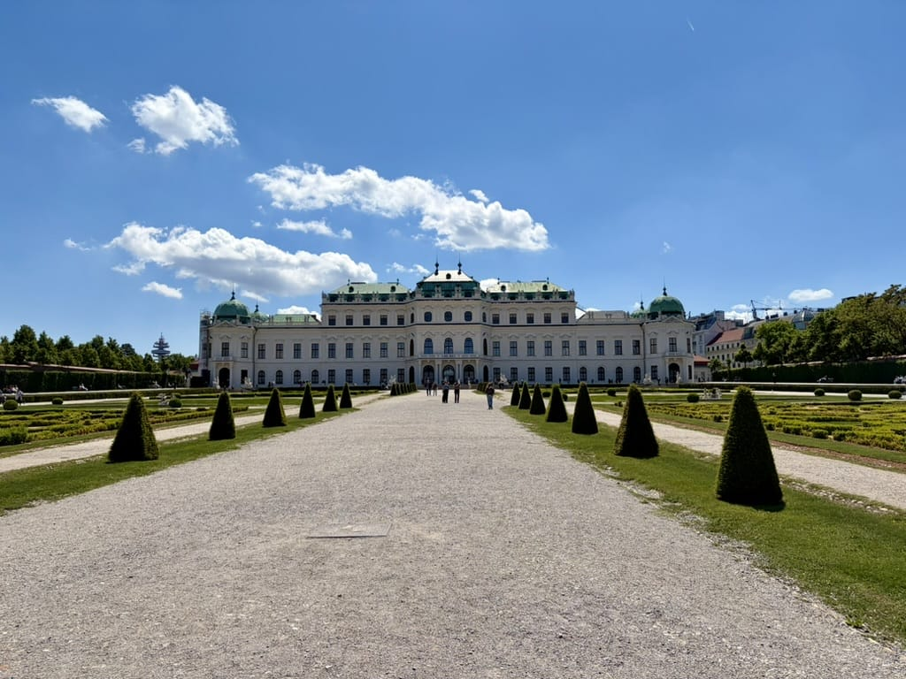

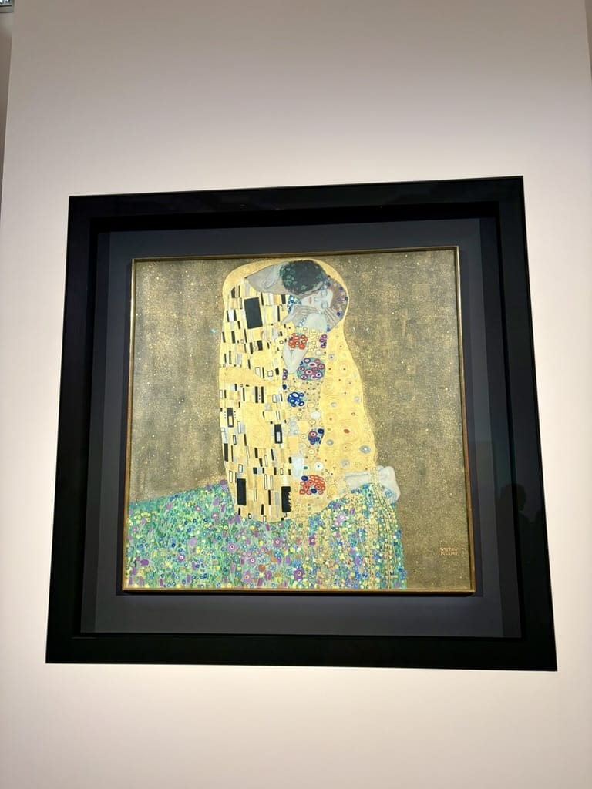

At the _Albertina_ I particularly liked the Miró and de Chirico pieces on show, and we closed things out with the _Kunsthistorisches Museum_, which we only had about three hours for and had to rush through more than I'd have liked. It has one of my favourite paintings of all, Bruegel's _Tower of Babel_, and seeing it in person for the first time was genuinely moving, Bruegel is one of my absolute favourite painters. I was also happy to come across an Arcimboldo, another painter I particularly like, one of his portraits made entirely out of fruit, vegetables, and grain (symbolising the summer).

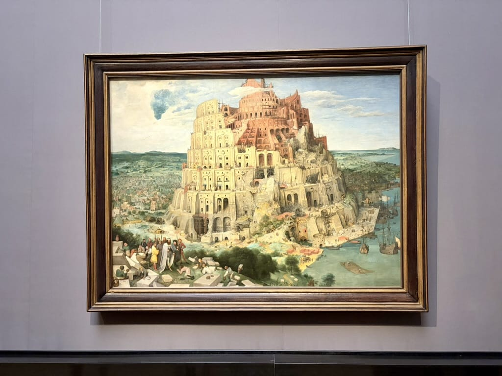

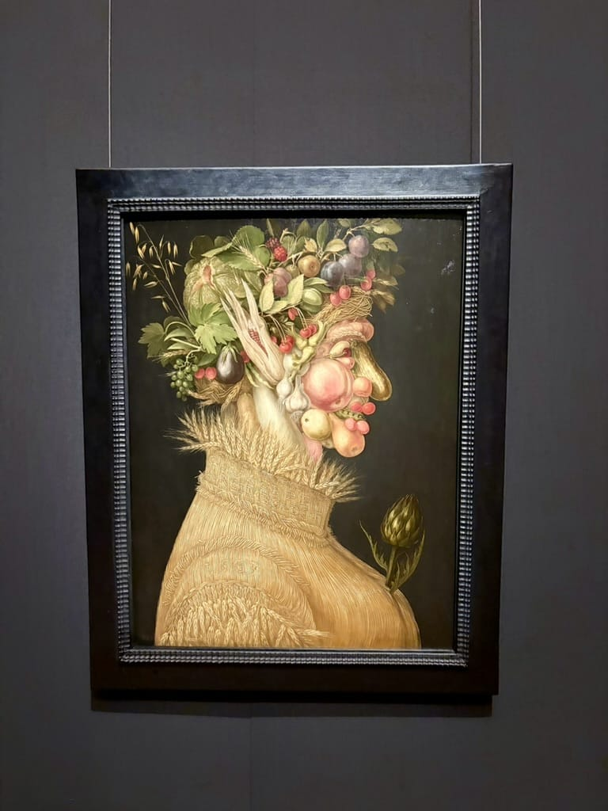

The museum's collection of mechanical miniatures was a nice surprise too, small clockwork models you'd wind up like a watch, with moving parts and, in at least one case, working little cannons. My favourite was a detailed model of an old sailing ship, its sails painted with scenes from mythology, that would fire its cannons and rock back and forth as it moved. There were also some videos explaining how it actually worked.

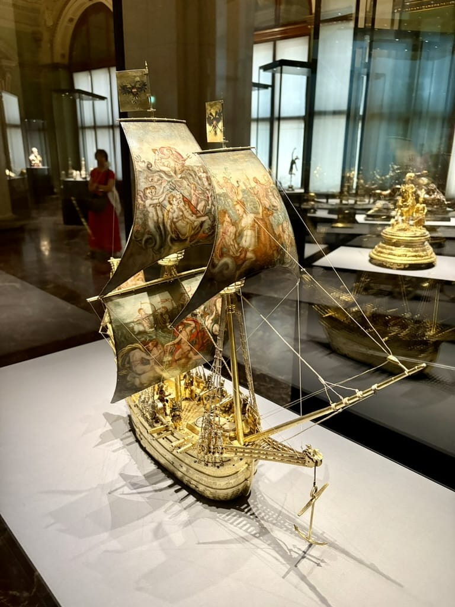

Vienna's food was the real surprise of the trip, I'll admit some of that is Italian snobbery about food outside Italy, but everything we ate over four days was properly good. Ana had at least one schnitzel a day, two on one occasion, and I managed to find a vegan version myself, which came with a side of potato salad I ended up ordering again at nearly every meal.

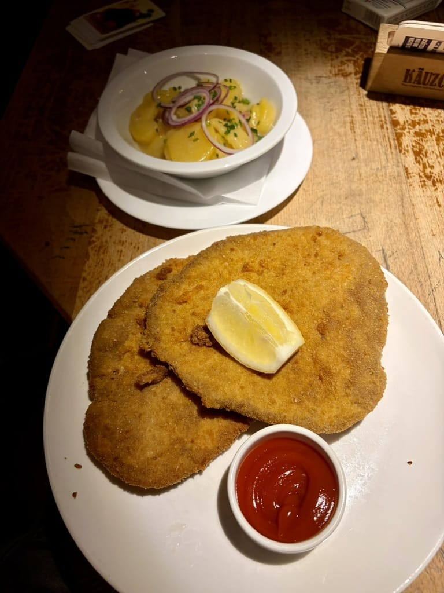

I also went in fully expecting to be unimpressed by pasta outside Italy, and ended up ordering _Krautfleckerl_, a local dish of small pasta squares braised with cabbage, twice. _Käsespätzle_, spätzle baked with cheese and caramelised onion, also common a bit further south in Tyrol, was another favourite, alongside what I think were _Kaspressknödel_, flattened, pan-fried bread and cheese dumplings sliced into pieces. And of course we made the almost mandatory stop for _Sachertorte_, which Ana had never tried and didn't even know about beforehand. The café itself feels a bit worn and old-fashioned, in a grand sort of way, but the cake is worth the stop regardless.

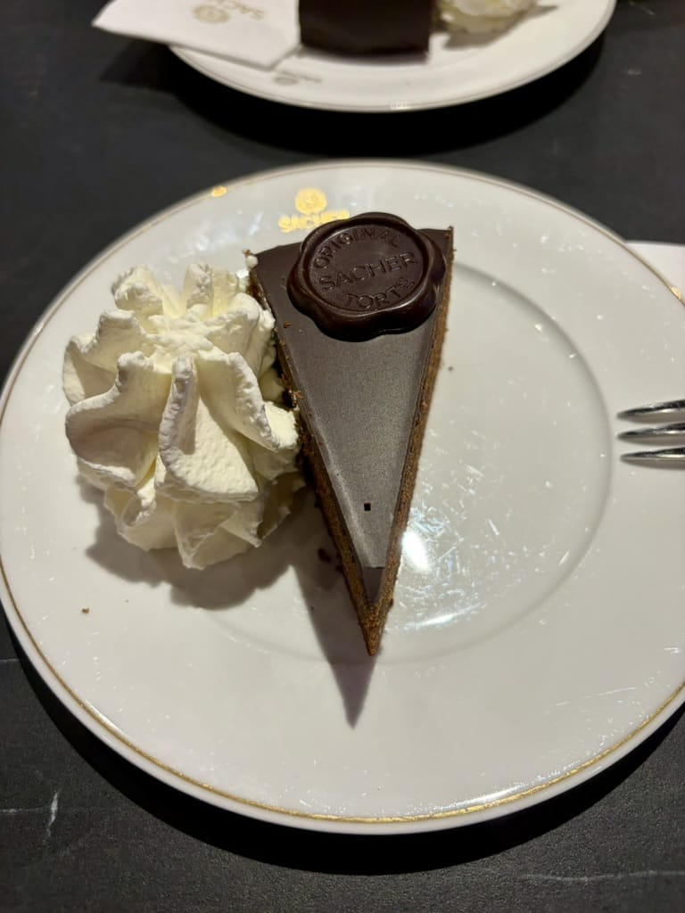

We also visited a couple of churches, including _Karlskirche_, if only to admire the maestose dome fresco. I was happy to learn it's dedicated to San Carlo Borromeo, who was born on Lake Maggiore, not far from where I grew up, a small, unexpected bit of home in the middle of Vienna.

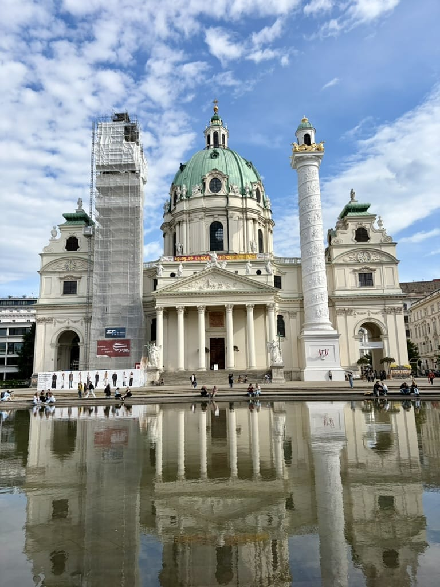

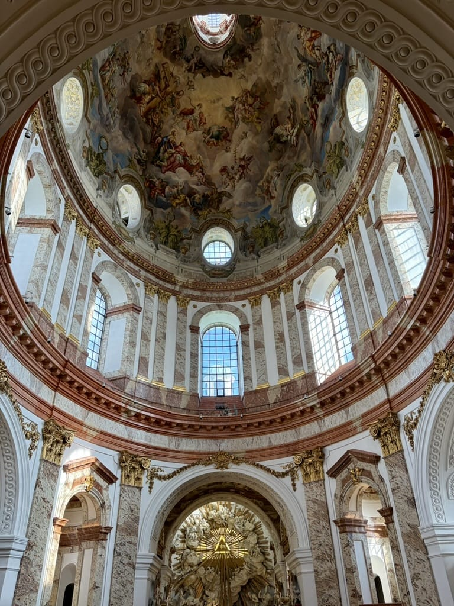

## The highlights

**Best surprise**: Vienna overall. I went in expecting Prague to be the highlight of the trip and came out having enjoyed Vienna considerably more than I'd anticipated, food included.

**Best view**: Charles Bridge, from the river, without any doubt.

**Best food discovery**: Viennese cuisine in general, an outcome I genuinely did not see coming.

We all left keen to go back, and given how well the three cities strung together on this route, I'd recommend it without hesitation, just maybe not in winter.

[^1]: These are David Černý's _Babies_. What looks like a blank face is actually meant to be a barcode, Černý's comment on society's relationship with technology.

[^2]: The window, in the cathedral's north nave, was designed by Alphonse Mucha and installed in 1931.

[^3]: According to legend, Prague is one point of a triangle of magic alongside Turin and Lyon, one version has it as a triangle of white magic, with a separate black magic triangle running between Turin, London, and San Francisco. The origins of the legend are, as far as anyone can tell, entirely modern and undocumented, but it fits a city that was once considered a centre of European alchemy.

[^4]: Built in the 1950s, 26 metres underground, the bunker was designed to shelter around 500 of the city's officials for several days in the event of a nuclear strike, and now operates as a museum.

[^5]: The crocodile is actually a real, preserved Nile crocodile, a gift to the city in 1608.
