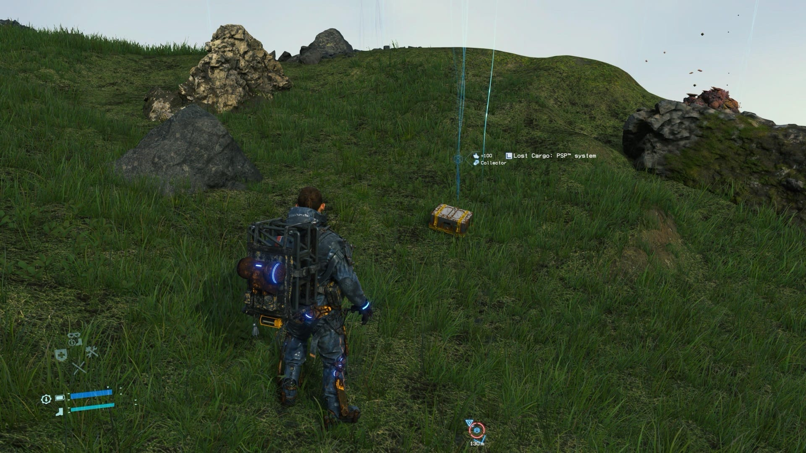
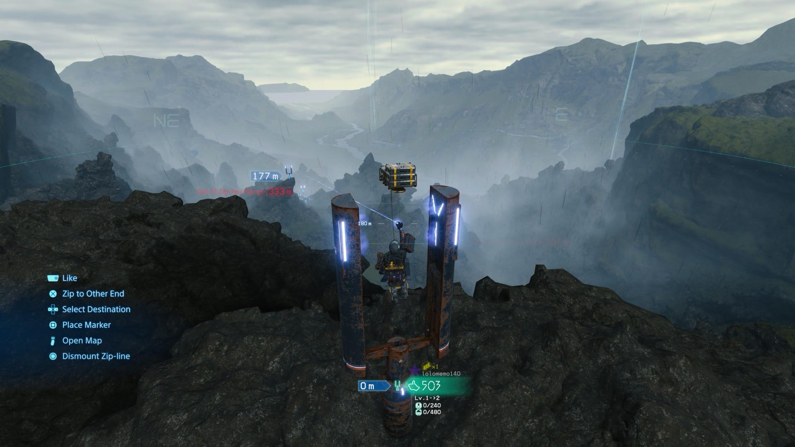
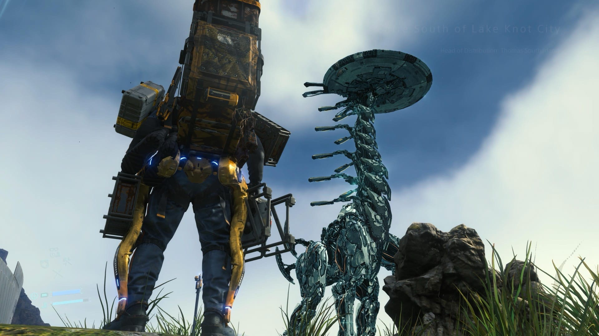

Kojima doesn't need an introduction. One of the most celebrated game directors in the industry, the reverence makes sense even from a distance.

My own history with his work is patchy. I played the original Metal Gear on the Famicom, and the first Metal Gear Solid on PlayStation, though both were more than thirty years ago at this point. What I remember is Psycho Mantis. If you know, you know.[^1] That encounter is still one of the most genuinely surprising things I've seen in a video game, and it set a bar that's been hard to unsee since.

The other piece of relevant context: I played the PT demo on PS4.[^2] One hallway. Repeated again and again. I was properly scared by a corridor. Guillermo del Toro was the co-creator of the cancelled project behind it, and he's one of my favourite directors. From horror to fantasy, he's someone so visibly passionate about what he does that it comes through in everything he makes. That quality is harder to find than it sounds, especially right now when intellectual properties get sold off and sanitised at a rate that makes your head spin.

## Arriving late

I knew Death Stranding would take around a hundred hours. That's not the kind of commitment you enter lightly, so I waited until I felt ready. Which kept not happening, as it tends to.

I finally started in November. Got as far as the encounter with Mama, and then the zipline network became available. Late at night, I couldn't get my head around how it all connected. Things came up in life and I had to put the game down entirely.

I picked it back up about six weeks ago. What pushed me back was a walk along the English coast.[^3] Clifftops, grass, sea, all of it. It felt like the game, and the resemblance made me want to go back and actually finish it.

## The "walking simulator"

A friend who shares a lot of my gaming tastes told me before I started that it was a walking simulator. Several other people said the same. They're not entirely wrong. There are stretches early on that are just traversal: you walk from one place to another, sometimes for half an hour, across terrain that's all rock and open sky.

What surprised me is how rarely this felt like a chore.

## Gameplay

The game is slow to start. You have to accept that early on you'll be carrying loads manually across difficult terrain, figure out what matters and what to ignore, and generally learn how things fit together before anything clicks.

When it does click, it stays clicked.

The connection network is the core of the whole thing. You build roads, ziplines, safe houses. Slowly the world opens up. And when you've wired enough of it together, moving through it becomes genuinely joyful. You stop fighting the terrain and start flowing through it.

I have a completion problem, which here worked in my favour. I went very deep into every system, understanding what to prioritise and when. The progression is satisfying in a way that doesn't let you stop. You start exploring a small area, then gradually expand it outward, and once a proper transport network is in place it's a pleasure to play. You move at a completely different pace.

## The story

No spoilers. It's completely out there, in the way you'd expect from Kojima and wouldn't have it any other way.

## Music

This was the part I wasn't expecting to care about as much as I did. At certain points, usually in transit between deliveries, a piece of music just starts. And something about the combination of the landscape, the movement, and the track makes it land hard. I remember early on descending through an almost lunar terrain with one of those songs underneath it. Completely subjective, but it got me.

## Easter eggs and collaborations

One thing I genuinely loved: the optional missions tied to other properties. There's content linked to Cyberpunk 2077, Half-Life, and Horizon Zero Dawn. And then there's the Collector, a character who sends you out looking for old consoles and magazines. It made the world feel like something built by people with actual enthusiasm behind it.

## What didn't work

The last chapter has a lot of loading sequences between scenes, and the credits are long. I understand the intention and it fits the game thematically. A button to speed it up would still have been welcome.

On a different note: I'm not sold on casting real actors in games. When you recognise a face, part of your brain maps it onto other roles that person has played, and the character in front of you ends up competing with all of that baggage. A minor thing, and clearly an intentional choice, but it didn't fully work for me.

## Final thoughts

I platinumed it on PS5 Director's Cut in just under a hundred hours. One of the best games I've played in a long while, across story, visuals, and especially the gameplay system. Highly recommended, without reservations.

I tried to get two friends into it. One started and apparently finished it. The other didn't make it past the first map.

I'm looking forward to Death Stranding 2, but not right now. I'm travelling, and if I start it I want to give it proper attention rather than play for three days and then stop for a week. Maybe autumn. Something about this game feels like an autumn game.

[^1]: Psycho Mantis, the telepathic boss in Metal Gear Solid, would read your PlayStation memory card and comment on other games you'd played. He'd also make the controller vibrate and ask you to put it on the floor, then slide it across the surface without touching it. In 1998 this was genuinely shocking. It still holds up as an idea.

[^2]: PT was a playable teaser for Silent Hills, a cancelled Konami project co-created by Kojima and Guillermo del Toro. The demo was removed from PSN after the cancellation and is no longer available. It remains one of the most unsettling things I've played, in a single corridor.

[^3]: That walk is [written up here](/blog/brighton-to-hastings).
