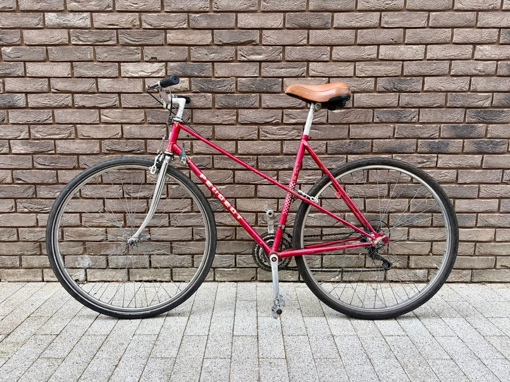
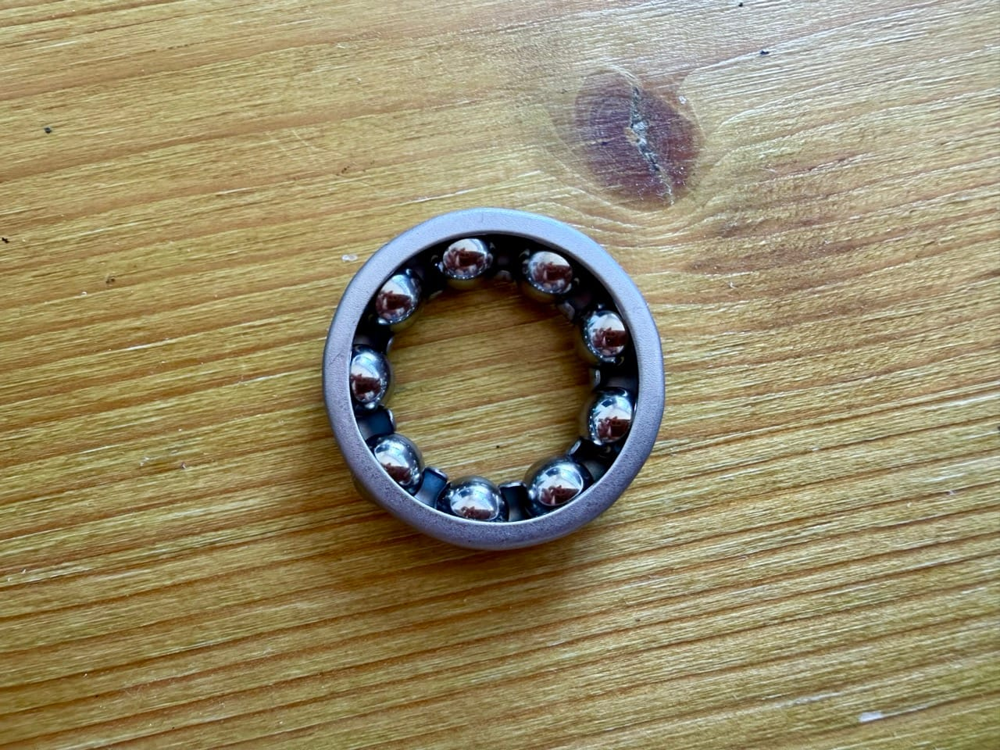

About five years ago a friend left London for good and, as a parting gift, handed me his bike: an old Peugeot, sort of a road bike, not quite a road bike, let's call it a road-bike-shaped bike. I've ridden it a lot since.

## A wheel drama

From early on, the rear wheel would occasionally rub against the frame. Mostly in high gears, when I was putting real effort into the pedalling, which I assume pushes the wheel sideways just enough to catch. I tried tightening things. I tried a few other things but nothing worked.

At some point I took it to one of the free bike service stands the council sets up around London. The people running it were lovely, cranked the wheel tight, and it got a little better. They also told me the tyres were wrong for that frame. It's a road bike, they said, so it needs narrower tyres, and they told me some size codes I forgot on the spot and have never remembered since.

## A very inconvenient rip

Not long after I inherited the bike, I took it out for a proper ride, and about 20km from home, on a Sunday, south of the Thames, I didn't just puncture. I tore the tyre and the inner tube clean open. Sunday, obviously, meant no bike shop was open anywhere nearby.

Fortunately I wasn't far from an Overground station, and Overground trains let you bring a bike on board, so I luckily managed to get home with it. In the following days I bought a replacement tyre, the same one I already had, without once checking whether it was actually the right size for that frame. It took me a while to fit, since I hadn't changed a rear tyre since I was about thirteen, possibly younger.

Given what the council guys had told me, replacing the whole wheelset felt like overkill at the time, so I made do. It worked, more or less, for as long as it lasted.

## The wobble returns

Between winter and travel I barely rode it, and when I did the tyres were always a bit underinflated. Eventually I pumped them back up properly, and the wheel started touching the frame again.

So, naturally, I took the whole thing apart.

I pulled the wheel off and brought it inside, planning to clean the axle. First problem: I couldn't find the cone wrench. Last time I'd used it was to change a wheel for a friend, and I'd apparently left it at her place, or somewhere, I genuinely couldn't remember. I searched the entire flat. I gave up and bought a new one. Five hours later I found the old one by pure chance, right where I'd have sworn I'd already checked.

## Discovering the bike mechanics

With a wrench in hand, I got the axle out, and out fell a handful of tiny ball bearings. In my complete mechanical ignorance of bicycles, it had never once occurred to me that a wheel hub contains loose metal spheres. It genuinely had not crossed my mind.

Minor panic. I was already covered in grease, since the bike was filthy in there, clearly nobody had touched that part in years, decades even. I tried to keep going but couldn't get the cassette off, and by then it was late, so I stopped for the night.

## YouTube for the rescue

The next day I went to buy grease, watching an unreasonable number of YouTube videos in the meantime on how to actually do this. Back home, I picked up the spoke wrench, put in what I can only describe as superhuman effort, half-bent the tool in the process, and still couldn't shift it. I ended up coaxing the ball bearings back into place with sticks and screwdrivers, swearing in a way I'm not proud of, swinging between "I am basically a mechanic now" and total despair, sometimes within the same minute.

Every step I second-guessed myself. Did I just put that back the wrong way round? I'd stop, wash my hands, start another YouTube video, try to match it to my specific hub, and go again. This happened more times than I'd like to admit, including once when I overtightened the axle nut and the wheel stopped spinning entirely.[^1]

Eventually, without ever fully stripping the whole thing down, and with considerably more patience than I started with, I got it back together, cleaned out what I could, and greased every bearing and the axle itself.

## Putting it back together

The actual underlying problem turned out to be that the rear wheel wobbled quite a bit, which is both why it rubbed the frame and, frankly, not great from a safety point of view either. Once the axle nut was properly done up, the wobble stopped. That alone felt like a big win.

I reattached the wheel to the bike, and it immediately started rubbing on the other side instead. Fiddling with the internal cone adjustment, loosening the play a little here, tightening it there, I managed to get it more or less centred. Looking at the tyre from both sides, there's only about 2mm of clearance to the frame, so the council guys were right all along: that's simply how much room this frame gives a tyre that size. Once you actually sit on the bike and the wheel takes some load, everything shifts slightly, so a bit of rubbing is close to unavoidable. After a few rounds of loosen-here-tighten-there, it seemed sorted.

I took it out for a ten-minute test ride. It felt noticeably better, possibly helped by the fact that the hub had been packed with dust and, unpleasantly, actual hair before I cleaned it out, so the wheel now spins far more freely than it has in years.

Whether it holds up properly, I'll find out tomorrow, when I'm riding it across town for a longer stretch.

**UPDATE**: In the last couple of days I rode it for around 100km across London. It held up well. No more rubbing, no more wobble. I'm glad I took the time to do it properly. I might actually ride it more now.

[^1]: Bike hub bearings run on a very fine adjustment: too loose and the wheel wobbles, too tight and it won't spin at all. There's a narrow sweet spot in between, and finding it by feel, with no prior experience, is most of what made this take so long.
