On the 1st of June I left London for five weeks in Southeast Asia, right in the middle of monsoon season. Ideally I would have gone at a different time of year, but because of a series of circumstances I ended up going in the middle of it. The first four weeks were with [Ana](https://untepid.com): Thailand, Malaysia, and Indonesia. After she flew home I did a loop on my own through northern Thailand and Laos, covered in [the second part](/blog/southeast-asia-2026-part-2) of this trip.[^1]

Most of the itinerary was Ana's work, a rough plan she put together before we left. My job was organising the transport in between and tweaking the small details of the trip. I don't love the planning side of travel, I'd rather figure it out as I go, so I was happy to leave the big shape of it to her.

Here's roughly how it all connected, one leg at a time.

## Bangkok to Khao Sok, by night train

We landed in Bangkok in the late afternoon and headed straight for the night train south. Booking it turned out to be the first small puzzle of the trip: sites like 12go.asia list tickets but charge more and don't show every option, so we booked directly through the Thai railways' own site instead. The catch is that the station doesn't show up on maps as "Bangkok", it's listed as _Krung Thep Aphiwat_, Bangkok's newer central terminal.

The night train was more comfortable than I thought, especially considering my past experiences with night buses in Vietnam. Here I could actually lie down and sleep. The train left in the early evening and got in around half past five or six in the morning, to Surat Thani. From there, taxis were absurdly expensive, so we found a bus instead that runs toward Phuket and drops passengers along the way at Khao Sok National Park.

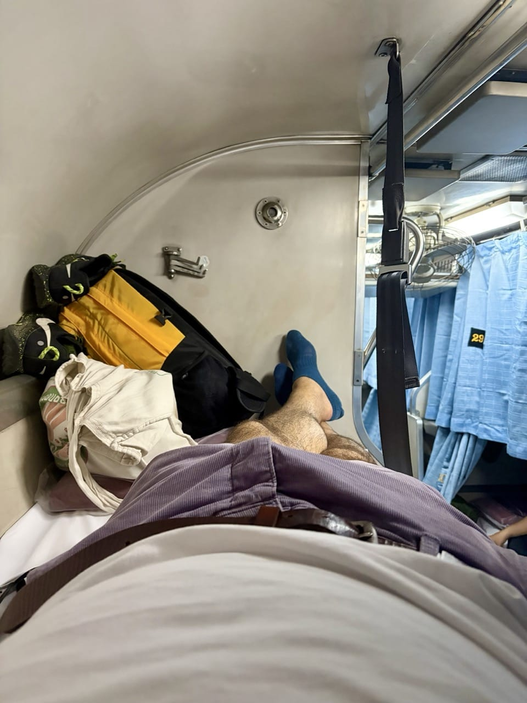

We arrived in heavy rain, which more or less set the mood for what was ahead: peak monsoon season, so heat and humidity in equal parts. Khao Sok itself is a single road of hostels and restaurants, but it sits right at the edge of the reserve, with both the jungle side and the artificial lake created by the dam within easy reach.

We spent three days there. The first day was a walk through the village followed by a walk into the jungle, where we ran into our first proper wildlife: giant monitor lizards, several types of monkeys, and, at a distance, a couple of great hornbills, one of the birds this stretch of southern Thailand is best known for. Also typical of the area is the Rafflesia flower[^2], the world's largest flower, but it usually blooms in winter, so we didn't see any.

The main event was a two-day boat trip on Cheow Lan Lake, the reservoir formed by the dam, sleeping one night on floating huts.[^3] The weather never really let up, on and off rain the whole time, and we were fairly upset about it at first. But the rain ended up making the scenery more dramatic rather than less: this enormous sheet of water, limestone cliffs on either side wrapped in low cloud and mist. We also did a couple of jungle hikes from the lake, no elephants but plenty of fresh tracks, more monkeys, and, during one of the walks, a proper leech attack on a few other people in the group. We got out unharmed, though part of me was almost curious to know what it felt like.

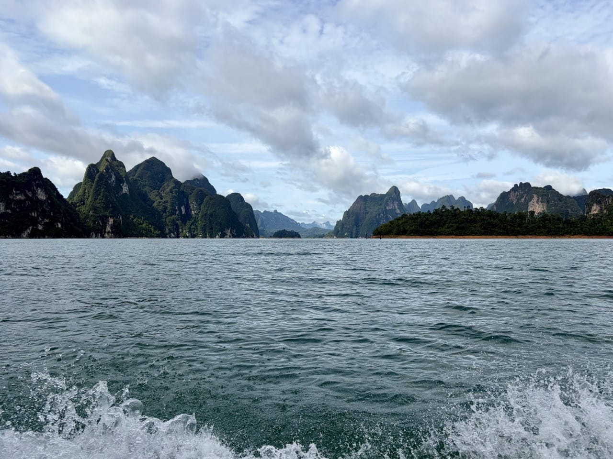

Khao Sok isn't a place with a lot to it beyond the naturale reserve itself, but as a first stop, relaxing into the jungle before the rest of the trip, I'd recommend it without hesitation.

## The long way to Penang

Next on the list was Penang, and we had two ways of getting there: fly out of Phuket, or go overland by minivan. Phuket used to be a great destination, a former Portuguese colony with real character, but from what I'd read it's been worn down by mass tourism to the point where a lot of its famous beaches are either overcrowded or off-limits for swimming. Combined with the monsoon sitting right over that side of the country, passing through there for two rushed photos of a beach we couldn't enjoy didn't seem worth it. We went overland instead.

It took about 15 hours split across three separate minivans, leaving in the dark at half five in the morning and arriving, accounting for the hour's time difference, at nine that evening in Georgetown. It went better than expected: there was always something to look at out the window, and honestly I'd take 15 hours overland over a 5-hour flight most days.

Georgetown itself is pleasant to just wander. Being UNESCO-listed means the low-rise heritage buildings can't be torn down or radically altered, so despite the tourist crowds it still feels well kept and charming. Food prices were a little higher than I expected for the region, though there are still plenty of stalls doing proper cheap street food. We also did a free walking tour with a guide who fed us local snacks and drinks along the way and delivered an unreasonable number of dad jokes and jokes with a double meaning, genuinely, don't skip it.

Everyone talks about Malaysia as a temple of food, a genuine mix of cultures, the Chinese-Malaysian influence especially. We arrived in the evening. Through cooking at [FoodCycle](https://sirlisko.com/blog/one-year-at-foodcycle) back in London, I'd met someone whose mother is from Penang, and he'd given me a full list of what to eat and where. I can confirm it lived up to the reputation, especially one Chinese restaurant where we ordered far too much on our first day and I left rolling rather than walking.

One of his recommendations was _cendol_, shaved ice (like if it were a kebab) drenched in coconut milk and palm sugar syrup, topped with sweet red beans and pandan (which gives it a distinctive green colour) rice flour jelly. It doesn't photograph well but it's genuinely delicious, and Penang Road is supposedly home to one of the most legendary stalls for it. Pandan turned out to be the flavour of this entire trip, and I'm a particular fan of it mixed with coconut milk.

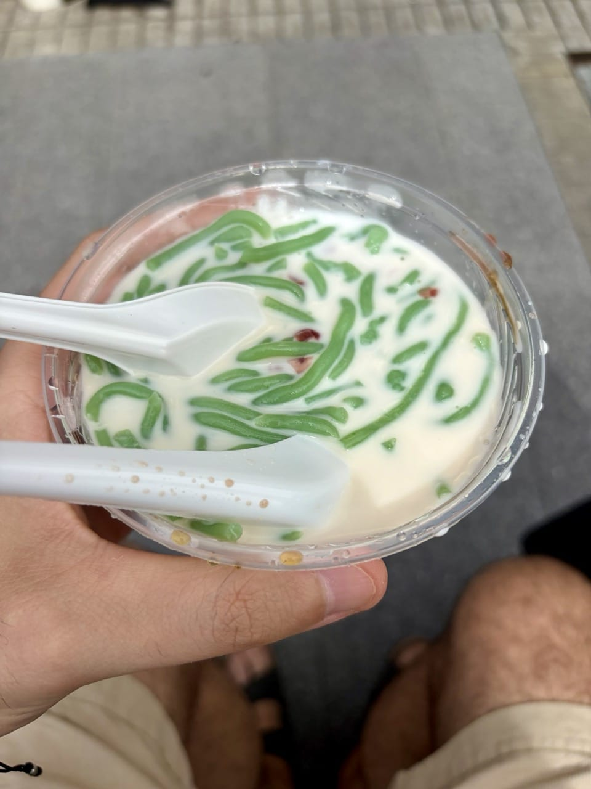

### Penang Hill, the hard way

Another one of his tips was to get up Penang Hill early, either by foot or by the funicular. We checked, and the funicular happened to close for roughly ten days a year for maintenance, and of course that included every single day we were in town.

I managed to talk Ana into climbing it. We got to the base of the funicular before dawn, still dark, and the staff there told us the usual route up, the _Heritage Trail_, was also closed, apparently also for maintenance. The alternative was the _Bat Cave trail_, considerably longer. I think she has never quite forgiven me for that morning.

We set off around six. The first stretch was sweet and sour in equal measure: giant durian trees with fruit hanging directly overhead, which I found genuinely terrifying, and a fair number of stray dogs, a couple of which growled at us. Getting bitten and having that derail the rest of the trip did not appeal. Further up, a steep climb and brutal humidity eventually opened onto a temple with a run of golden domes overlooking the city below. I think I drank two and a half litres of water on the way, mostly sweated straight back out. We also came across a small group of spectacled langurs, four or five of them lined up on a branch, staring at us from close range with their distinctive white eye-rings.

With the funicular shut, most things at the top were closed too, but we found one small café open and had breakfast overlooking the city. Right as we reached the summit a huge downpour started, so we'd made it up dry, at least. The view was worth every bit of the climb, even if the climb itself, mostly because of the humidity, was properly demanding.

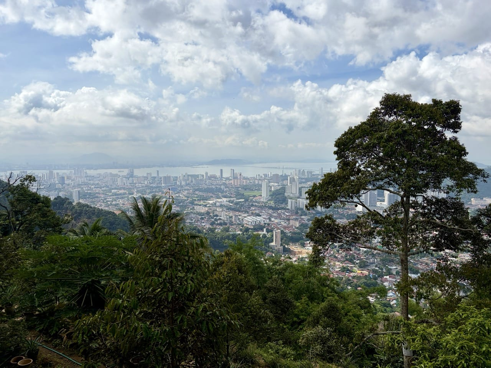

Coming down we tried the Heritage Trail anyway, the one we'd been told was closed, and it turned out to be open after all. No idea why we were told otherwise, but it worked out well: the Heritage Trail is a fairly direct route, while the Bat Cave trail is longer and passes both the durian grove and the temple, so doing both ways basically gave us the full experience. I'd genuinely recommend combining them if you want the full experience.

| Distance | Elevation | Time     |
| -------- | --------- | -------- |
| 11.35 km | 832 m     | ~4 hours |

From there we visited Kek Lok Si Temple, the largest Chinese temple in Penang and the largest Buddhist temple in Malaysia, which was visible from partway up the hill, home to a huge Buddha statue and a stunning pagoda, worth the stop and worth spending some time there.

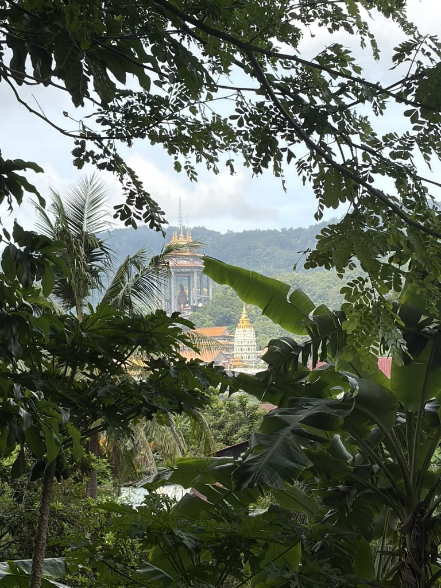

We also saw the Blue Mansion, the building behind Georgetown's UNESCO listing.[^4] Honestly the building itself didn't blow me away, but the guided tour was worthwhile for the history of the man who built it and the story of the city around it.

## Cameron Highlands: tea, strawberries, and mixed feelings

From Penang it was another four or five hours by bus to the Cameron Highlands, a mountain area in central Malaysia sitting at around 1,500 metres above sea level. We only stayed one night, mainly because Ana wanted to see the tea plantations. Between the tea, the strawberry farms, and the Mossy Forest, we booked one guide to cover all three.

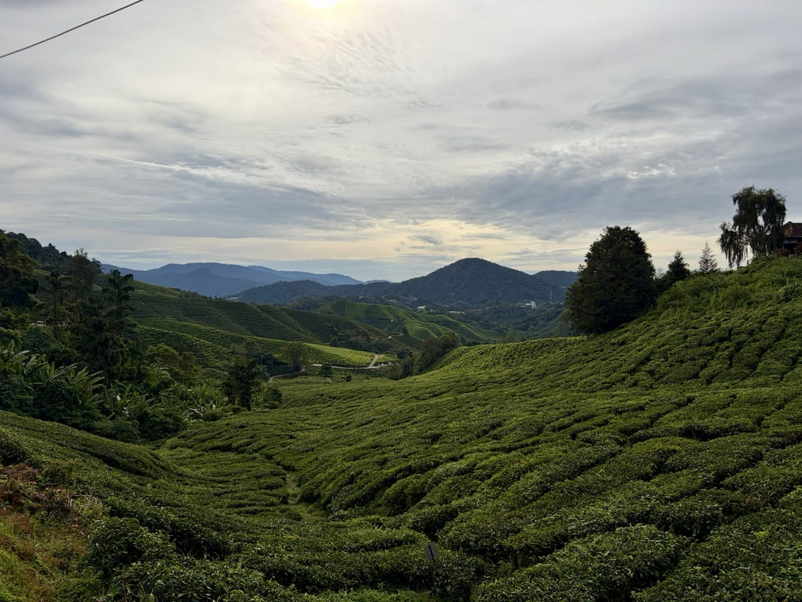

The tea plantation was genuinely lovely, mostly for the scenery, rolling green hills as far as you can see, and interesting to learn how the tea is actually processed. We got to sample several varieties, including one distinctly Malaysian thing I'd never heard of: tea and coffee brewed together, with condensed milk. I expected it to be worse than it was. Haven't tried recreating it at home yet, but I might.

The Mossy Forest, on the other hand, I’d built up in my head and it didn’t really deliver. Part of the boardwalk was closed, apparently because of storm damage, and while the misty valley views were nice, it didn’t feel like much more than "a forest". The strawberry farm was clearly built for tourists from Asia, as growing strawberries there is not as easy as in Europe. As a friend likes to say, "we have X at home", in this case strawberries. My garden in Italy grows plenty. Still pleasant enough to walk through.

For dinner we tried the regional specialty, _steamboat_, essentially a hot pot where you cook everything yourself in a shared broth. We ordered two, a mushroom one and a miso one, and, like we kept doing on this trip, ordered far too much of it. It didn't blow me away, I've had better hot pot elsewhere, though that might be our own fault for what we ordered.

## Kuala Lumpur, chaos and durian

Another four or five hours south got us to Kuala Lumpur, which is enormous and permanently jammed with traffic. We stayed near Chinatown, on a recommendation, and, feeling a bit indulgent, picked a place with a rooftop pool looking out over the city.

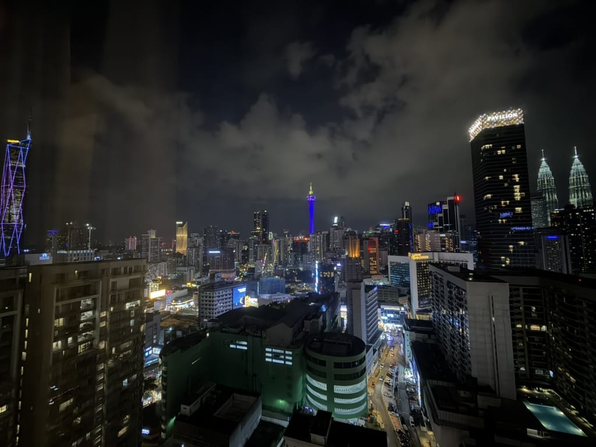

Predictably, that pool was packed at sunset. Late afternoon in KL also tends to bring thunderstorms, so floating in a rooftop pool with lightning somewhere nearby made me more nervous than I needed to be.

I've always liked chaotic Asian cities, always something happening, always something to eat, glass towers standing right next to buildings falling apart. KL has that almost in every corner. Ana wasn't feeling well for a couple of the days we were there, so I ended up exploring alone more than once.

We did another free walking tour, this time with a guide named Akim, who we stayed in touch with and even met up with again later that trip. Beyond the history of the city, he had us try several local fruits and pointed us to some good places to eat. He also took us through a couple of markets, including one distinctly non-touristy one that was, let's say, an intense experience for the food.

Separately, I finally tried durian, something I'd wanted to do for a while, and found a proper tasting where I went through five different varieties. It was an experience: different textures, different intensities, one I genuinely liked, two that were fine, and two I didn't get on with at all, one of which was bitter with a texture I still can't quite describe. Ana wouldn't go past a single millimetre-sized taste, so I ate the rest. I'd recommend trying it at least once, even if it's not for everyone.

Just outside the city we visited Batu Caves: a long, brightly coloured staircase leading up to a temple set inside a limestone cave, with a giant golden statue standing guard outside. We went early, before the heat and the crowds built up, which made a real difference.

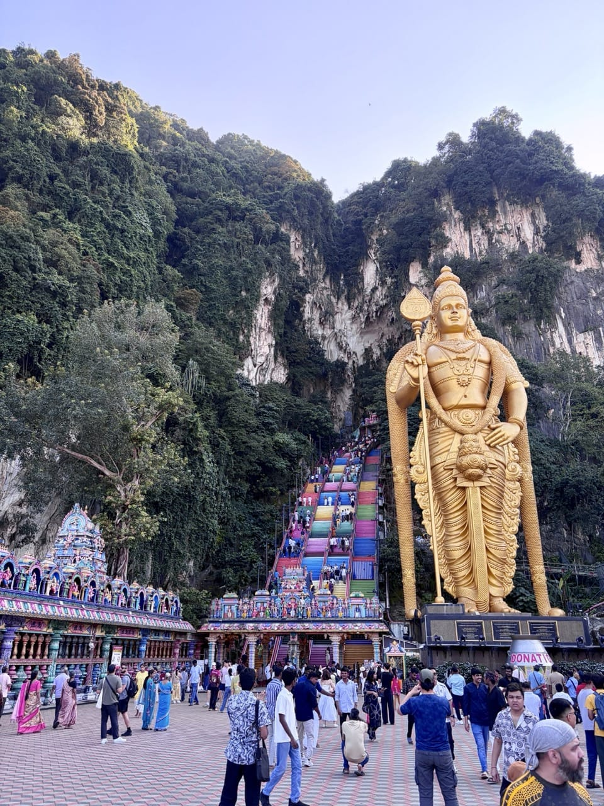

We also stopped at the city's central forest park, directly under the KL Tower, full of monkeys, including a few with babies still carrying their striking golden-orange baby fur. That was a genuine highlight, though a sudden downpour cut the visit shorter than I'd have liked. One or two days is enough for Kuala Lumpur. I wouldn't build a trip specifically around it, but with Ana not at her best we skipped a side trip to Malacca I'd half considered, and I have no regrets about the time we did spend there.

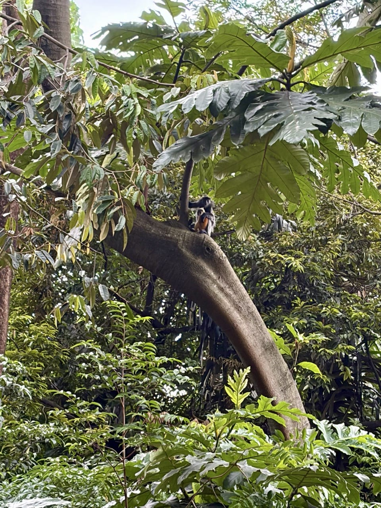

## Bali: Ubud, rice paddies, and Galungan

From KL we flew to Bali and spent three nights in Ubud, visiting a handful of temples in the surrounding area. Purely by chance, we were there right as Galungan was beginning, one of the island's most significant celebrations, held over several weeks and marked by decorated bamboo poles called _penjor_ lining every street, and small offerings of flowers, rice, and coins left outside homes and shops.[^5]

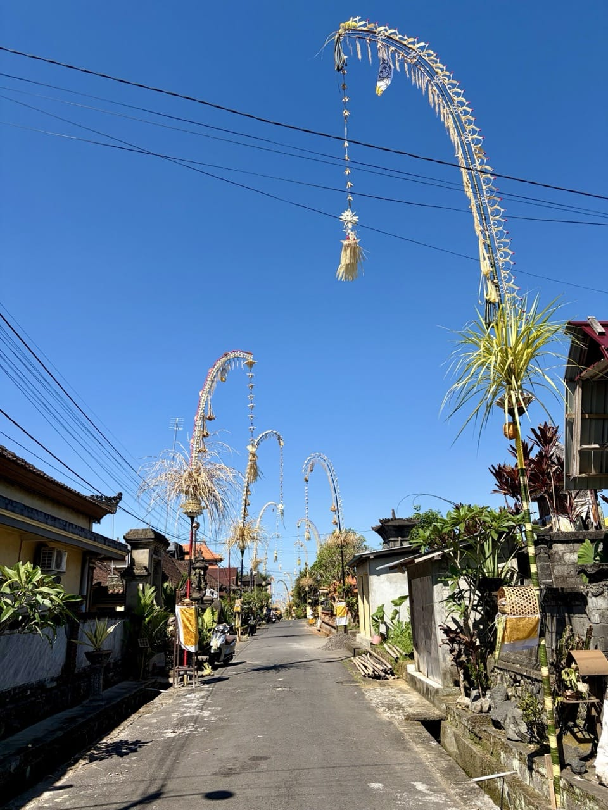

Ubud has a genuinely chaotic amount of traffic and tourists, but you can step out of the centre quickly and find yourself among endless rice paddies, with plenty of historic temples and structures scattered through the town itself. Despite Indonesia being majority Muslim, Bali is entirely its own thing culturally.

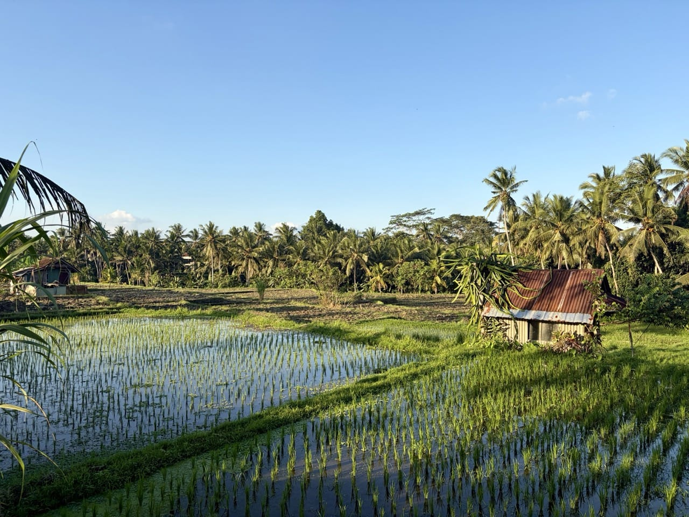

We walked the rice terrace loop right in the centre of Ubud, which was lovely. We also visited Goa Gajah, the "Elephant Cave", named for the carved face at its entrance rather than for any elephants, and the water temple known for its purification springs, which felt more like a tourist checkpoint than anything else. On a separate walk, my map showed the outline of a temple nearby with no name attached, so we went to have a look without knowing what to expect. It turned out to be the best surprise of the stop: a set of ruins along a river, genuinely striking, and, because almost nobody else knew it was there, we mostly had it to ourselves.

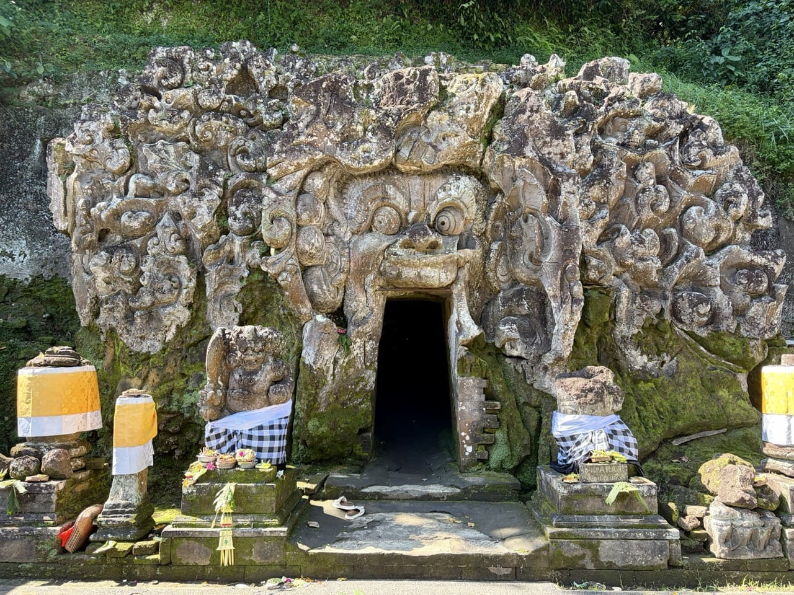

One activity I'm glad Ana pushed for was a wood-carving session with an elderly local craftsman. He would carve the rough shape of a mask first, then have you carve the rest yourself. He was a total perfectionist about it, more than once telling me directly that I'd ruined mine, and kept us there an hour and a half past when we were meant to finish. I'd have called it done after two hours. He insisted otherwise, and the final result was genuinely good, worth every extra minute.

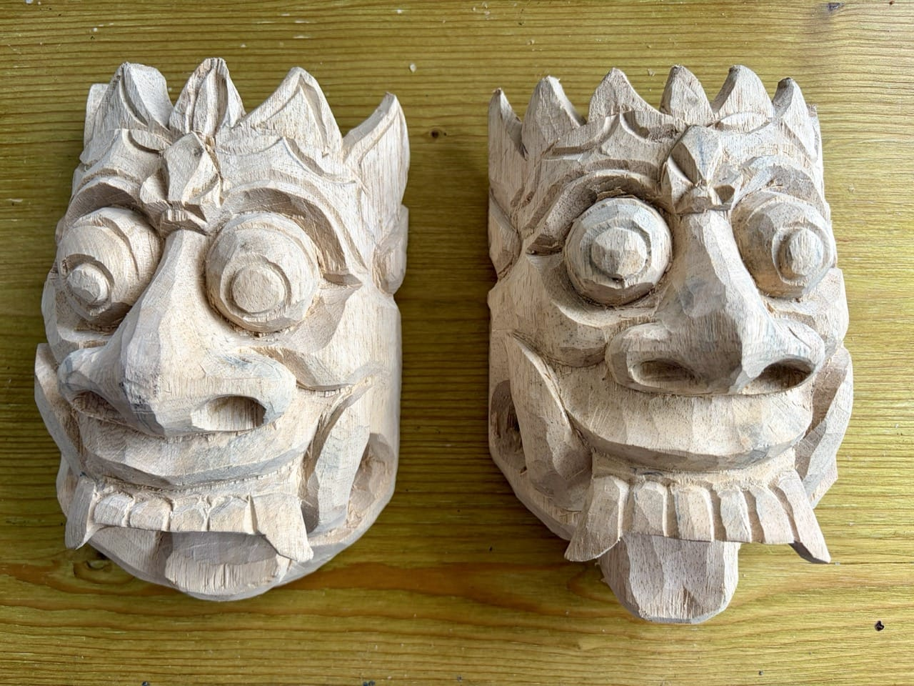

We also stopped at the so-called Monkey Forest, which despite the name isn't really a temple visit, more a park full of free-roaming monkeys among tourists. It's not entirely clear how ethical the setup is, but from what I read the monkeys aren't confined, they're free to leave the forest itself, they just don't stray far, since it sits right in the middle of town and they're fed there. During the Galungan offerings we watched them roaming the streets nearby, tearing open bags of rice left as gifts, which caused its own kind of chaos.

Food-wise, Ubud was where I finally had proper, house-made tempeh, especially good with peanuts, alongside plenty of coconut water, both of which I can't get enough of. Indonesia overall was noticeably cheaper than Malaysia, provided you stayed away from the most touristy spots.

## Java: sunrise over Mount Bromo

From Bali we flew to Java and this leg turned into a proper endurance test. The flight was delayed, so we only landed in Surabaya around seven in the evening, and by half eleven, midnight, a driver was already picking us up for Mount Bromo. We reached the first checkpoint around three in the morning, switched to jeeps, and got up to the viewpoint by around five, freezing at close to 2,300 metres.

It was, without exaggeration, one of the best things I saw on the entire trip. Not so much the sunrise itself, though that was lovely too, but the volcano: still-active fumaroles venting steam, an incredibly scenic setting all around. We waited until the sun was properly up, then continued by jeep down into the main crater basin and up to the rim of the active cone itself, a strong smell of sulphur and a proper look down into it. Getting there alone, crossing that huge, caldera floor, was worth the trip on its own.

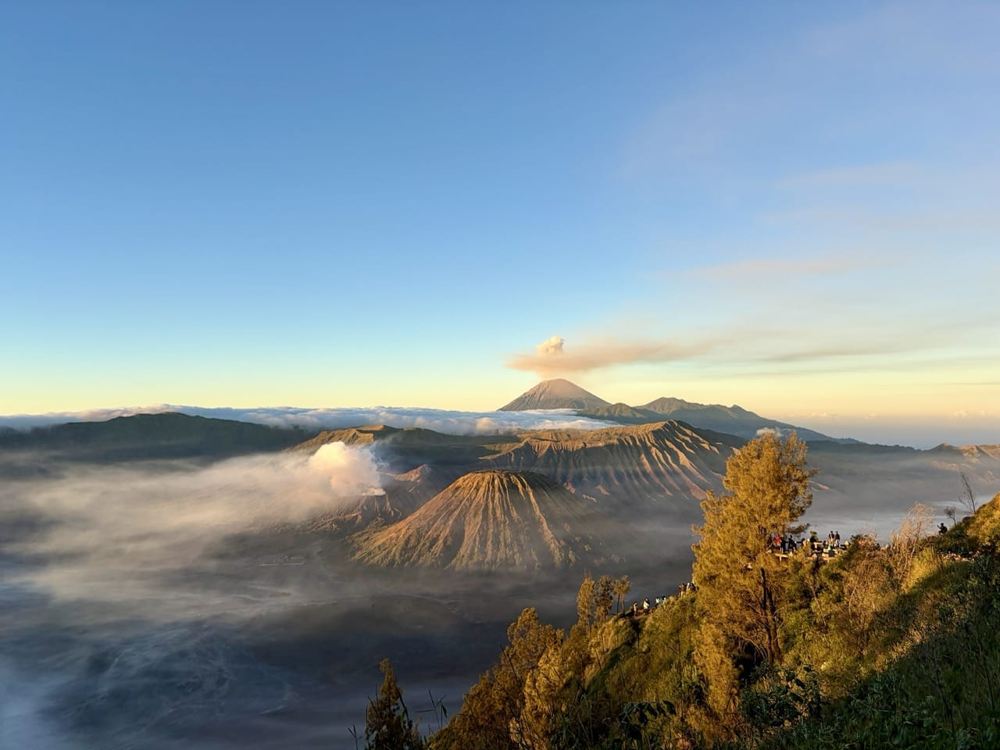

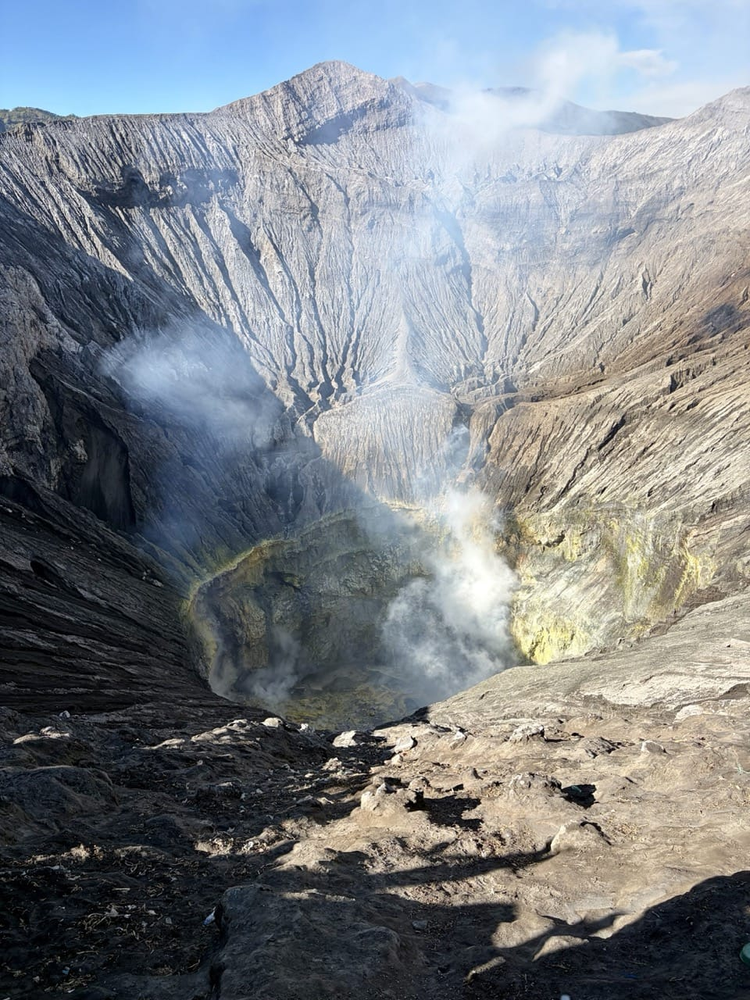

From Bromo we made our way back to Surabaya and caught a train to Yogyakarta.

### Yogyakarta: low-key city, remarkable temples

Yogyakarta itself is fairly low-key as a city, but it's home to two genuinely major temples, one recalling Angkor Wat, Hindu, and one Buddhist, and we gave each a full day.

Breakfast there deserves its own mention: _gudeg_, a traditional Javanese stew of young jackfruit simmered in coconut milk and palm sugar, served with steamed rice, tempeh, and a duck egg. It cost something like 70 euro cents and was fantastic.

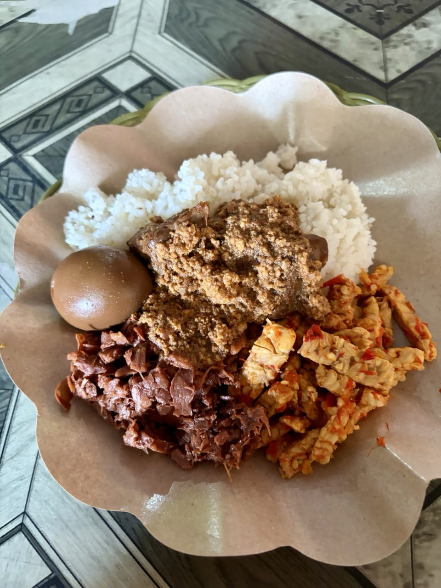

Prambanan is a massive 9th-century Hindu temple compound dedicated to the _Trimūrti_, _Brahma the Creator_, _Vishnu the Preserver_, and _Shiva the Destroyer_, and it's covered in carved scenes from the _Ramayana_[^6].

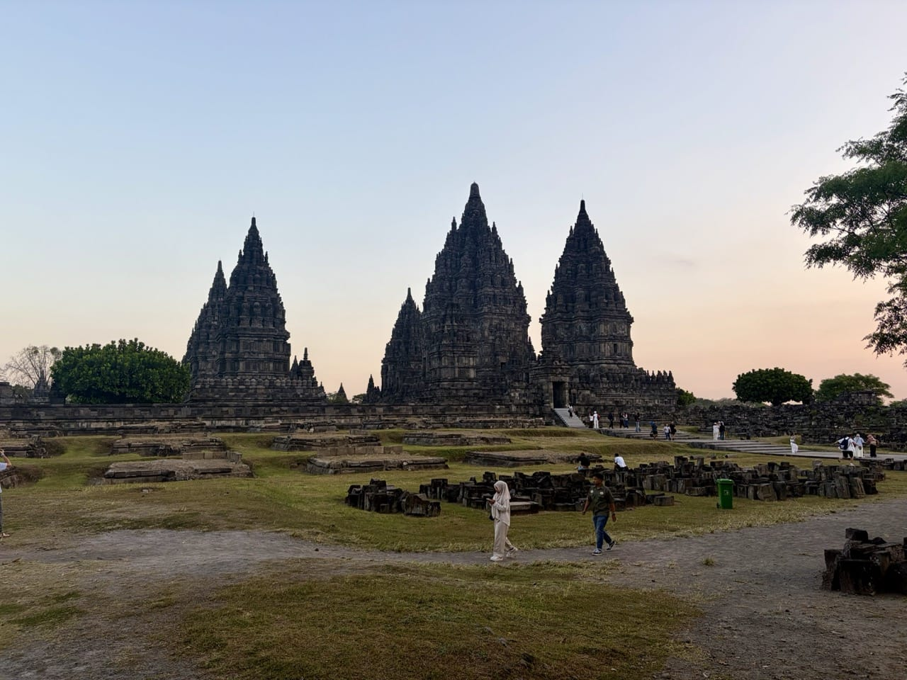

That evening we watched the Ramayana Ballet performed on the open-air stage there, with the illuminated temple as a backdrop. We were so tired after the previous 24 hours, but it was still very much worth staying awake for. The guide beforehand walked us through the story in enough detail that the performance actually made sense.

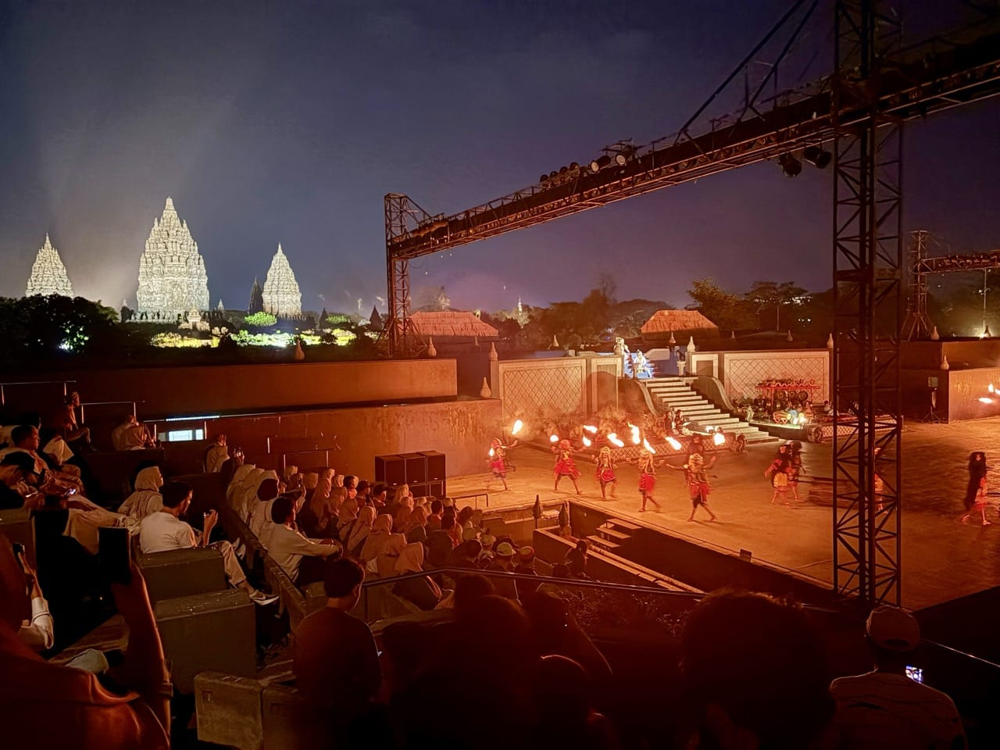

The next day was Borobudur, the world's largest Buddhist temple, on a completely different scale: tier after tier of stone, _stupas_[^7], and carved reliefs.

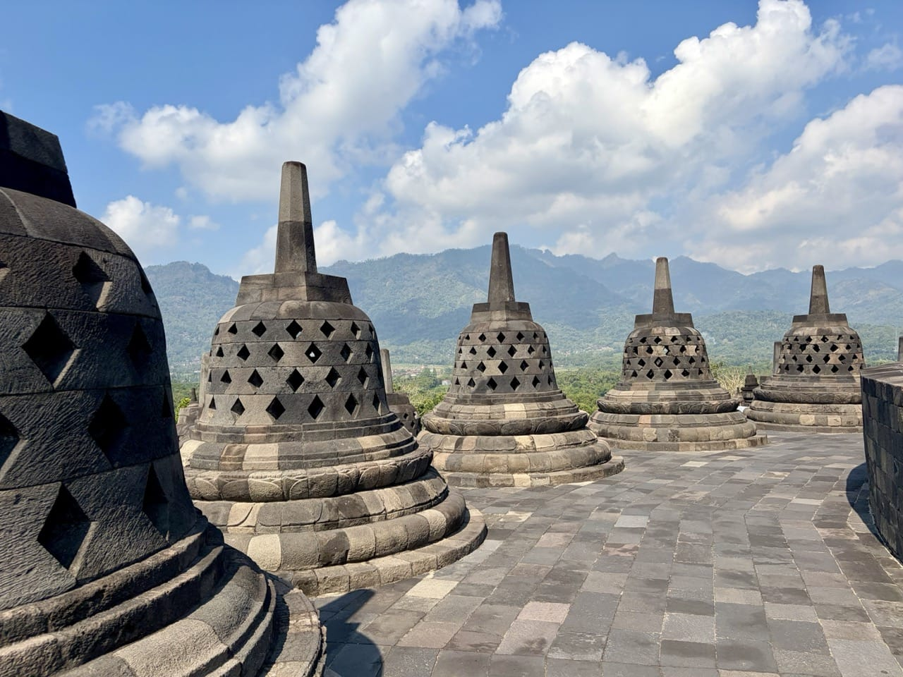

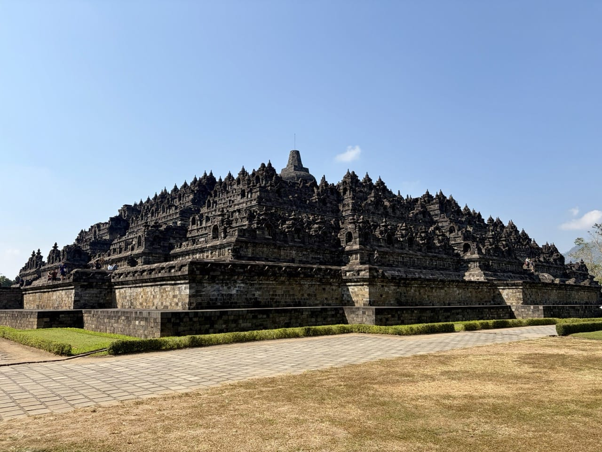

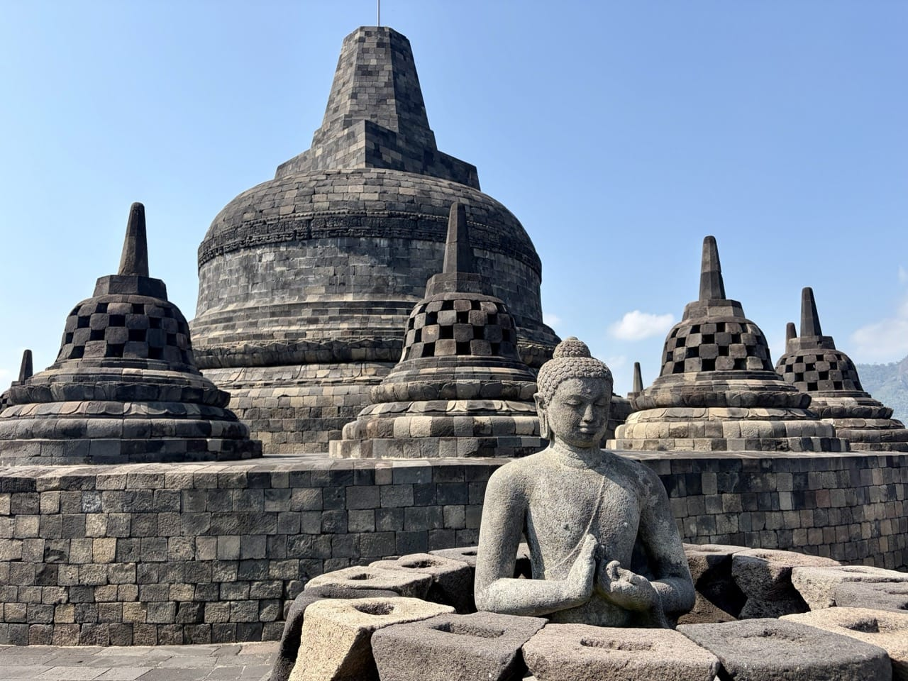

We also did a walking tour through the city itself, including Malioboro Street, the main shopping strip, but beyond the two temples there really wasn't much else to the city.

## Jakarta, and back to Bangkok

From Yogyakarta we took another train, around eight hours this time, to Jakarta. We'd booked a hotel barely 200 metres from the station, and of course the skies opened the moment we arrived. We got stuck sheltering under a bridge while every taxi we tried to book cancelled on us in turn.

The next day we flew back to Bangkok. From the plane I actually spotted Khao Sok from above, the lake and the limestone cliffs unmistakable even from that height, a nice way to close the loop on where the trip had started.

## Last days in Bangkok, together

Back in Bangkok we spent our final days together before Ana flew home, she had a Bad Bunny concert to get back for, which, well, fair enough.

We visited the Grand Palace, overwhelming in the best and worst sense: an enormous amount of ornate detail packed into one site, in genuinely brutal heat.

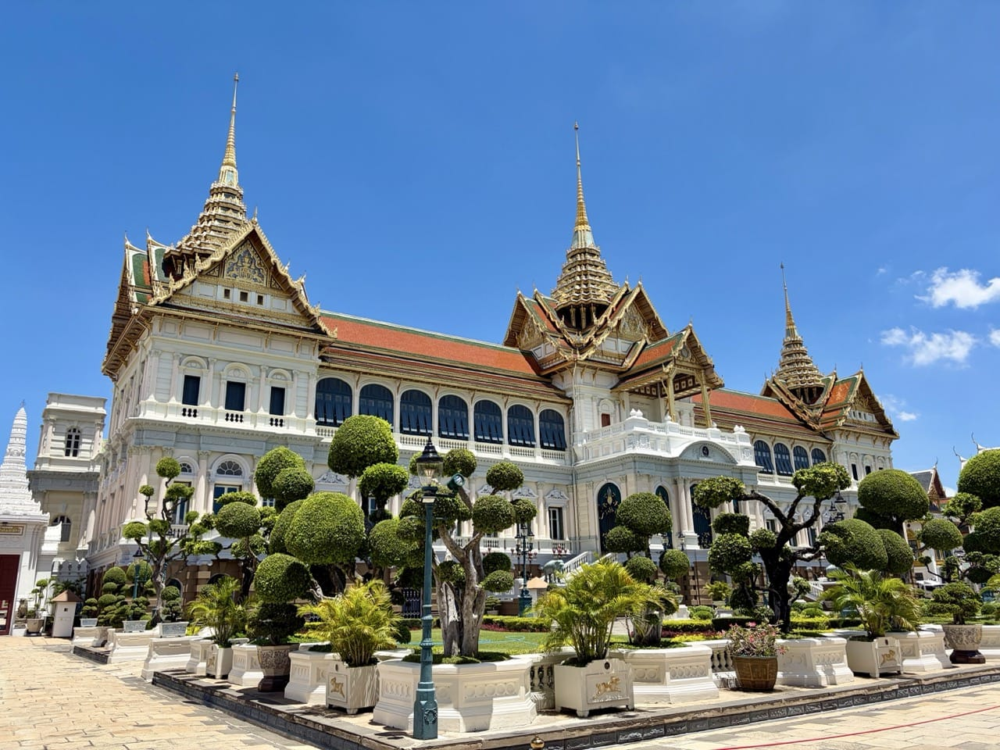

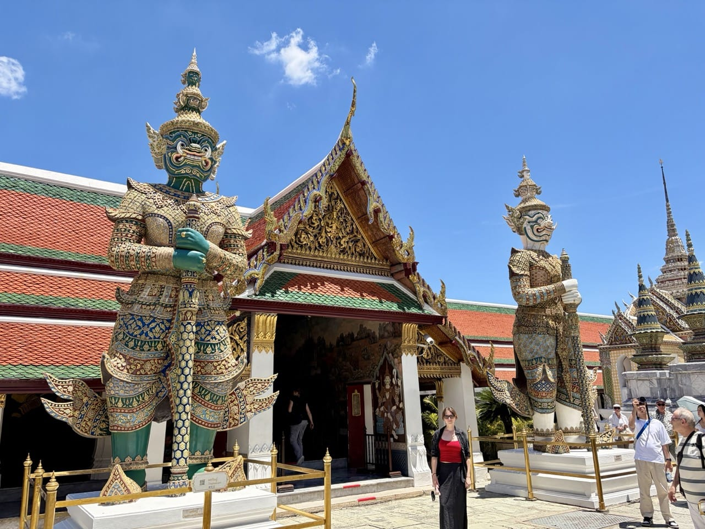

We also saw the giant reclining Buddha at Wat Pho.

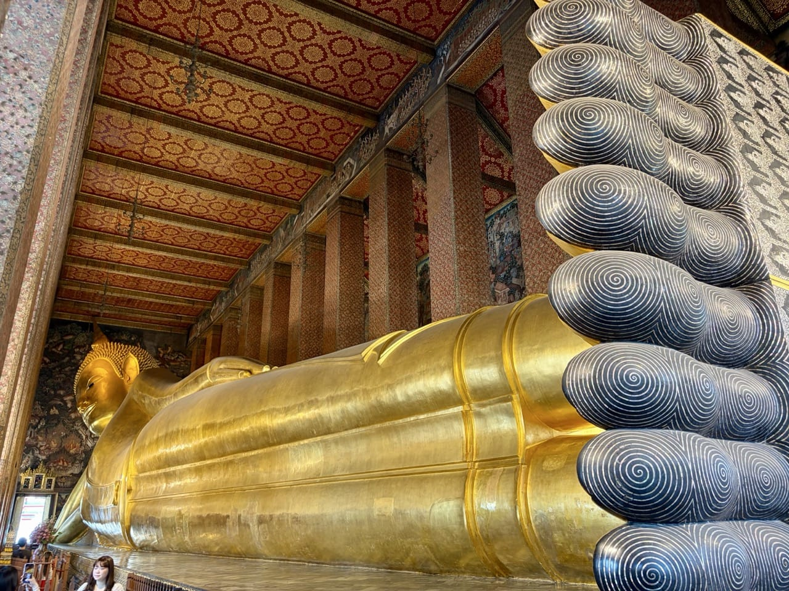

Another walking tour, with a guide who taught us a handful of Thai phrases and walked us through several markets, including a list of typical prices so we'd know what a fair deal looked like. I found it genuinely interesting, Ana less so.

We ate an enormous amount of mango sticky rice, wandered Chinatown, and took a boat along the river.

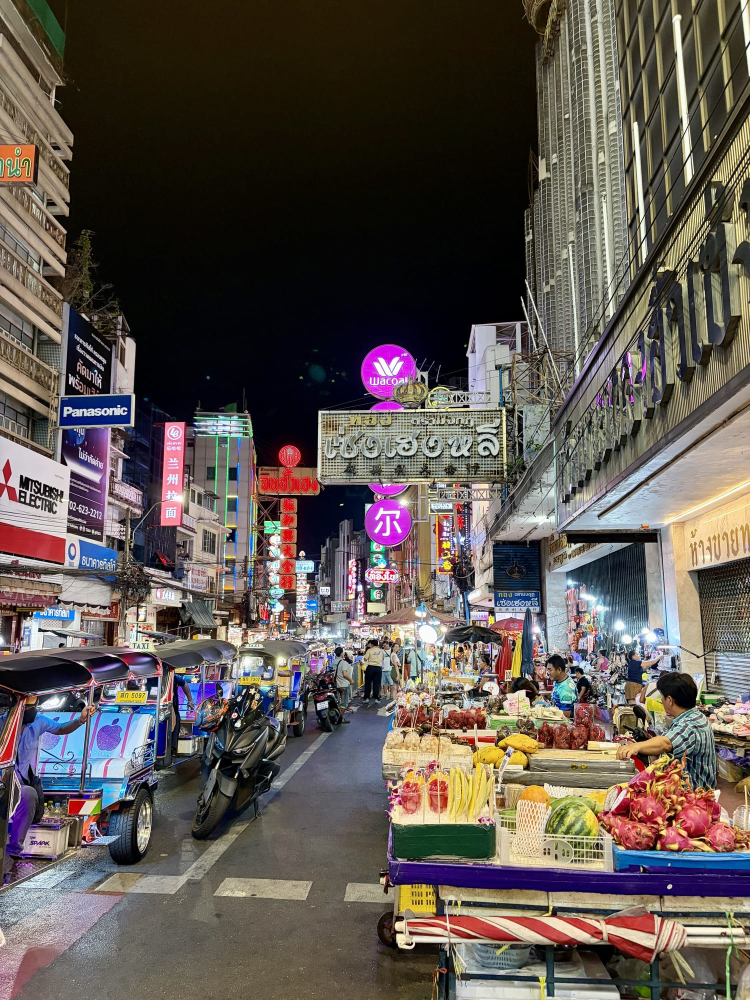

We also did a cooking class, massaman curry, tom yum goong, pad thai, and mango sticky rice, starting with a trip to the market to pick out ingredients ourselves. That market was memorable, mostly for how it treated some of the animals for sale, less a pleasant food stop and more genuinely hard to watch.

One thing I loved without question: the monitor lizards at Lumpini Park, some of them well over two metres long. I liked it enough that it was the very last thing I went back to see before flying out, after my own loop through Laos, weeks later.

Between the rain most evenings and how little time we actually had left, we didn't get to see as much of the city as I'd have liked. Bangkok is an odd place: plenty that's genuinely interesting, but I wouldn't call it a beautiful city, similarly to Kuala Lumpur. Both are easy to get to on cheap flights and worth two or three days, not more. I wouldn't say I loved Bangkok this time, but I'd happily give it a second chance.

## The highlights

**Best food**: Penang, no contest.

**Best hike**: Penang Hill. Mostly forced on us by the funicular closure, but genuinely satisfying, intense, and one of the highlights of the whole trip. Ana might disagree.

**Best nature**: Mount Bromo, unbeatable. Ijen and its blue flame crater was meant to be part of the same leg, but it was closed while we were there over some kind of dispute with the operating company, the explanations we got varied depending on who we asked.

**Best flavour**: pandan, specifically with coconut milk, and in an infused drink we had in Penang.

**Most fun**: Kuala Lumpur, probably more for the company than the city itself, since we barely went out in Bangkok between the rain and some bad timing. That said, Bangkok isn't a city I'd write off either.

[^1]: Bangkok to Chiang Mai, Chiang Rai, across into Laos, down the Mekong, Luang Prabang then Vientiane before looping back to Bangkok. About ten days on its own.

[^2]: Rafflesia is commonly called the "corpse flower" or "stinking corpse lily" because it emits a strong odour, similar to decaying flesh, to attract pollinators like flies. Its blotchy red face genuinely reminds me of the monster from Stranger Things.

[^3]: The lake sits behind the Ratchaprapha Dam; its purposes are electricity generation, irrigation, flood control, and fishing.

[^4]: Built in the late 1800s for Cheong Fatt Tze, a Hakka businessman once known as the "Rockefeller of the East."

[^5]: Galungan and Kuningan, the island's most significant cultural celebrations, ran from the 17th to the 27th of June 2026, marked by communal feasts, spiritual rituals, and penjor poles lining the streets.

[^6]: The Ramayana is an ancient Indian epic poem that tells the story of Prince Rama's quest to rescue his wife Sita from the demon king Ravana. It's one of the most important works of Hindu literature and has had a profound influence on the cultures of South and Southeast Asia.

[^7]: A stupa is a hemispherical dome-like structure containing relics, typically Buddhist, that is used as a place of meditation and worship. They are often found in Buddhist countries and are considered symbols of the Buddha's presence and enlightenment.
