This is the second part of a five-week trip through Southeast Asia. The [first part](/blog/southeast-asia-2026-part-1) covered Thailand, Malaysia, and Indonesia with Ana. Once she flew home from Bangkok, I still had about ten days left before my own flight, so I did a loop on my own: north to Chiang Mai and Chiang Rai, across the border into Laos, down the Mekong by boat to Luang Prabang, then south by train through Vang Vieng to Vientiane, and back to Bangkok for one last night before flying home.

## Chiang Mai, one temple too many

Another overnight train out of Bangkok got me into Chiang Mai the next morning. I'd heard so much good about the city that I was honestly a bit let down. There isn't a huge amount to it, and after weeks of temples all over Thailand, Malaysia, and Indonesia, the wats in Chiang Mai started blurring together: wooden structure, golden decoration inside telling scenes from the Buddha's life, a _chedi_[^1] standing outside. All genuinely beautiful, but by the third or fourth one in a row I wanted something a bit different.

I did a free walking tour that covered a handful of temples, starting at _Wat Saen Muang Ma Luang_, plus a good amount of history and religion, including the region's long, complicated relationship with _Burma_. The guide also talked about the Emerald Buddha, the small jade statue we'd seen at the Grand Palace in Bangkok, and how it started its journey right here in northern Thailand.[^2]

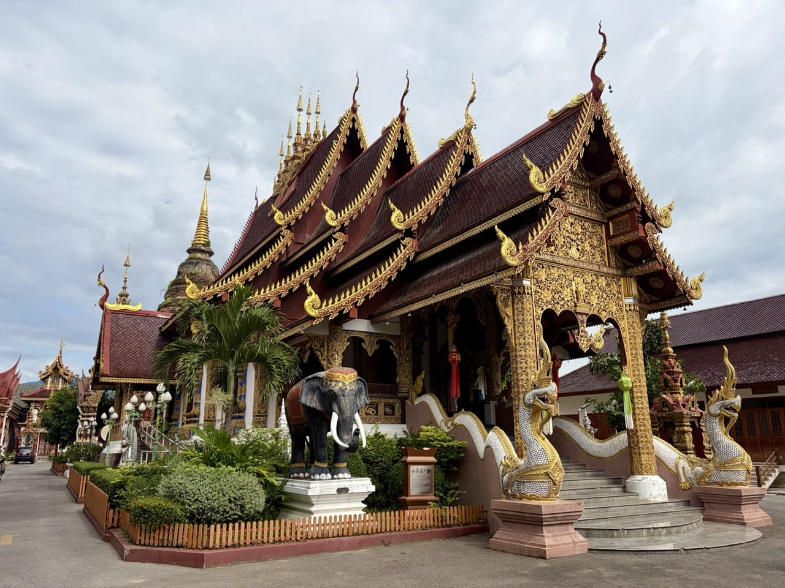

The best stop was _Wat Chedi Luang_, home to a genuinely enormous chedi that partly collapsed centuries ago and was never rebuilt. What's left is still imposing, a broken brick base with one intact corner hinting at how massive the original must have been.

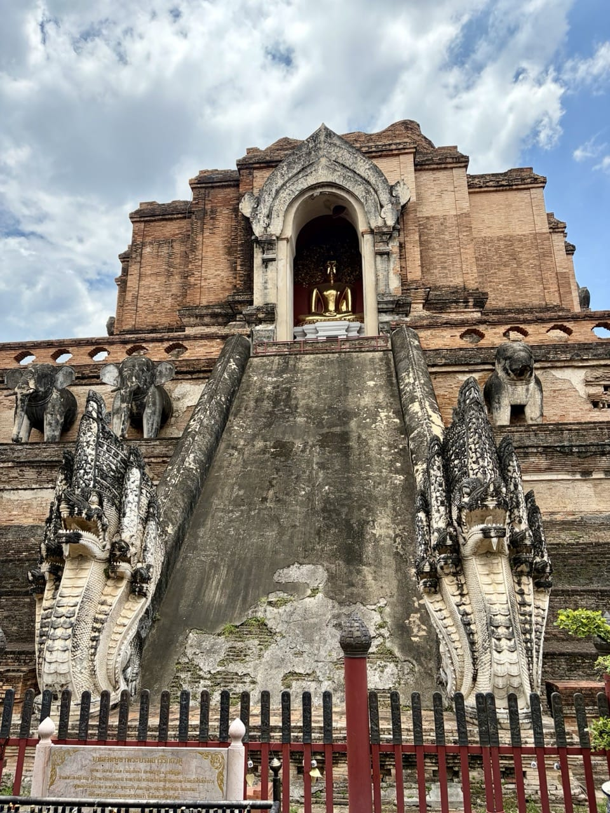

Food-wise, this was where I finally tried _khao soi_, Chiang Mai's signature dish, a curry noodle soup topped with crispy noodles. I found a vegan version, not an easy thing to ask for in Thai, but I didn't need to worry much: I was surprised by how many fully vegan places there were, especially at the food markets, several of which use a simple red sticker system so you can spot vegan stalls without speaking a word of the language.

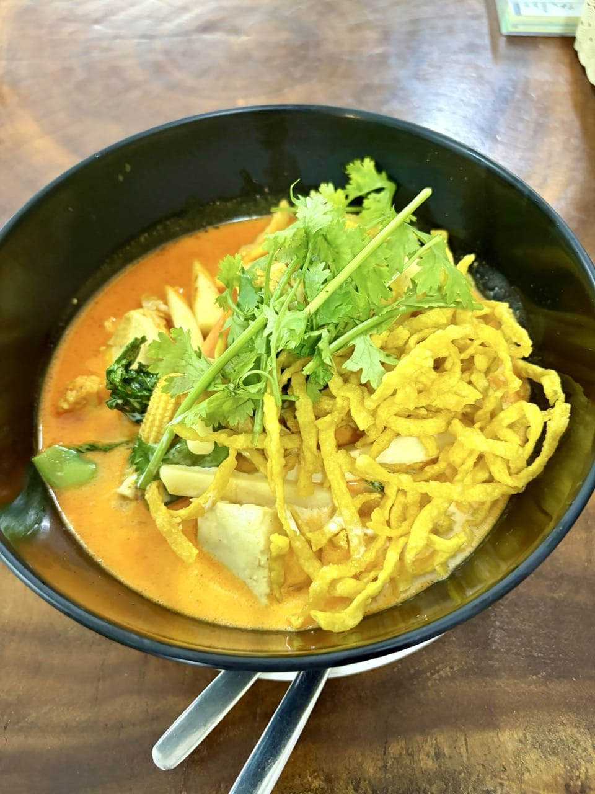

### Up to Doi Suthep, in the rain

The next day I hiked up to _Wat Phra That Doi Suthep_, the temple on the hill above the city, using the old _monks trail_. About five minutes in, the sky opened. It rained without stopping for the next couple of hours, and the trail itself, mostly dirt through the forest with several steep sections, turned properly slippery.

About a third of the way up is _Wat Pha Lat_, a small, quiet temple built right into the stream, and I waited out the worst of the rain there before continuing.

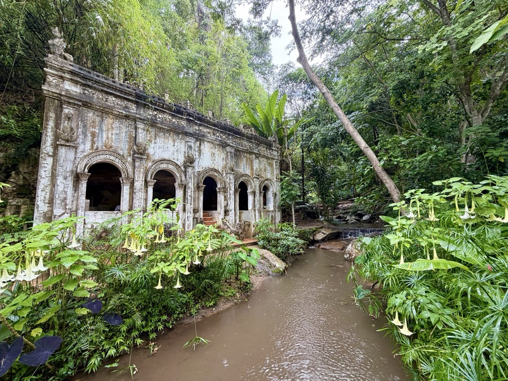

By the time I reached the giant staircase leading up to Wat Phra That Doi Suthep, the rain had mostly stopped. The temple itself is said to hold a bone relic of the Buddha[^3], under a golden dome, with another copy of the Emerald Buddha inside. The real reason to come up, though, is the view: from up there you can recognise the old city's square walls and the moat that still wraps around most of it.

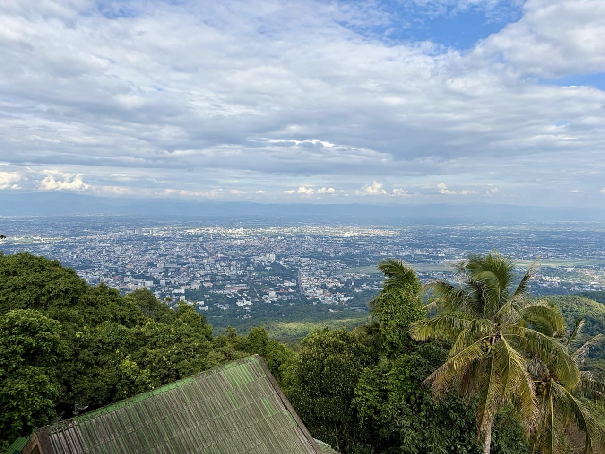

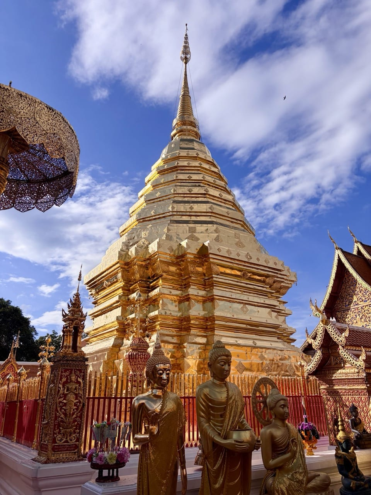

| Distance | Elevation | Time     |
| -------- | --------- | -------- |
| 14.96 km | 712 m     | ~4 hours |

That's just the hike itself. Instead of taking a tuk-tuk back down, I decided to walk all the way to my hostel on the east side of the city, which pushed the day's total past 20 km.

That evening, on the recommendation of pretty much every friend I'd travelled with who'd been through Thailand before me, I finally got a _Thai massage_. I'd never really considered it, partly because I had the wrong idea of what it actually involves: less lying still and more a mix of massage and yoga-like stretching, with both of you in loose pyjama-style clothes. I'd been told to book two and a half hours and only booked one, which I regretted almost immediately. I picked a place that trains former inmates as therapists, which felt like a good/ethical way to do it, and after 20 km on my legs it was exactly what I needed.

Two nights in Chiang Mai was enough for me. There's also a well-known elephant sanctuary nearby, but even with assurances that the animals are kept ethically, I decided to skip it. It wasn't really what I'd come for anyway: I was more interested in the culture and the landscape than in that kind of stop.

## Chiang Rai, four stops in one day

From Chiang Mai I headed to Chiang Rai, getting closer to the Laos border. The city is known for two relatively new, art-driven temples plus a giant statue, and I managed to fit all of it into a single day.

The bus dropped me close to _Wat Rong Khun_, the White Temple, and a short, cheap tuk-tuk ride got me there. It's not really a working temple, more a living art piece started in 1997 by a local artist and still being expanded. The entrance alone has plaster arms reaching up out of a pit below a bridge, meant to represent desire and suffering, and the white, mirror-studded _ubosot_[^4] is covered in carvings of mythical creatures. Photos aren't allowed inside, but a quick search online will show you what's hidden among the usual dragons and Buddhas: Xenomorphs, the Terminator, Pac-Man, and a long list of other pop culture references. Around the back there's a golden building housing the restrooms, sometimes called the most beautiful bathroom in Asia, built specifically to be the opposite of what someone expects from a toilet in every sense.

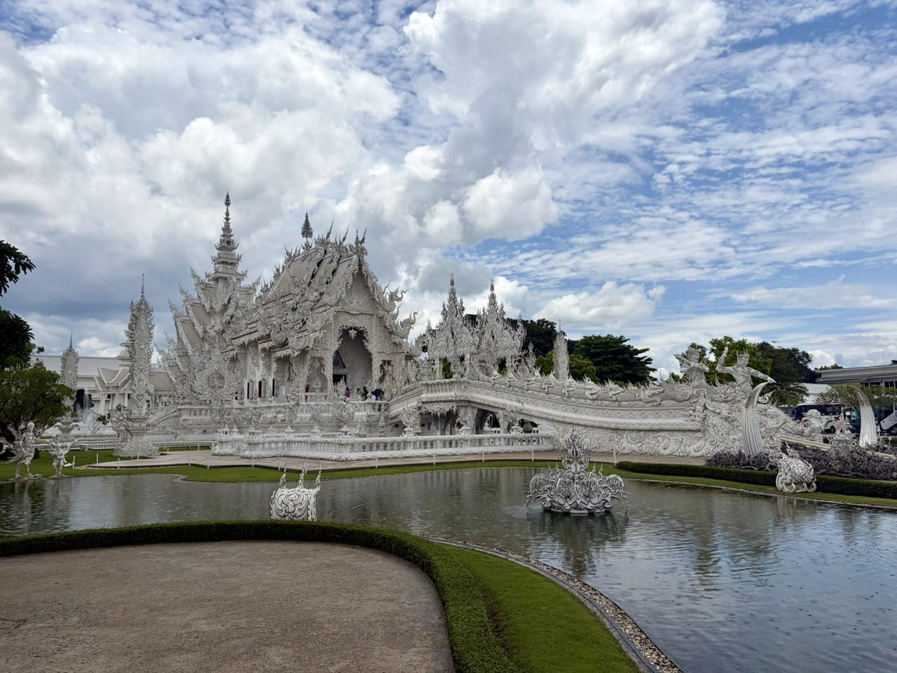

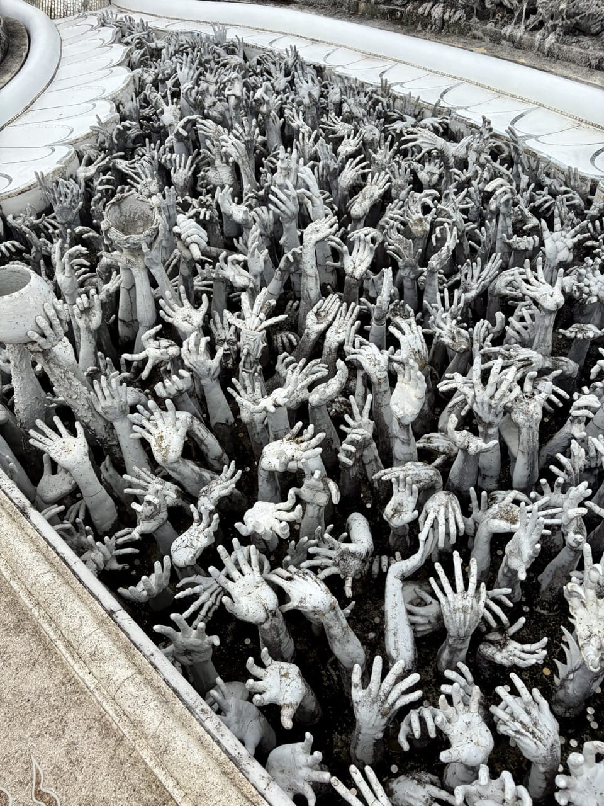

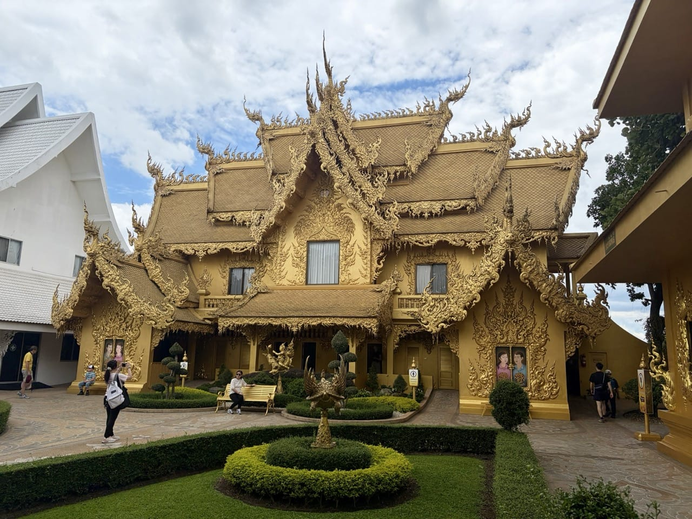

There's also a small museum on site about the artist and the temple's design, but it was closed and I didn't want to wait two hours for it to open, so I headed into town instead. The centre of Chiang Rai is small and tidy, and I found a canteen-style vegan spot where the owner just picked dishes for me. Everything was excellent and very cheap.

In the afternoon I took a taxi out to _Baan Dam_, the Black House, about 15 to 20 km from the centre, built by the teacher of the artist behind the White Temple. It's not a temple either, just a cluster of wooden buildings full of animal horns, carvings and some genuinely dark, macabre pieces. Worth an hour of wandering if you're already in the area, though I most likely had too high expectations, it was enjoyable anyway.

On the way back, maybe 15 minutes from the Black House, is _Wat Huay Pla Kang_, home to a massive statue known locally as the Big Buddha, though it's technically _Guan Yin_, the Chinese goddess of mercy.[^5] It sits on a hill and is visible from kilometres away. You can climb up inside the statue and look out through its eyes, which turned out to be a properly good view.

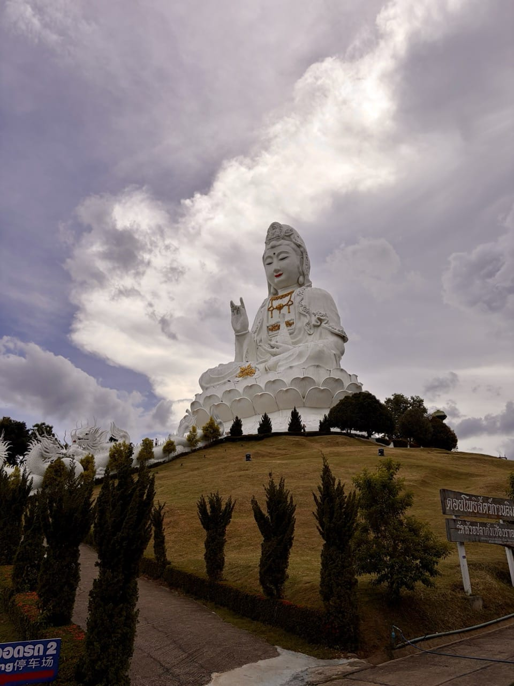

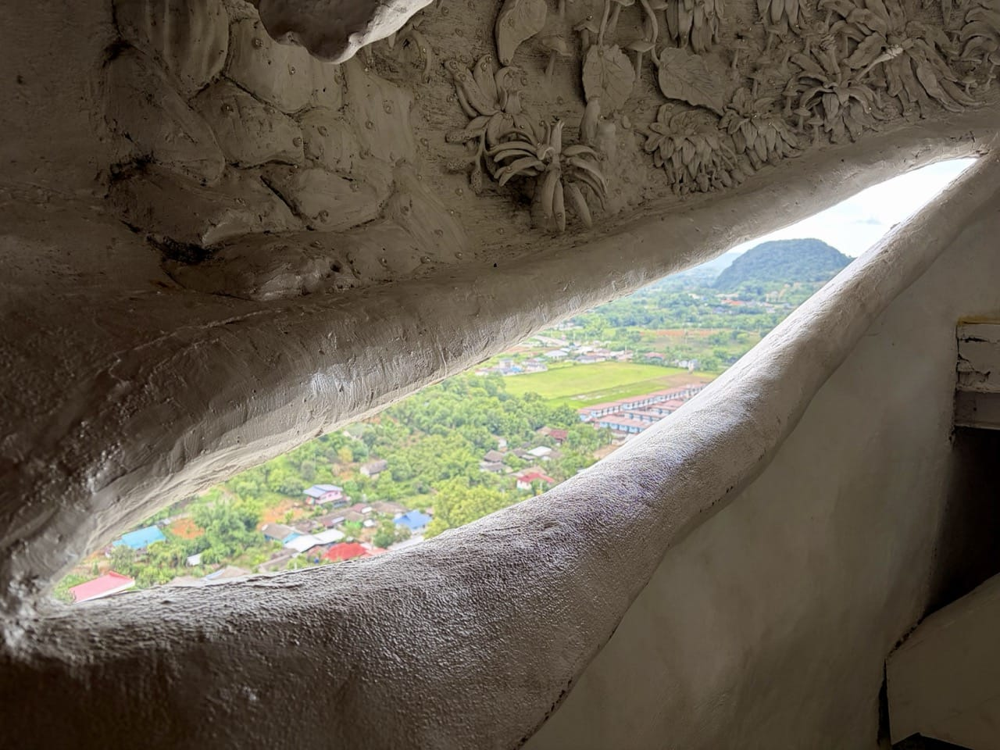

Last stop was _Wat Rong Suea Ten_, the Blue Temple, built more recently than the White Temple, everything painted deep blue and gold. The lighting inside plays off the Buddha statue in a way that makes the whole thing glow. I'd genuinely recommend doing all four of these in one day if you're based in Chiang Mai or Chiang Rai, it's an easy day trip. Without an international licence I stuck to taxis rather than renting a scooter, and most drivers there are happy to wait between stops for a bit extra, which in the end was more convenient than trying to find a new ride each time.

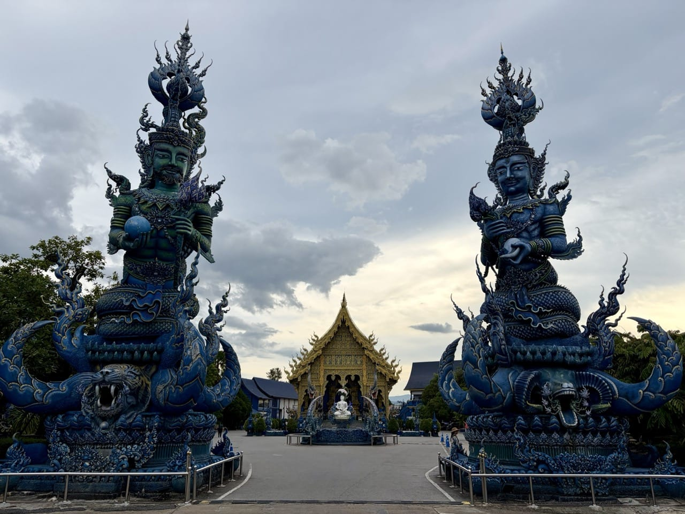

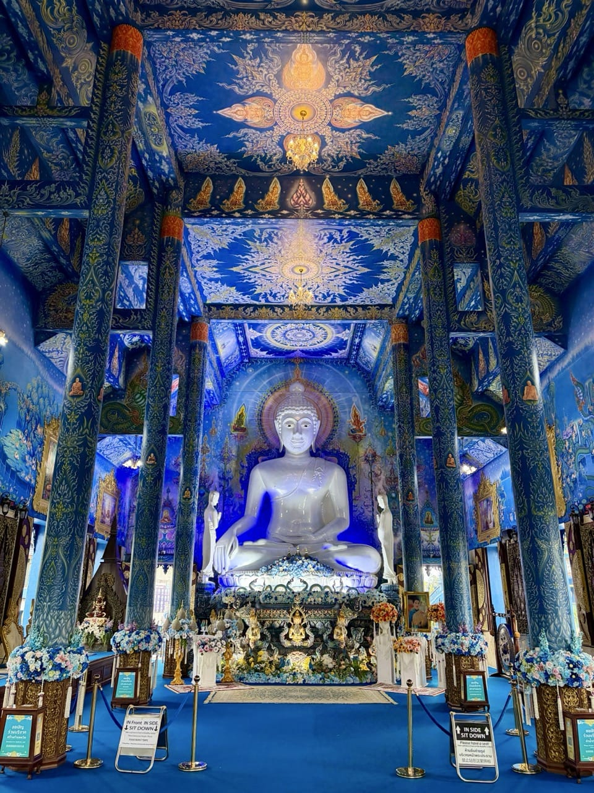

I also stumbled on a village festival with local dancing at the food market that evening, and I don't think I saw another foreigner there all night. I walked back to the centre of Chiang Rai from the Blue Temple, and left the next morning.

## Crossing into Laos

From Chiang Rai I took a bus to Huay Xai, the first town on the Laos side of the border, planning to start the two-day boat trip down the Mekong to Luang Prabang the next morning. The bus took longer than expected, stopping repeatedly to drop off packages and supplies along the way, but I didn't get bored as the scenery was entertaining.

Leaving Thailand was simple. Entering Laos was not. I'd applied for my visa online in advance specifically to avoid border hassle, since I'd read that officials there can be difficult about money, and losing a day at the border would have thrown off the whole loop back to Bangkok. When I got there, the border post was mid-renovation, workers a couple of metres away while I tried to sort out paperwork. Staff asked for extra cash to stamp my passport, and comparing notes with other travellers afterward, everyone had been asked for a different amount, so it was clearly some kind of scam, though there wasn't much to do about it in the moment. They also wanted extra forms filled out that weren't listed anywhere on Laos's official tourism site.

On the other side, tuk-tuk drivers were asking for absurd fares for a ten-minute ride into town, so a group of us waited to split one. Huay Xai itself, sitting right on the Mekong, isn't bad: I found a cheap room with a terrace looking over the river. I walked around a bit despite the rain, past another temple and the ruins of an old French fort. Boat tickets at the pier were nearly three times what I'd read online, apparently prices across Laos had jumped after tensions in Iran started affecting fuel costs. My guesthouse booked mine at almost the same price and included a ride to the pier the next morning, which turned out to matter, since it poured that morning and rain was forecast for the whole two-day trip down the river.

## Two days down the Mekong

We left around 9am. The first stretch was under heavy rain, the long boat's sides sealed with plastic sheeting that leaked in several places. I spent close to an hour and a half holding a bucket to catch water dripping from the roof. The boat was fuller than I expected, most people had been hiding from the weather the evening before so I hadn't seen how many of us there actually were.

Once the worst of the rain passed, we could roll the plastic sheets up and actually see out: dense jungle, low cloud, mist rising off the water, more storms clearly building further down the valley. We got into the overnight stopover village around 4pm, after roughly seven hours on the water. Despite the weather, the ride was genuinely enjoyable, plenty of chatting on board. I happened to be wearing a Netherlands shirt while they were playing a World Cup match, so people kept coming over to ask me for score updates on their phones, a good icebreaker I hadn't planned for.

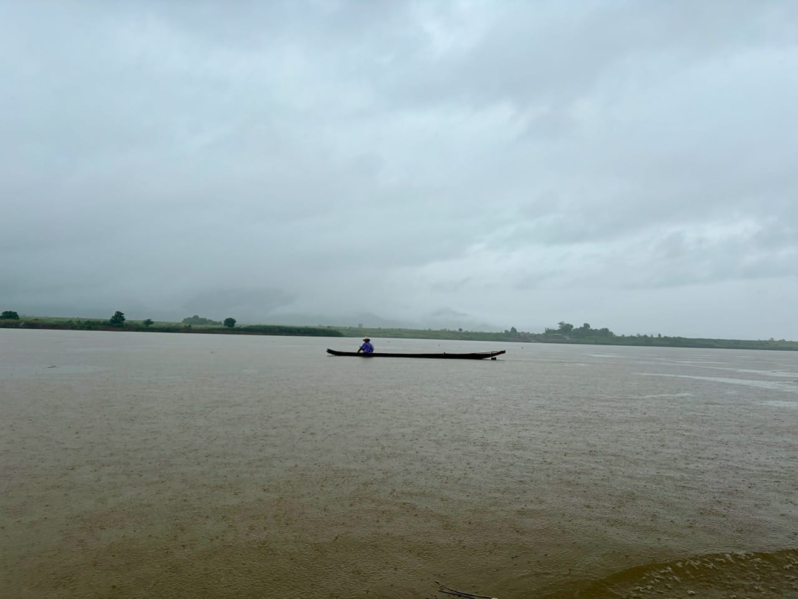

The stopover village itself doesn't have much beyond the people who live there and whoever got off the boat that day. I booked a guesthouse a few steps from the pier the same day, given the weather I didn't want to wander far looking for something better. Before calling it a day, I walked up the hillside behind the village to see the foundations of a giant Buddha statue still under construction, with boards showing the finished design. I spent the rest of the evening back at the guesthouse figuring out the next steps of the trip, still not entirely sure what my plan looked like, and booked the fast train from Luang Prabang to Vientiane, since tickets only open up about three days ahead and I didn't want to risk missing the night train back to Bangkok I'd booked weeks earlier.

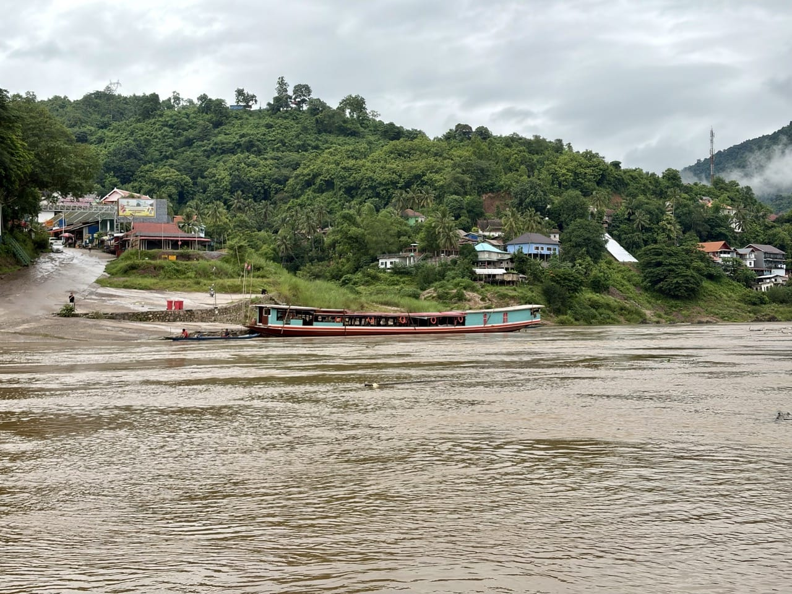

The second day of navigation started around 9am, cloudy but dry. We passed several riverside villages, stopping now and then for small trades with locals. In the last couple of hours the sky finally cleared, my first proper blue sky in days, and the scenery turned genuinely beautiful: limestone mountains in the distance, the wide brown river below. We reached Luang Prabang around 4 or 5pm, and a shared tuk-tuk took a group of us into town.

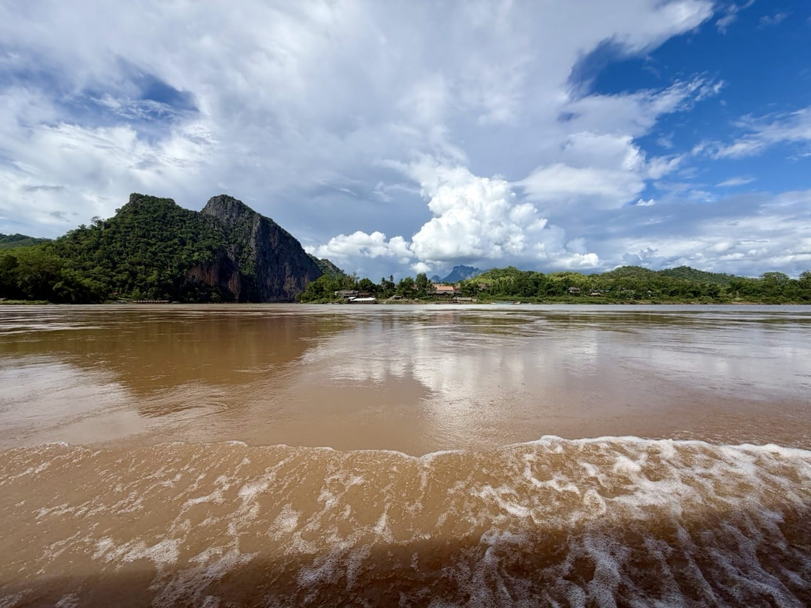

## Luang Prabang

I dropped my bag at the guesthouse and headed straight up _Mount Phousi_ for sunset, the hill with a temple right in the middle of the old town peninsula. The temple itself didn't do much for me after so many others, but the view was worth the climb. At the top a group of local students practising their English for a school assignment adopted me for half an hour, working through a list of questions with their teacher nearby. I'm not sure how much of what I said actually landed, but they told me they do this every day, which is a genuinely good way to build up fluency over time. I was mid-conversation when the sun actually went down, so I didn't get the photos I'd gone up there for, but it was a nice way to spend the last light of the day regardless.

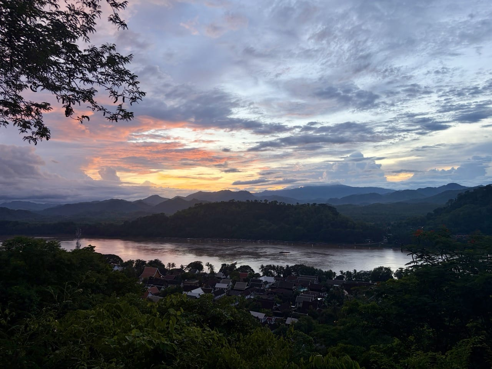

Afterward I went down to the night market on the peninsula, which runs every evening, and had a very good dinner among the food stalls there.

The next day I went out to _Kuang Si Falls_, about 20 minutes outside town. The water is a striking turquoise, with several pools you can swim in, and a trail leads up to where the falls actually start. It's a pleasant walk through the forest, and I found one quiet pool with nobody around to relax in. There's also a rescue centre nearby for Asiatic black bears saved from poachers and traffickers. I'd recommend the falls without hesitation if you're anywhere near Luang Prabang.

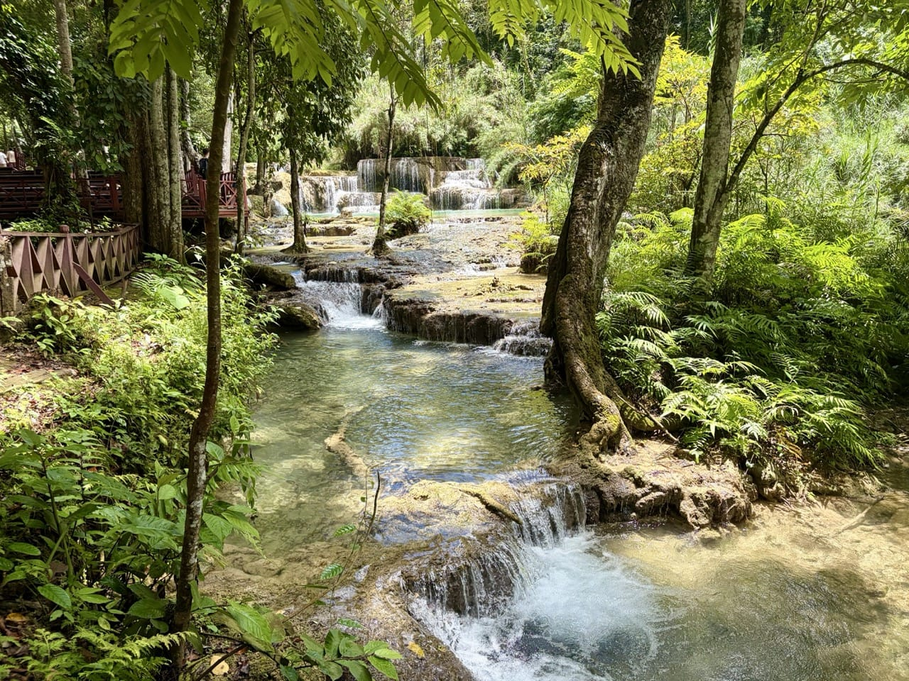

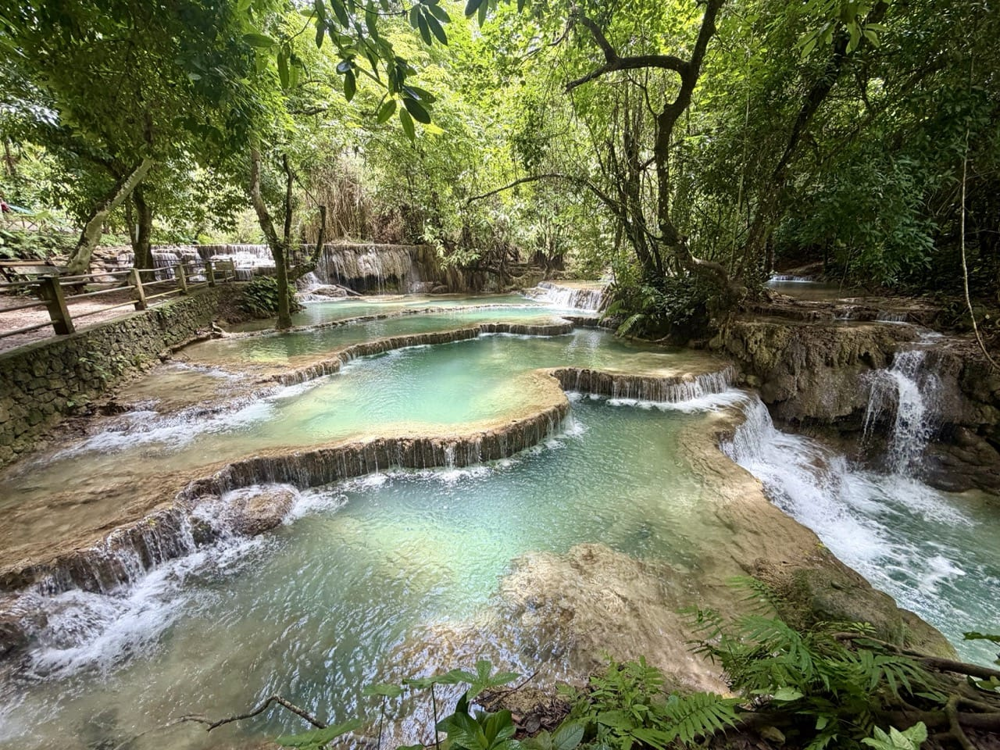

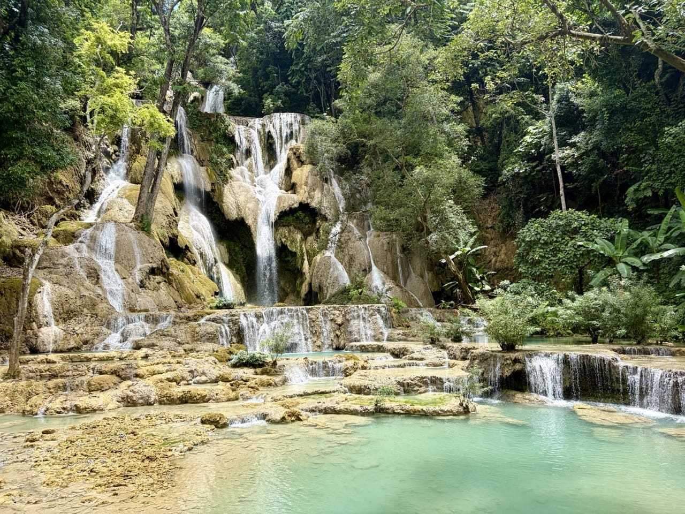

There's also a cave nearby full of Buddha statues, reachable by boat on the Mekong, but after two days of river travel already I decided to give the boat ride a miss. My guesthouse gave me some free tickets for an evening river cruise, and even after all that time on the water, it was a nice way to close the day, storm included, with a properly dramatic sunset over the river.

The old town itself is lovely, but small and made for two people rather than one, I think I'd have enjoyed it more with company. After looking at photos and talking to other travellers, I decided to cut Luang Prabang a day short and move on to Vientiane instead.

One last thing before leaving: the _monks' alms procession_, held every morning between around 5 and 7am, where monks walk through the old town collecting food offerings. It's supposed to be quite a moving, spiritual thing to witness. In practice, it felt more like a photo opportunity for tourists than anything else. I'm glad I went, but it cost me three hours of sleep after a late night sorting out the following day's travel, and I wouldn't call it unmissable.

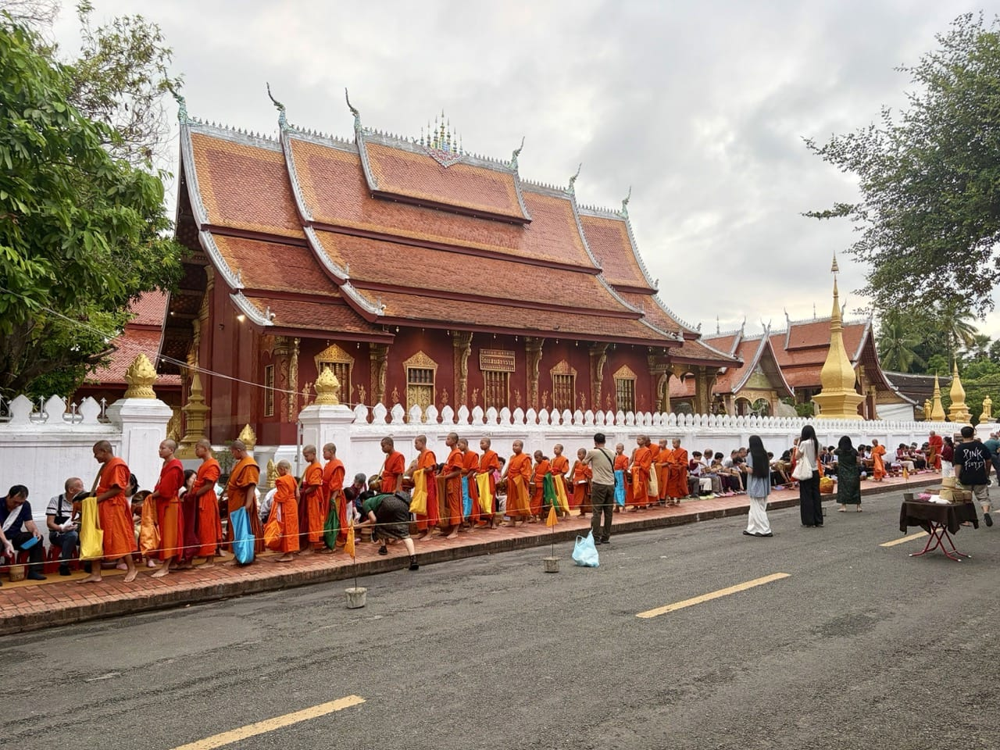

I also visited the old royal palace, decent but nothing remarkable, and _Wat Xieng Thong_, the oldest temple in the city, with a striking tree of life mosaic on its rear wall. It's genuinely beautiful, if a little diminished after so many temples in a row by this point. The Emerald Buddha is believed to have spent time here too, back when Luang Prabang, not Vientiane, was the capital of the old _Lan Xang kingdom_, before continuing on to Vientiane and, much later, Bangkok.[^2]

## Vang Vieng, for one view

Getting relevant, up-to-date information for travelling in Laos is genuinely hard: prices have jumped recently, and a lot of what's written online is already out of date. There's a new Chinese-built high-speed rail line connecting the main cities, comfortable and reasonably priced, but tickets are limited online. The official site wanted a local phone number I didn't have, so I ended up booking through a third-party site instead, without any real confirmation I'd actually get a seat until the day itself.

Everyone I'd met recommended the viewpoint near Vang Vieng, so instead of another full day I'd planned in Luang Prabang, I found a train that let me stop off, do the hike, and still make an evening connection onward, adding a stop over in Vang Vieng to my journey to Vientiane.

Arriving into the valley by train is dramatic, limestone mountains closing in around a tiny town. Not having much else to do, I decided, not entirely wisely, to walk from the station to the viewpoint on foot, backpack and all, under full sun the whole way. By the time I got there I was drenched and questioning my choices. The ticket office kindly held onto my bag while I started the climb in sandals, despite having proper shoes with me. Parts of the trail were easy, other parts were genuinely tough, made worse by mud left over from the previous day's rain, not ideal footwear for that.

At the top, though, I got lucky: it was just me and two French travellers, and the view was one of the best I saw on the whole trip, a full 360 degrees over rice paddies and fields, with music drifting up from the villages below. I'd seen photos beforehand, but they didn't come close. It's one of very few places that actually made me say "wow" out loud. I stayed over an hour, resting in a cool breeze under overcast skies.

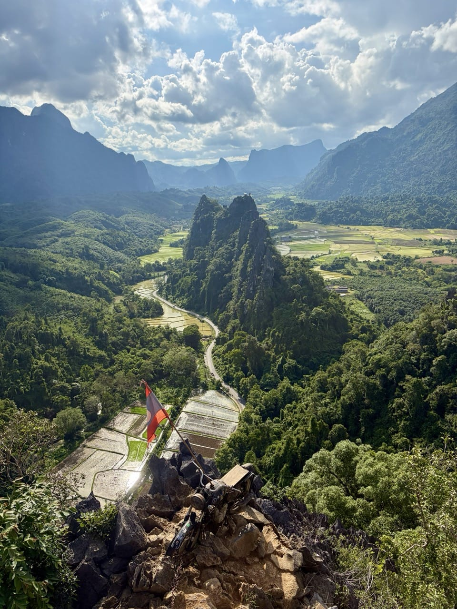

The way down was slippery and unpleasant, and getting back to the station meant negotiating with a handful of competing tuk-tuk drivers. I managed a decent price, and got to the station with plenty of time to spare, just as another downpour started. The whole day had gone remarkably well: the ticket, the weather holding off exactly when it needed to, all of it. The mountains in the distance at sunset, rain visible falling somewhere far off, were genuinely beautiful. The only downside was a two-hour delay caused by the storm, which had me worried about a late check-in at my hotel, though it worked out fine in the end.

In Vientiane itself I took an evening walk, but didn't find much going on despite it being a weekend. There are bars and a small nightlife scene, but nothing that stuck with me. The ride from the station into town was long, the station sits well outside the centre, and going through the town's main illuminated arch by tuk-tuk after dark was a nice moment on its own.

## Vientiane, and back to Bangkok

In Vientiane I started at the _COPE Centre_, a museum about landmines and unexploded ordnance left over from decades of conflict, and the prosthetics made for the people still affected by it. Genuinely moving, the testimonies and the exhibits stayed with me.[^6]

For lunch I found a place serving proper local food: papaya salad, mushroom larb, and sticky rice, both excellent and cheap. I also tried the local coffee tradition, a cup of coffee and a cup of green tea served together with some condensed milk, drunk one after the other while people sit and talk. The owner explained it's meant as a social ritual, a reason to slow down and chat.

I also stopped at _Pha That Luang_, the large golden stupa that's become something of a national symbol, and a couple of other temples, one of the oldest in the area, though the name slipped my mind. Vientiane's own arch, clearly inspired by the _Arc de Triomphe_ with a distinctly Laotian twist, has probably the best view in the city.[^7]

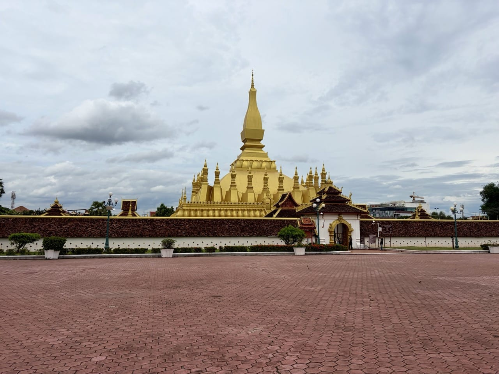

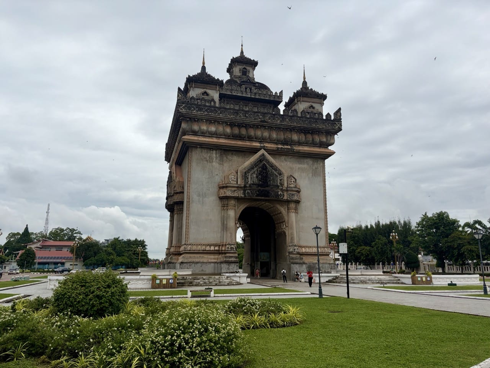

The last temple I saw was _Wat Si Saket_, the oldest surviving temple in Vientiane, its cloister walls lined with thousands of small Buddha statues in individual niches.

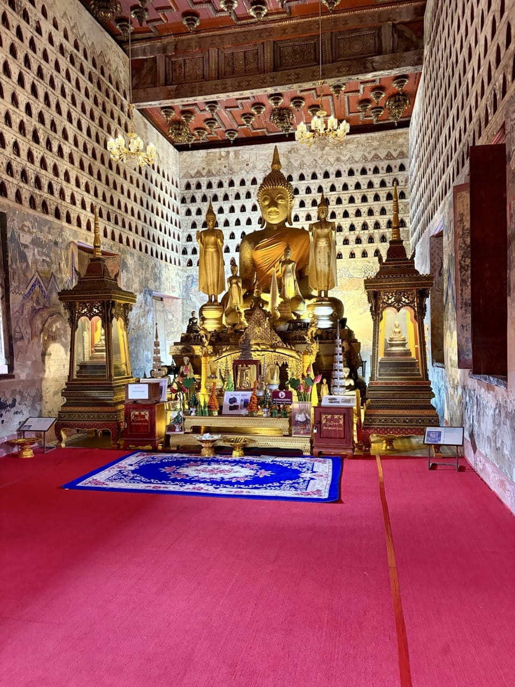

Overall, though, Vientiane is skippable if you're short on time. Luang Prabang is a much prettier city, and while Vientiane has some interesting stops, there isn't a lot else making it unmissable.

I got to the station early for the border crossing back into Thailand. The train left on time but stopped for about an hour right after the border for checks, and once we got moving again the beds in our compartments had already been made. It was a pleasant ride, although a bit too cold, and a smaller carriage than the train I'd taken up from Bangkok weeks earlier. I got into Bangkok early, around 7am, and spent a while just finding somewhere to leave my backpack for the day.

Since it was a Sunday, I went to one of the huge weekend markets, touristy, but with a genuinely interesting art section near the back, and picked up a few gifts along the way. From there I went back to Chinatown for lunch, since Ana had wanted to buy some beads there and we hadn't had time together earlier in the trip. Chinatown's market is an experience in itself, unfamiliar food everywhere and incredibly packed.

I finished the day the way I like to end most trips, walking, along the canals and then back through Lumpini Park for one last look at the giant monitor lizards there, before heading to the airport, where this trip finally came to an end.

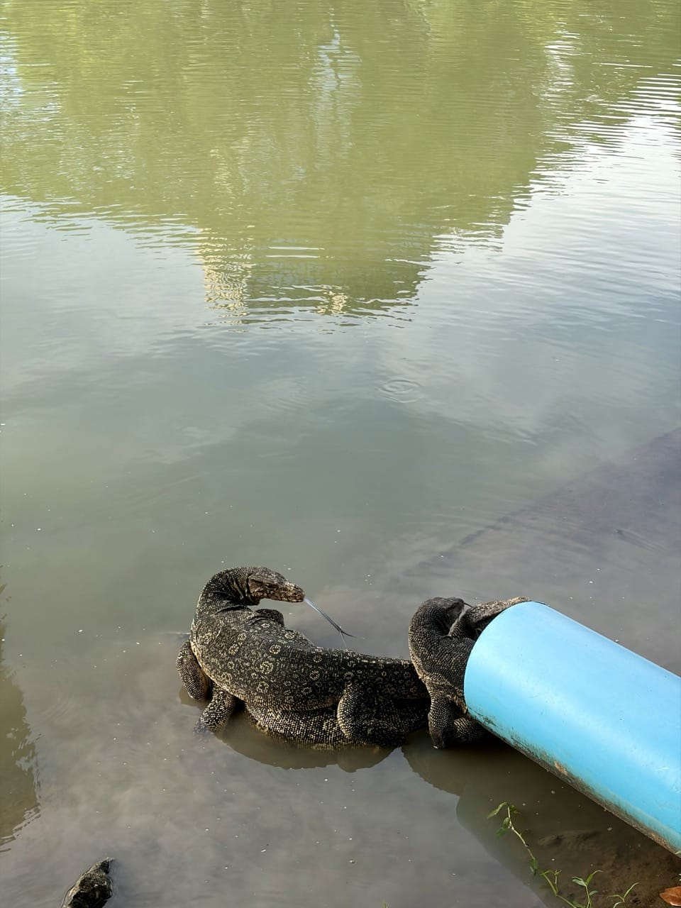

## The highlights

**Best view**: the Nam Xay viewpoint near Vang Vieng, by far. One of the very few places that made me stop and just say "wow".

**Best hike**: the monks trail up to Doi Suthep, mostly for Wat Pha Lat and the jungle in the rain, even if the last stretch back into town on foot was probably unnecessary.

**Best food discovery**: how widespread vegan food is across Thailand, khao soi especially, and the surprising number of clearly marked vegan stalls at every market.

**Most unexpected**: the border crossing into Laos and the general unpredictability of prices and information there, frustrating in the moment, but part of what made the country feel genuinely different from Thailand right next door.

[^1]: A chedi (also called a stupa) is a dome-shaped structure that usually holds a relic. From what I understood on the walking tour, it's technically a chedi if it contains a genuine relic, and a plain pagoda if it doesn't, though the terms get used loosely.

[^2]: The Emerald Buddha, actually carved from jade rather than emerald, was reportedly found in Chiang Rai in 1434 after lightning cracked open a stupa. From there it travelled to Lampang, then Chiang Mai, then into Laos as the kingdom's capital shifted from Luang Prabang to Vientiane, where it stayed for over two centuries. In 1779 it was brought back to Thailand and eventually installed at Bangkok's Grand Palace in 1784, where it remains. The King changes its robes three times a year, one for each season.

[^3]: According to legend, the relic was carried up the mountain on the back of a white elephant, which is said to have trumpeted three times, circled the spot, and died there, marking where the temple should be built.

[^4]: The ubosot is the main ordination hall of a Buddhist temple, usually the most important and most heavily decorated building in the complex.

[^5]: Guan Yin is a bodhisattva associated with compassion in Chinese Buddhist tradition. The statue is widely nicknamed the Big Buddha locally, even though it isn't a depiction of the Buddha at all.

[^6]: Laos is, per capita, the most heavily bombed country in history, a legacy of the so-called Secret War fought alongside the Vietnam War. Unexploded ordnance still injures people today, decades later.

[^7]: Patuxai was built using cement originally donated by the United States for a new airport runway, which is why it's sometimes jokingly called "the vertical runway" locally.
