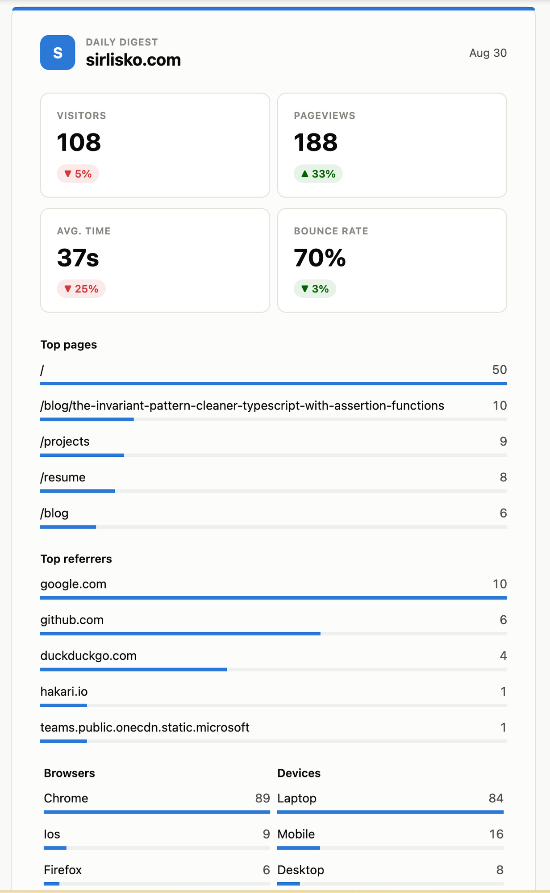

I stopped using Google Analytics years ago. Partly because I've been trying to keep Google out of as much of my life as possible, partly because Google Analytics is far too intrusive for what a personal blog needs. I wanted something more privacy-friendly, and simple.

This is the story of how I got there, and of [umami-digest](https://github.com/sirlisko/umami-digest), the small tool I ended up building along the way.

## From Umami to Plausible and back

I actually tried [Umami](https://umami.is/) ages ago, but back then it felt too barebone, so I moved to [Plausible](https://plausible.io/) instead. I paid for their hosted plan for a couple of years, then switched to the free, self-hosted community edition on a VPS.

Eventually I came back to Umami, about two years ago. In the meantime it had grown a lot, shipping two major versions and becoming a genuinely solid open source project. It's exactly what I want from analytics: simple, no frills, does its job. Plausible is fine too, but self-hosting it is more involved, even just on the database side (yes, _ClickHouse_, I am looking at you).

I've moved the Umami instance itself a few times. It started on Netlify, using Railway as the database. Everything was working fine, but when Railway dropped free database support, I gave up on that setup and moved everything to a VPS running Docker instead, which is where it lives now. All in one place.

## The one thing I missed

Moving away from Plausible, there was one feature I missed: email recaps. Plausible would send me a summary of visits, and I liked getting them, partly out of curiosity, partly because, sure, it's a nice little ego boost to see how the blog is doing.[^1] This mattered more once I started posting again with some regularity.

## Looking for a digest tool

I looked around for something that could send these recaps for a self-hosted Umami instance, and found [umami-alerts](https://github.com/Thunderbottom/umami-alerts), an open source project written in Rust. I used it for a while, and even contributed support for Umami v3 to it.

But I wanted something more portable that I could set up once and forget about. I'm not that comfortable with Rust, and it doesn't have anywhere near the tooling and support TypeScript has by now, so I decided to build my own version instead.

## Why not GitHub Actions

My first idea was to run it as a scheduled GitHub Action. Simple, free, no extra infrastructure. Except free repositories throttle cron-triggered Actions: if there's no other activity on the repo for 60 days, the scheduled workflow just stops running. That's the opposite of what I wanted. I needed something that, once configured, would keep running without me having to think about it.

## What I ended up building

I settled on two services with generous free tiers: a [Cloudflare Worker](https://developers.cloudflare.com/workers/) for the cron trigger and logic, and [Resend](https://resend.com/) to send the email, around 1000 free emails a month if I recall correctly, which I already use for _Coolify_.

umami-digest is the result: a small Cloudflare Worker, inspired by umami-alerts, that queries your Umami instance and emails you a summary. You point it at your Umami domain and project, choose daily, weekly, monthly, or any combination, and it takes care of the rest.

The email covers all the basic metrics you can see in your Umami dashboard. In the future, I'd like to add a yearly recap too.

I'm happy with how it turned out. It was the one thing I missed after leaving Plausible, and now I have it back, self-hosted, and running on infrastructure I don't have to babysit.

[^1]: No shame in admitting it.
