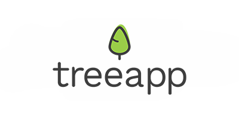
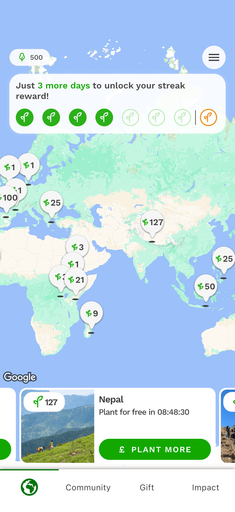

Similar to my post about [Be My Eyes](./be-my-eyes) a while back, today I want to talk about another app: TreeApp. A colleague suggested it to me, and I recently reached 500 trees planted.

## How it works

Every day, you watch a short ad, just a few seconds long. These ads are usually for ethical or sustainable products. After watching one, you get to plant a tree.

There are many planting projects around the world to choose from. Right now I'm planting a lot in _Nepal_. Each project comes with a short description of the environmental impact it will have.

## Your carbon footprint

The app also lets you work out your own carbon footprint, through a short questionnaire. It then shows your result, and puts your planted trees next to it, so you can see how much of your yearly and monthly footprint you've offset just by planting.

## A year and a half in

I've been using TreeApp for about a year and a half now. I ran into some bugs while travelling across time zones, but customer service helped me fix them each time. On my last trip, I didn't run into the problem again.

## Is it legit?

I looked around online, and the app seems legitimate: they really do plant the trees. My guess is they buy them in bulk, so each one only costs a few cents.

This still feels like a smart way to do a bit of good with very little effort. I added it to my daily routine: plant a tree, simple as that. A small gesture, but hopefully a big impact over time.

If you want to try it, here's the [website](https://www.thetreeapp.org/). And here's my [referral link](https://thetreeapp.org/referral?code=JS23K0): if you sign up through it, I get an extra tree.
