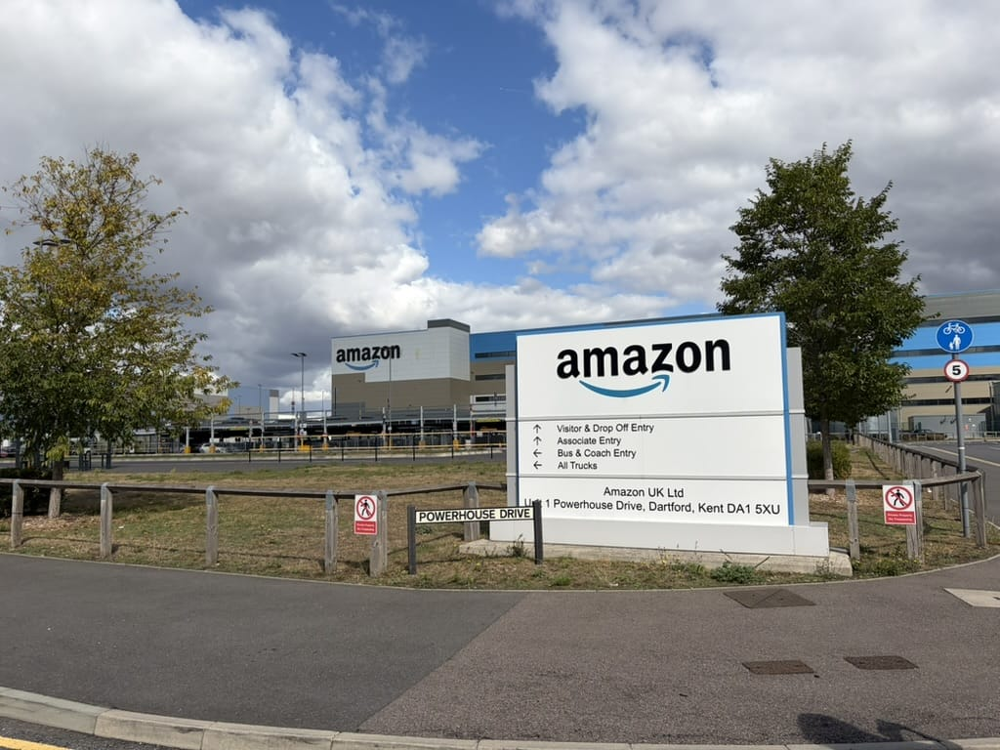
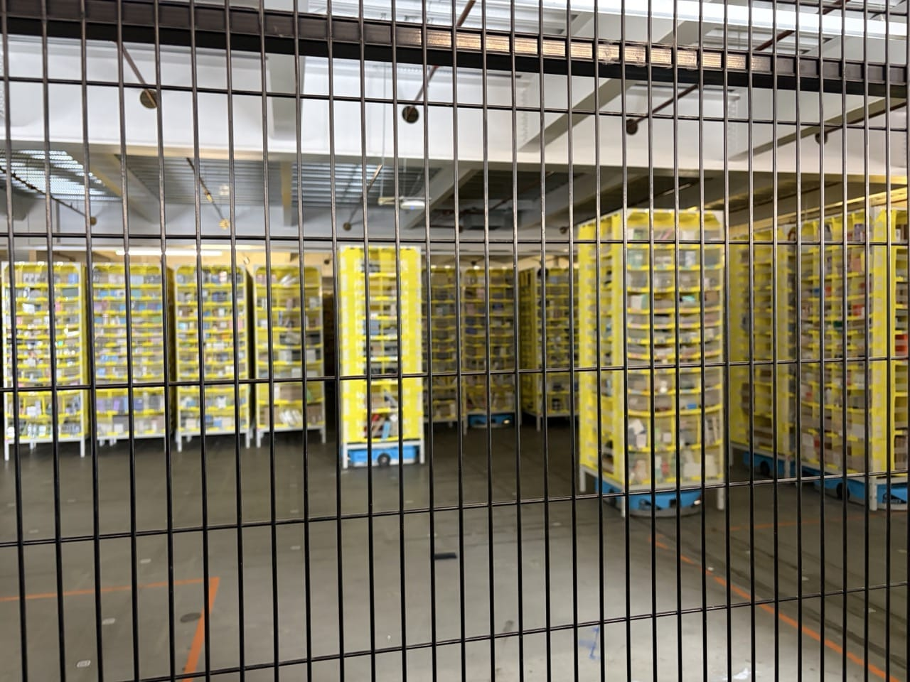

Last Wednesday I went to visit an Amazon fulfillment center. It started with a parcel sitting in my building's parcel room. On the label there was a QR code inviting me to a free, guided tour of an Amazon fulfillment center, and out of curiosity I signed up.

I thought, why not? I was curious to see how the whole thing actually works. At sign-up there were several sites to choose from. The closest one to London is in _Dartford_, called _LCY3_, named after the nearest airport[^1]. It's the biggest fulfillment center in Europe, covering an area the size of seven football pitches placed side by side.

Sign-up also included a short survey, questions like "What do you think about Amazon" or "Amazon treats its employees well", to answer from Strongly Positive/Agree to Strongly Negative/Disagree. Obviously the whole process is a way for Amazon to clean up its image in front of visitors, so I answered honestly. I don't think much of Amazon as a company, not for its aggressive strategy, and not for how differently it treats people up and down its own ladder, from the driver delivering your parcel to the people at the top. That gap is huge. Still, I'll admit some of the initiatives I saw on the tour were genuinely good. I don't want to get into the discussion about AI training, because it's a difficult topic and, right now, probably one of the most negative ones out there. Finding a company that does it ethically is a real challenge.

The center took about an hour and a half to reach from London, by public transport. Our group was about twenty people, led by one tour guide and three assistants, who walked us through every step of the process, from the moment goods arrive to the moment they're shipped out. At each stop we were allowed to ask a maximum of three questions.

## More manual work than I expected

Honestly, I expected a lot more automation. Goods that arrive from suppliers are still sorted by hand, even though everything is logged into the system right away. A person unloads a truck, checks the contents, and enters them manually using barcodes.

The part I found genuinely interesting is how the stock itself is stored. Instead of fixed shelves, there are large mobile shelving units that ride on robots called _Hercules_, essentially oversized _Roombas_[^2]. When their battery runs low they drive off on their own to recharge, and the whole fleet coordinates with each other to avoid collisions and queue up in the right order.

## Random storage, and Harry Potter's fault

According to the guide, items are placed on these shelves at random, with a few obvious exceptions. Food can't sit next to something that could contaminate it, brake fluid for a car, for example.

The random part exists for a good reason. When the first Harry Potter book came out, everyone ordered it at the same time, and all the copies ended up stored in the same spot. That created a huge bottleneck when it was time to pick and pack them all. Now, a single title can be split across up to fifty different spots on fifty different mobile shelves, so fifty orders for it can be picked in parallel instead of everyone queuing for the same shelf.

## From totes to shelves

Before storage, items are taken out of their supplier boxes and placed into containers Amazon calls totes[^3]. These totes go up to the floor above, where another worker takes each item and places it onto one of the mobile shelves, in whatever slot happens to be free. The worker keys in which slot they used, and a machine checks that the item actually landed where the worker said it did.

One detail stuck with me here. At this station there were two screens: one showed the controls for entering the slot number and scanning the item's barcode, the other ran something that looked a bit like a farming or crop-growing game, and every so often it would also show a short exercise to do at the desk. The guide said this was there to give workers something fun to look at during a repetitive job. It's a nice idea on the surface, but it apparently reacts to how many items you process and lets you compare your score with coworkers. So it can just as easily push people to work faster to beat a colleague on the leaderboard, which is a much less charming story than the one being told.

This same area, where the mobile shelves move around on their own, was the only place we were allowed to take photos.

## Picking and packing

Further along, other workers pick items off the shelves as the robots bring them over. A screen tells them exactly what to take, how many, and which container to drop it in, and a light points to the exact compartment on the shelf.

From there the items go to a different set of workers who do the actual packing: taking the items out of the container, boxing them, and sticking an identification code on the box. That code later lets a robot print and attach the shipping label automatically, so the person packing the box never finds out who is buying what. If the robot fails to attach a label, the box gets pulled aside and checked by hand.

## A few numbers on sustainability

The guide shared several figures, mostly about environmental efforts. About a third of the site's electricity reportedly comes from solar panels on the roof. Boxes are made almost entirely from cardboard reused from supplier shipments. Even the adhesive used on the packing tape is supposedly a mix designed to be less harmful to the environment. I can't verify any of this myself, but it's what we were told.

## What I took away

I'm glad I did the visit. It was interesting to see how the biggest fulfillment center in Europe actually runs. It didn't change my opinion of Amazon much, though. The workers do a physically demanding job, and the building itself is a giant space lit entirely by artificial light, which is understandable, it's not meant to be a small shop, but it's still what it is.

I appreciate that Amazon lets people visit at all, even under tight control and with photos limited to one spot. That's still more openness than I expected. But I'll keep trying to buy from independent shops first, and avoid the big corporations whenever I reasonably can.

[^1]: LCY is the code for _London City Airport_, the closest one to the site.

[^2]: Hercules, also called the _H Drive_, is Amazon's most widely used warehouse robot: a blue, autonomous unit that lifts pods of goods weighing up to 1,250 lb and carries them to workers for order picking.

[^3]: A tote, in warehouse terms, is just a reusable plastic bin used to move small batches of items around instead of a full box.
