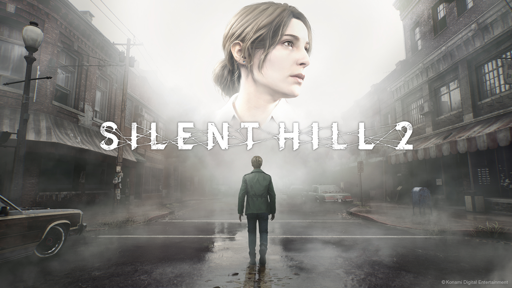

I've always been a big fan of Silent Hill, or better, of its lore, especially the first two games. More than twenty years ago I used to watch my cousin play the first one. I never really played games like this myself, Resident Evil included. I liked them, but as a kid they made me too anxious to play. Watching someone else play them, though, always fascinated me.[^1]

## Before playing

Even without playing it, I knew Silent Hill 2 well. It's everywhere in gaming pop culture: _Pyramid Head_, the nurses, the hospital. And the music. I'm a huge fan of the composer, _Akira Yamaoka_, and for over twenty years I've had his soundtracks on loop, especially the one from Silent Hill 2. I like listening to game soundtracks while I work, and this is probably my favourite one, together with Skyrim's. Last.fm says I have around [2,500 scrobbles of Yamaoka's music](https://www.last.fm/user/sirLisko/library/music/Akira+Yamaoka), so I think that proves the point.

When the remake was announced, I got interested. The videos looked good and I read good things about it online. It came to PS Plus a year ago, in October, which is the perfect month for it. Between other games in my backlog and some laziness on my side, I didn't start it until I read it was leaving PS Plus. At that point I had no excuse left.

## Atmosphere

The game brings together most of the things I love lately in a game. The first one is atmosphere, and here it's everything. There's a constant sense of oppression, the feeling that something is crawling in the fog or in the dark next to you and could come out at any moment. I could rarely play for more than half an hour at a time because the tension was too high, even when, most of the time, nothing happened.

Then there are the puzzles. In a survival horror game you expect to use your head to move forward, and Resident Evil never skipped them either. I still remember the bird puzzle on the piano in the first Silent Hill.

Then the music, which is a huge part of the experience. And the fog. How can I not talk about the fog?

Some time ago I learned from a podcast about game development that the fog in the first Silent Hill was a workaround for the limits of the original PlayStation. By hiding everything beyond a short distance, the game only had to render a small area around the player, which used much less of the hardware. If you think about it, it's a brilliant idea, and it became one of the things the series is most famous for.

## Story

The story doesn't need much of an introduction. It's impressive if you think the original came out in 2001. Games today often compete with cinema in how they tell stories, and sometimes do it better, but this one did it 25 years ago. It deals with heavy topics with a lot of care: psychological abuse, watching someone you love get sick, losing them, and fear in general. It's full of symbolism about what the main character thinks and feels. I don't want to go into detail to avoid spoilers.

Pyramid Head is one of the most famous villains in gaming, at the level of _Sephiroth_,[^2] and a big part of that is all the symbolism behind him.

It's also one of the few games where I was happy to play again to see the different endings, each one telling the story in a different mood. My favourite is obviously the _Dog_ ending.[^3]

## Old games and the remake

I don't remember the original very well. I watched some videos and comparisons, but it's hard to judge it with today's eyes. I think the first 3D games on the PlayStation aged badly, even though they were very advanced for their time. Back then, trying to make something look real was very hard. Strangely, games with a more cartoonish style, like Final Fantasy VII, aged better, because the gap with today is less obvious. And pixel art will never age, if you like pixel art.

Controls aged badly too. I tried the Tomb Raider remasters and the old Resident Evil games with better textures, but the _tank controls_ feel impossible compared to what we're used to now. The remake team did a great job here, replacing them with a modern over-the-shoulder camera.

## Playing it in practice

The only problem is that it's a game to play in winter. It's very dark, and many areas are almost pitch black. During the day, with the light reflecting on the screen, I couldn't see anything. In the evening, I was anxious to play alone after [Ana](https://untepid.com) went to bed, and she didn't want me to play while she was around, because she was scared to watch or even hear it.

## Final thoughts

It's an amazing game, really. It easily made my top 5 favourite games, I'd even say top 3. _Final Fantasy VII_ stays my favourite of all time, then _Bloodborne_, then _Silent Hill 2_. Maybe with some distance I'll change my mind, but during the last month I was obsessed with it: I played it, watched video essays about it afterwards, read about it, and listened to the soundtrack on repeat.

I really recommend it. I'm happy I played it, and I want to thank Bloober Team, the studio behind the remake, because they did an excellent job.

Now I'd love to see Akira Yamaoka live. He played in London a couple of years ago, and I hope he comes back to Europe soon.

[^1]: Who would have guessed, back then, that watching other people play would become normal, and that streaming games on platforms like Twitch would become a real job.

[^2]: Sephiroth is the villain of Final Fantasy VII.

[^3]: The _Dog_ ending is a joke ending: it reveals that a _Shiba Inu_ was behind everything in Silent Hill all along.
