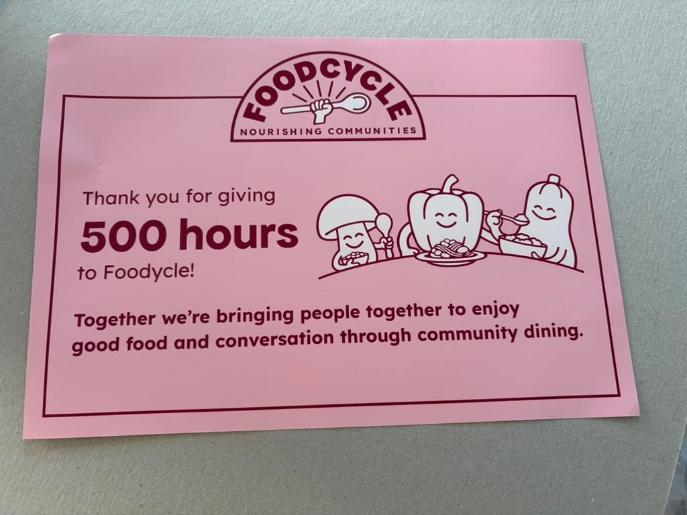

Last Saturday I reached 500 hours of volunteering at [FoodCycle](https://foodcycle.org.uk/). It feels like yesterday that I started, and also like yesterday that I reached 100 hours. I joined about a year and a half ago[^1], and now the counter says 500.

## How the hours added up

In this time I've cooked at around 13 different venues across London. What made the number grow fast was this summer. Between July and August I volunteered almost full time for a couple of weeks: every day, often two shifts a day, one for lunch and one for dinner.

I'm also now a _Project Lead_ at two hubs, Walthamstow and Finsbury Park.

## The people and the chaos

I've met a lot of people and worked with many new faces. There were a lot of laughs, and a lot of small moments of madness: something burnt at the last minute, guests with incredible combinations of different dietary needs and allergies, or numbers nobody expected. Once 83 people walked through the door.

There were also a few moments of tension, with some guests who didn't behave well. They are rare, but they are part of the job too, and you learn to stay calm and handle them as a team.

## What I learned in the kitchen

I've learned many recipes, most of which I would probably never have tried on my own. I've cooked ingredients I would never have bought. And I've given a second chance to things I always found disgusting, if they were made in a different way. Yes, I'm talking about beetroot: pickled, it's not bad at all.

## A certificate in the post

To celebrate, FoodCycle sent a certificate to my home.

## Next stop: 1000

As I said in the other post, this experience gives me a lot of satisfaction. I hope I can keep giving my time to it. Now let's see if I can get to 1000.

[^1]: I wrote about the first year in [One Year at FoodCycle](/blog/one-year-at-foodcycle).
