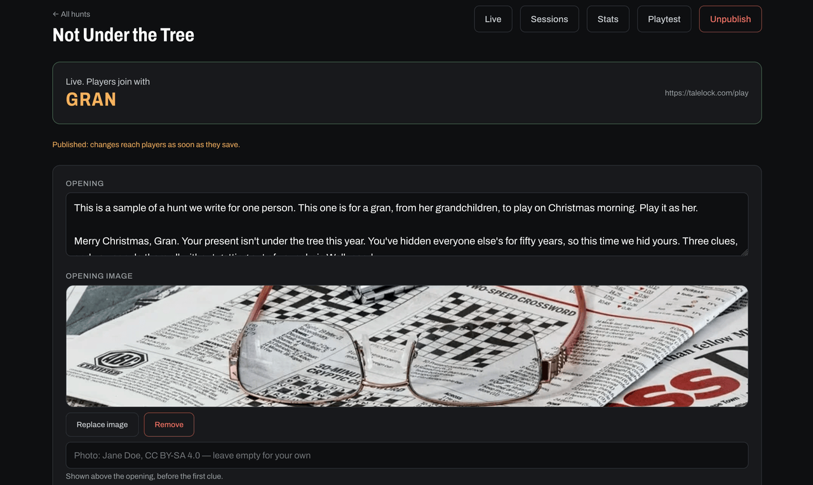
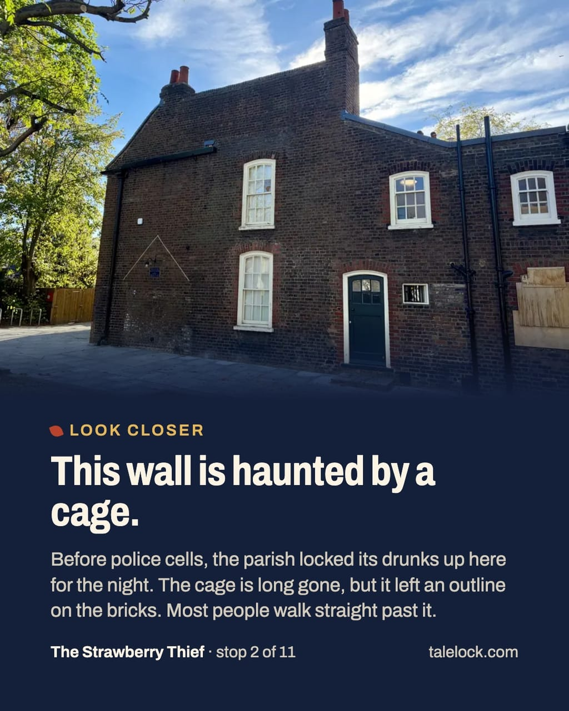
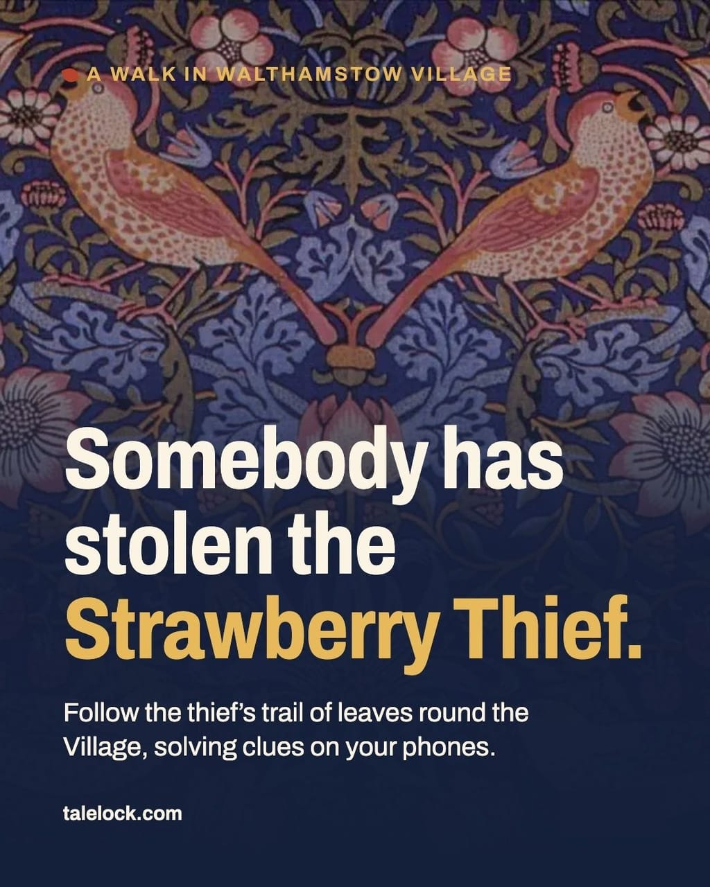
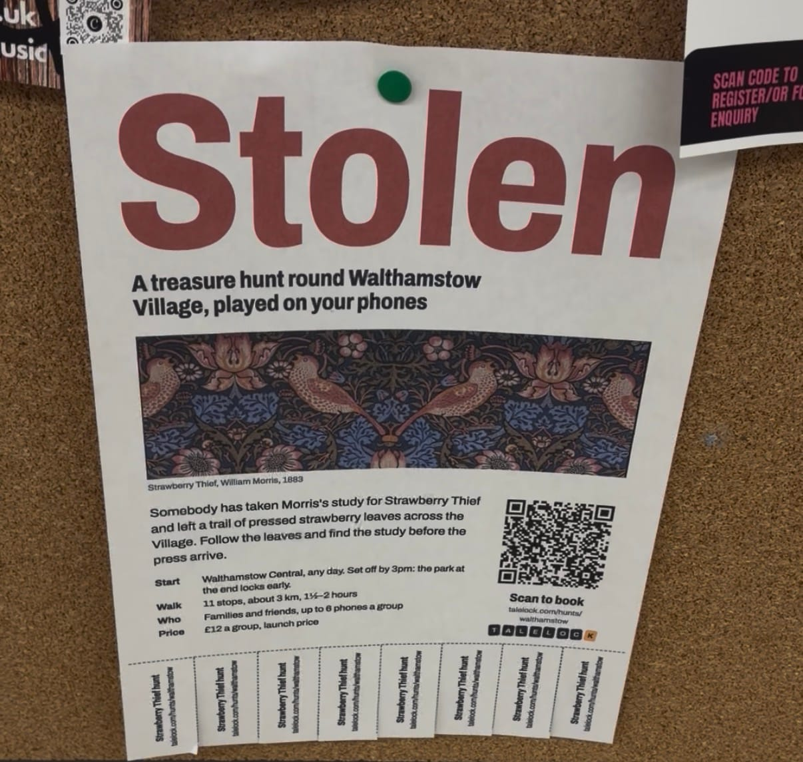
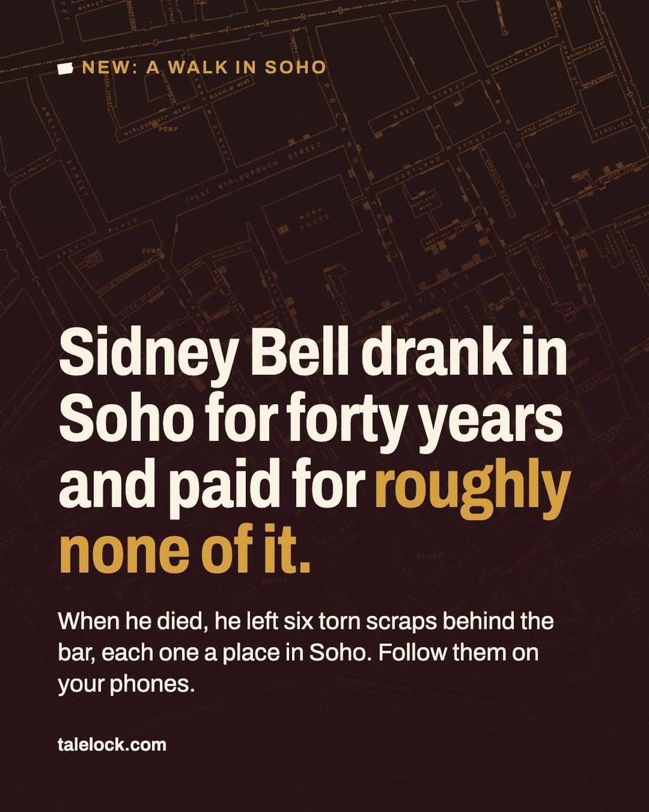

I launched a business. Yes, really. I worked on it for a while, and a few weeks ago the first hunt went live. It's called [Talelock](https://talelock.com), and it's a way to write and play treasure hunts around a city (or from your sofa).

## Why treasure hunts

In the last few years I've started to explore cities this way. I'm terrible at planning trips in advance: it makes me anxious, and my plans always change anyway. A treasure hunt gives me a plan without having to make one. It's gamification used for something useful.

I tried several companies that make them. They work, but I wanted something more fun. What I found were fake chats that load in the browser, or PDF files. And most of them were just a list of riddles, without a strong story and without much to learn along the way. The story was a chat with a character, and it got lost between one clue and the next.

So I made my own.

## Two parts: Studio and Play

Talelock has two parts.

- **Studio** — where a hunt is written.
- **Play** — where people play it. You join with a link or a code, on your phone. No app to install, no account.

Play is what people see, but Studio is the part I'm most proud of.

### Studio

In Studio you write the story, the steps and the hints, and add a picture to each step. Then you choose how each step unlocks. There are six ways:

- **Riddle** — type the answer. Small typos and accents are forgiven.
- **Pick one** — choose from a few options, with only one try.
- **Order** — put a list back in the right order.
- **QR code** — scan a code hidden somewhere.
- **Photo** — send a photo, accepted on the spot or after I check it.
- **Place** — walk to the right spot. The app tells you if you're getting _warmer_ or colder, but never where the spot is.

Writing good riddles is harder than it looks, so Studio comes with a reference of puzzle types: ciphers, anagrams, answers hidden inside a text, wordplay, things you can only see on site. Four ciphers in a row is really the same riddle four times, so the reference pushes you to mix them.

You also decide how the game feels: with or without points, timer and hints.

Before a hunt goes out, I test it from Studio, starting from any step. For a place step, I stand on the spot and press "Use where I am now".

While people play, a live page shows me where each group is, which photos are waiting for me, and where groups get stuck. Each group gets its own private link. They can play together and all see the same clue, or race against each other.

### What makes a good hunt

For me, a good hunt has three things:

- **Discovery** — you learn new things, and you notice spots you walk past every day without seeing them.
- **A story** — consistent from start to end, told by one voice that drives you from one step to the next.
- **Puzzles** — fun to solve, not just a list of questions.

## The first hunt: William Morris in Walthamstow

The first hunt is in _Walthamstow Village_, where I live[^1]. It's built around [William Morris](https://www.wmgallery.org.uk/), the artist and designer who grew up here. Somebody has stolen his _Strawberry Thief_, and you follow a trail of strawberry leaves across the Village to find it.

Two groups have played it so far. One of them said: "I didn't know my neighbourhood was so full of stories." That's the best thing anyone could tell me. And today, for the first time, someone I don't know bought it.

If you live around Walthamstow, you may have seen this poster in a café. Yes, that's me.

Since then a second hunt has gone live in _Soho_. It follows the last round of Sidney Bell, who drank there for forty years and paid for almost none of it. If you prefer to stay on the sofa, there's a free [armchair hunt](https://talelock.com/play?code=AUDITION).

## Made for you

I also write hunts for one person. You tell me about them: names, places, dates, running jokes. I write a hunt around those stories, to play at home or on a walk through places that mean something to them. It works as a present, or for a birthday or an anniversary. All the details are on the [made-for-you page](https://talelock.com/made-for-you).

## What's next

For now I'm the only one writing hunts in Studio. I'd like to open it to others, so anyone can write and share a hunt for their own city or neighbourhood. I'd also like to make the made-for-you hunts even more personal: you could send me your own photos, props or graphics, and I'd build the hunt around them.

## What I get out of it

I'm having a lot of fun building it, and even more writing the hunts. Each one teaches me a lot about the city, especially the less touristy areas. They don't get many visitors, but they are full of curious stories.

I hope you like them. If you play one, tell me how it went.

[^1]: And where I cook at [FoodCycle](/blog/500-hours-at-foodcycle). One of the first free codes for the hunt went to a group I met there.
