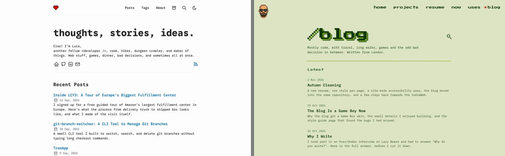
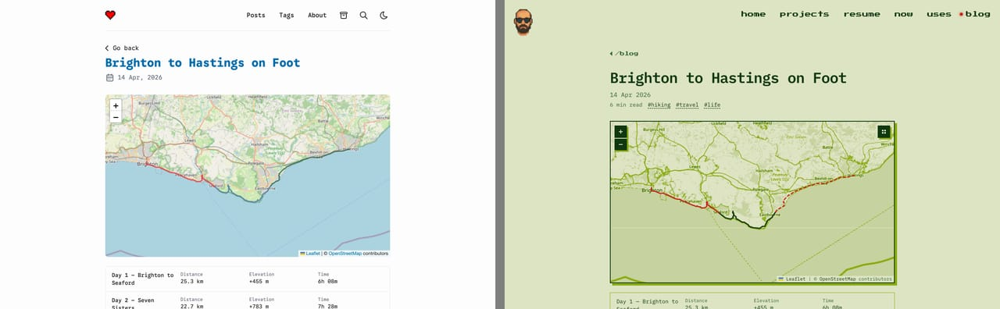
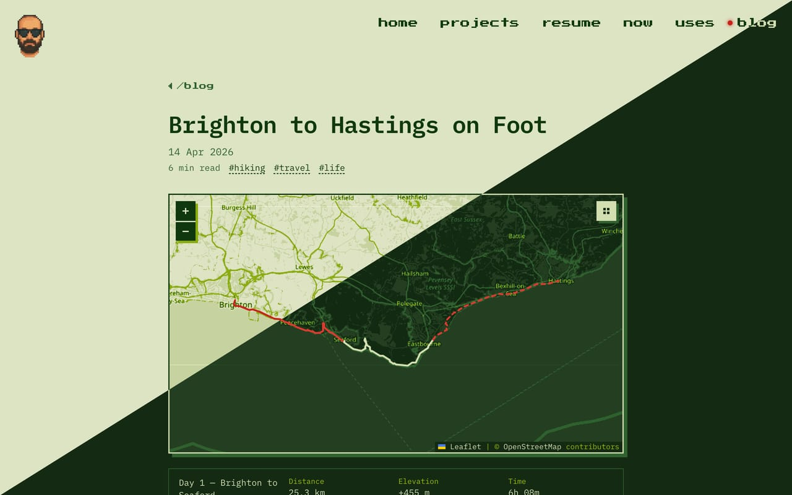
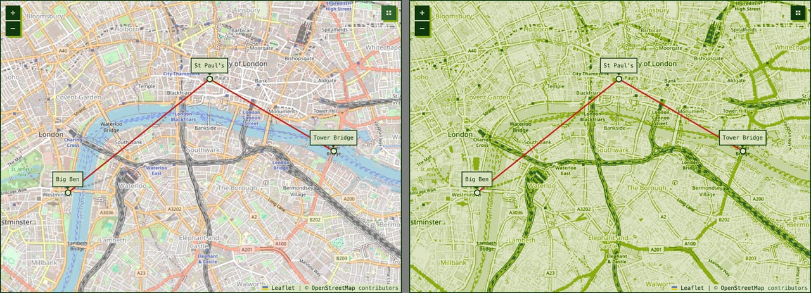
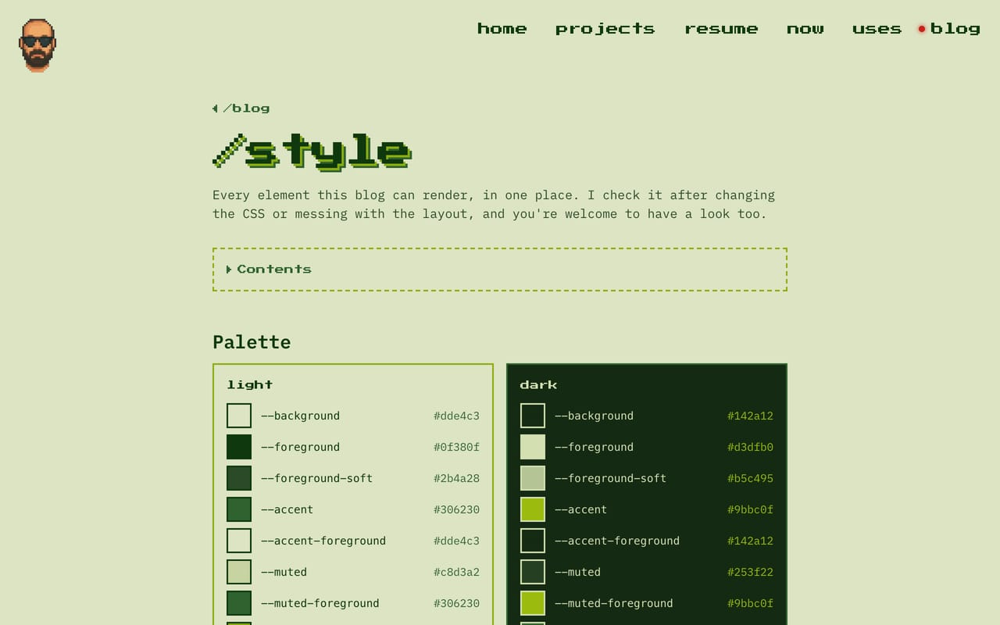

Every page on [sirlisko.com](https://sirlisko.com) is a different game. The home page is a title screen, [/now](https://sirlisko.com/now) is Pac-Man, [/projects](https://sirlisko.com/projects) is a bootleg NES _multicart_ menu, and [/uses](https://sirlisko.com/uses) is a Zork session. The blog was the one page that broke the rule. It still looked like the theme I started from, [AstroPaper](https://github.com/satnaing/astro-paper): white, a blue accent, and a navy and orange dark mode.

It was the last part of a bigger autumn cleaning of the site, and the one where I spent the most time.

## The missing cartridge

The problem with a blog is that the main part is the text, and I did not want to change that. Long text needs to stay easy to read, whatever the theme.

So I thought about what reading on a screen looks like when it is calm. The answer was e-ink readers, with their flat, grey-green screens. And the closest thing to that in a video game is the Game Boy. It was also a step further back into my childhood than the Final Fantasy VII resume I had just retired.

So the blog became the missing cartridge: a Game Boy.

## Four shades of green

The first Game Boy, the _DMG_, had a screen with four shades of green. I took them from the [original Game Boy palette](https://lospec.com/palette-list/original-gameboy) on Lospec, a site with colour palettes for almost anything. That is the whole palette here. The light theme is the pale screen with dark green ink. The dark theme flips the ramp, so it looks like lit pixels on a dark screen.

Four colours is not a lot, and that was the point. Every time I wanted a new colour for something, I had to decide which of the four it really was. The only extra is a red, `--led`, for the power light. It shows up as the dot next to "blog" in the menu, on the file name badges of code blocks, and on the GPX tracks on the maps.

Titles and labels use [Press Start 2P](https://fonts.google.com/specimen/Press+Start+2P), and body text uses IBM Plex Mono, the same fonts as the rest of sirlisko.com.

## The small things

These are the parts I enjoyed the most, and the ones nobody asked for.

- **The boot scroll.** The "blog" title, and the big "404" on the 404 page, scroll down from the top and stop, like the Nintendo logo when you turn the console on.
- **The menu cursor.** Hovering a post in a list shows a small triangle pointer next to it, like a Game Boy menu. It hangs in the margin, so the list does not move.
- **Pixel arrows.** Press Start 2P has its own ◀ and ▶, but they are tiny and sit on the baseline, so they never line up with the text next to them. The arrows on "Go back", "Previous" and "Next" are drawn as a small pixel triangle instead.
- **The START button.** On a phone the menu is behind a START button, and it opens a "Paused" screen.
- **Maps.** The GPX and route maps use Game Boy tiles, more on them below. While a map loads it shows a blinking "LOADING...", and if it never loads it says "NO SIGNAL".
- **The Konami code.** Type ↑ ↑ ↓ ↓ ← → ← → B A on sirlisko.com or here and every page gets _scanlines_ and a curved glass edge, like an old CRT TV. The blog lives on the same domain, so the effect stays on when you move between the two.[^1]

## Maps in green

The maps were the part that clashed the most. Hiking posts have maps with the route on top, and they were full colour OpenStreetMap tiles in the middle of a green page.

_Yak shaving_[^2] is my biggest talent, so I decided to make a Game Boy theme for [Leaflet](https://leafletjs.com), the map library the blog uses. It was a lot more fun than I expected.

CSS filters can only shift colours, so they cannot limit a map to a fixed palette. [leaflet-gameboy](https://github.com/sirlisko/leaflet-gameboy) uses an SVG filter instead: the brightness of each pixel picks one shade of green.

The hard part was choosing the shades. With only the four Game Boy colours, too many things ended up the same: rivers in a city looked like roads, and the map was hard to read. In the end I added a fifth, paler shade, so that most land falls into one calm background, while water, woods, roads and labels keep their own colours. It is a bit more than an original Game Boy could show, but I am happy with the result.

It is on [npm](https://npmjs.com/package/leaflet-gameboy), with a [demo](https://sirlisko.github.io/leaflet-gameboy/). If you try it and have ideas, or something looks wrong, tell me and I will try to fix it.

## The parts that did not match

A reskin is quick when it is only colours and fonts. The slow part is finding everything that still looks like the old theme.

AstroPaper was a good base, but I wanted something more personal, with my own signature, so I decided to drop it completely. Some of its pieces were still there, and I only noticed them one at a time. The back to top button was still a rounded, blurred chip. Callouts used icons from a different theme, so "Tip" and "Important" had the same one. The share card for links was the only place where the change was obvious from the start, so it got a Game Boy of its own early.

## A page with everything

To find the rest, I made a [style guide](/blog/style): one page that shows every element the blog can render. Headings, lists, callouts, tables, code, images, diagrams, maps, buttons in every state, and the parts that sit under every post. It also shows the states that you normally never see, like an image that fails to load or a map with no signal.

The idea is simple. When I change the CSS, I open one page, switch between light and dark, and look.

The first time I did that, it found more than I expected. In dark mode, the numbers under the hiking maps were almost invisible, and highlighted text was bright yellow, the one colour that is not on a Game Boy. None of it was hard to fix, only hard to find.

That is the main thing I would take from this: if a site has a look, it is worth one page that shows all of it. It does not need to be pretty, it needs to be complete. That is more or less what a _design system_ does, just smaller. Mine is at [/blog/style](/blog/style), and it is also listed in the [credits](https://sirlisko.com/credits) of sirlisko.com, as the Game Boy manual.

[^1]: It is also a session flag, so it turns itself off when you close the tab.

[^2]: Solving a small problem by first solving a long chain of other problems, each one further from where you started. The [Jargon File](http://www.catb.org/jargon/html/Y/yak-shaving.html) has the classic definition.
