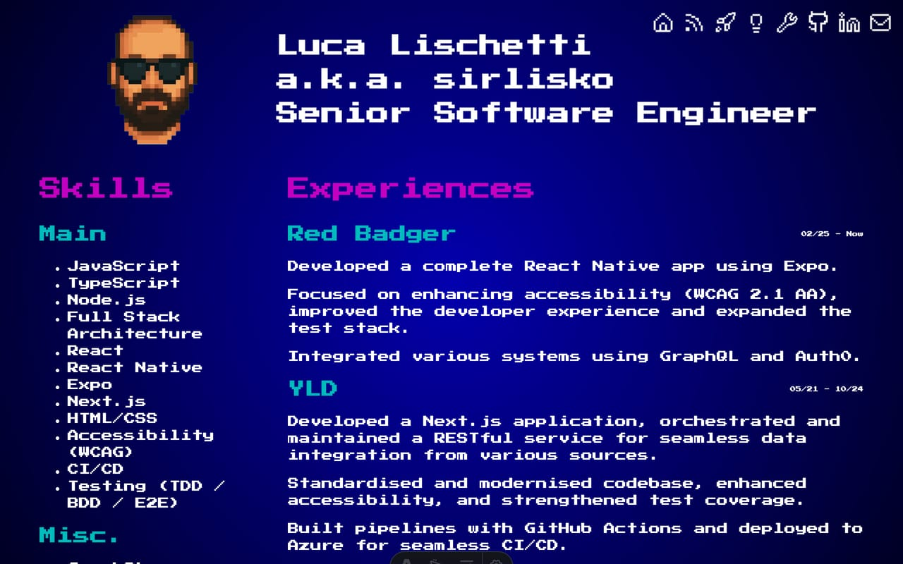
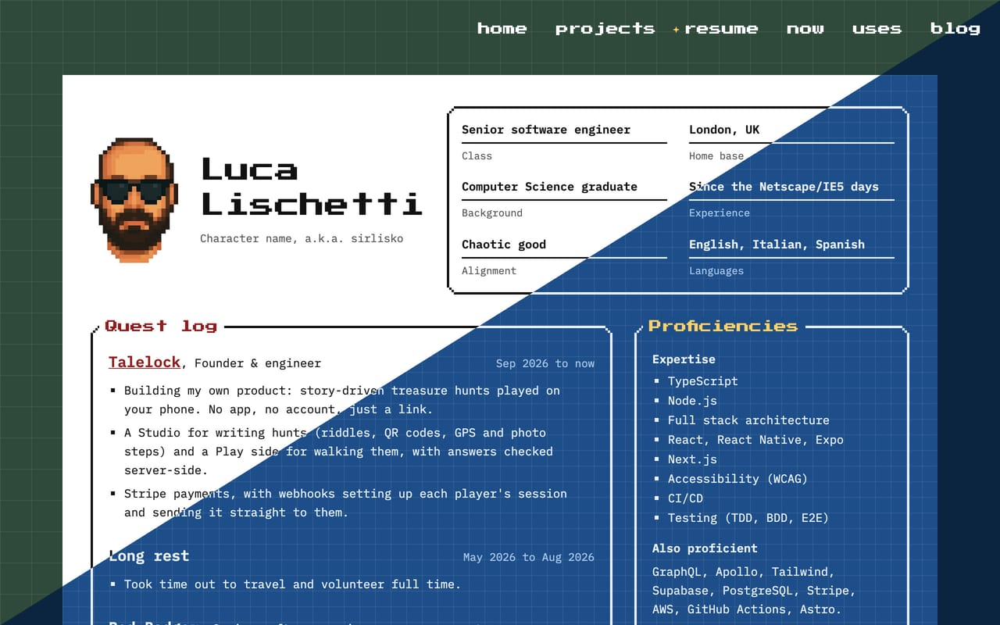
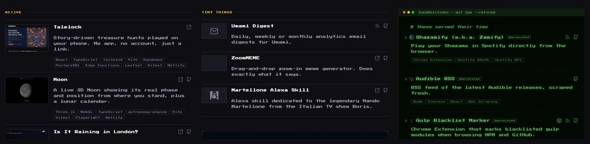
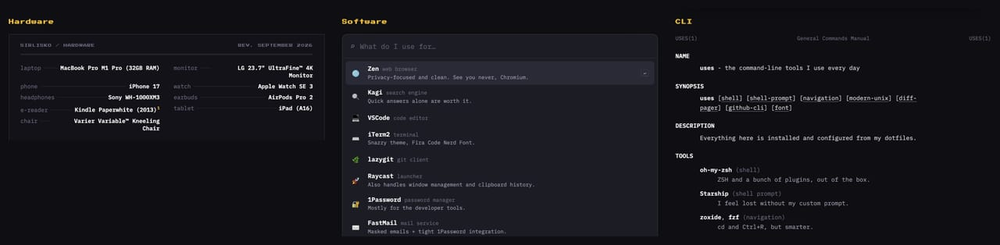
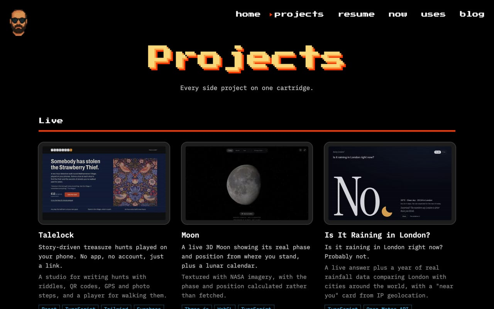
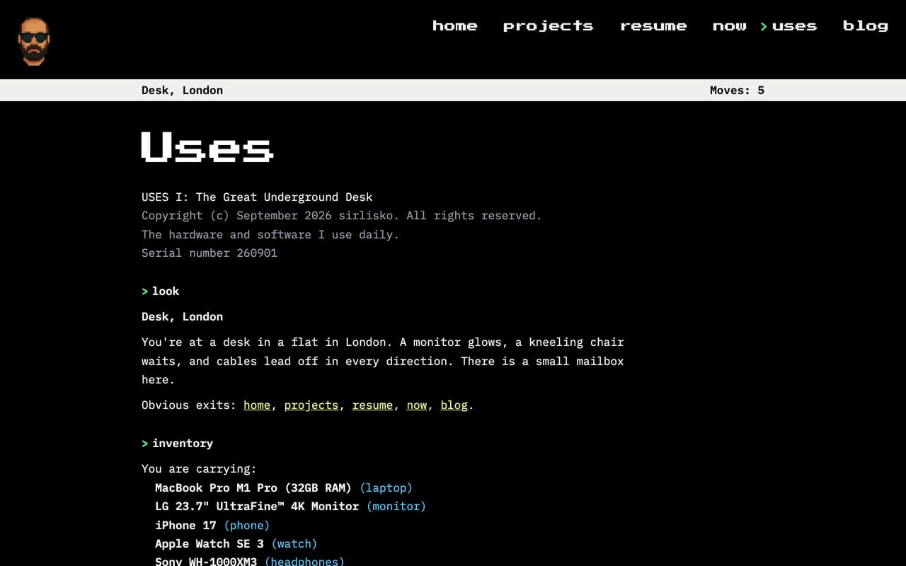
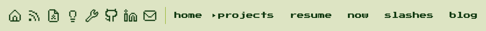

Usually it is spring cleaning. This year I did it in autumn: a few weeks spent going through [sirlisko.com](https://sirlisko.com) page by page, before the winter.

Every page on the site is a tribute to a video game. Over the years some pages drifted away from that idea, some got harder to read than they should be, and the blog lived in a separate project with its own look. This is what changed.

## The resume

My [resume](https://sirlisko.com/resume) was based on the character status screen of _Final Fantasy VII_. It is a game I still love, almost 30 years later, and I liked having it there.

Over the years I got a lot of feedback on it, mostly from recruiters, and most of it said the same thing: it was too much. That never bothered me. But I could see their point. The blue background and the colours were from a game that is almost 30 years old, and reading long sections in that font was not easy. I have always been an advocate for accessibility, so it felt wrong to keep a page that was hard to read. Yes, the print styles turned it white, and the footer linked to a plain black on white version. But that was a workaround, not a fix.

The new one is inspired by a character sheet from tabletop role-playing games like _Dungeons & Dragons_. Jobs are a Quest Log, smaller projects are Side Quests, skills are Proficiencies, and achievements are Feats. It is still playful, but it reads like a normal document, and it prints exactly the same.

Technically is a tabletop game and not a video game. But it’s another big passion of mine, and I wanted to pay it the same respect.

## One page, one game

[/projects](https://sirlisko.com/projects) and [/uses](https://sirlisko.com/uses) had the same problem. Each had three sections, and each section had its own style. Projects were split into current projects, small projects and old ones that I no longer use. Uses had hardware, software and command line. There were interesting parts in both, but each page looked like three pages.

So I moved to a more consistent approach. Projects became a bootleg NES _multicart_ menu, and uses became a session of _Zork_, the old-school text adventure.

## Accessibility and navigation

I ran an accessibility audit on the whole site and went through the generated HTML of every page. All the pages now have a skip link, proper headings and labels, and they work with a keyboard and a screen reader.

The navigation got the biggest change. It used to be only icons, and some sections were shuffled together. Now it is a menu with clear labels, and it is the same on every page of the site, blog included. It links only to pages of the site. The old one was cluttered with my LinkedIn, my GitHub profile and my email. Now they are where they matter: LinkedIn and GitHub are in the contacts of the resume, and the email is on the home page and at the end of every post. The new menu also shows where you are. The old one simply hid the page you were on and showed only the other destinations. The new one keeps every page in the list and puts a cursor next to the current one.

## One repository

The blog lived in its own repository. It started as a copy of [AstroPaper](https://github.com/satnaing/astro-paper), an Astro blog theme, and the rest of the site was a separate Astro project, built from scratch. Any change that touched both meant doing it twice. The navigation is shared, and more than once I had to make the same fix twice, or found a bug because they were drifting apart.

The redirects were the worst part. The blog lived in a subfolder of the site, sirlisko.com/blog, but the server only read the redirects from the main repository, the one at the root of the domain. So every time I moved or renamed something in the blog, I had to add its redirect in the other repository.

Now the blog lives in the same repository as the rest of the site. Everything on sirlisko.com is in one place.

## The blog

This is where I spent most of the time. The blog had a few retro references, but it was the classic Astro blog you can find anywhere on the web. I wanted it to have a character of its own, without touching the text, which is the point of a blog.

The answer was a Game Boy.[^1] I wrote about it in [The Blog Is a Game Boy Now](/blog/the-blog-is-a-game-boy-now): the palette, the small details, the map theme that became an npm package, and the style guide page that found the bugs I had missed.

Also, now every post has a "Suggest an edit" link next to "Reply via email". It opens the post on GitHub, where anyone can propose a fix.

## Back to the IndieWeb

I also added the IndieWeb basics:

- **Microformats.** An _h-card_ on the home page and _h-entry_ on posts, so other sites and readers can understand who wrote what.
- **Webmentions.** When another site links to a post, or someone replies to it, it shows up under the post as "From the web".
- **The fediverse and Bluesky.** Through [Bridgy Fed](https://fed.brid.gy/), the blog has its own account, [@sirlisko.com](https://bsky.app/profile/sirlisko.com.web.brid.gy), and new posts are shared there.
- **A /friends page.** [/friends](https://sirlisko.com/friends) is a high score table of people I like around the web.
- **A webring.** The blog footer links to the [IndieWeb Webring](https://xn--sr8hvo.ws). The arrows take you to the previous and next site in the ring.

The webring took me back to when I started using the internet, at the end of the 90s. It was not a trap to make money yet. The people who made things online, companies included, were the rebels. I wrote more about that in [Why I Write](/blog/why-i-write), so I will not repeat it here.

## Two new pages

[/stats](https://sirlisko.com/stats) is my years in numbers: posts, walks, countries, volunteering, music, films and books, in the style of _OutRun_. It is still a work in progress. [/slashes](https://sirlisko.com/slashes) lists every [slash page](https://slashpages.net) of the site, from /now and /uses to /stats and /friends, laid out like the world map of _Super Mario World_.

If you want to know which game is behind each page, the [credits](https://sirlisko.com/credits) list them all, rolled as end credits.

## What's next

The big part is done, and I am happy with the state of the site. I will keep working on it slowly over the next weeks and months.

One thing I would like to do is release the blog as an Astro theme. That needs a lot of work, because right now it is tied to my site. The navigation, for example, links to the other pages of sirlisko.com, which makes no sense for anyone else. I would make something focused on blogging, maybe with an intro page, but still a Game Boy. I know it is not for everyone. But I like to keep my small, odd things, and to be a bit eccentric.

[^1]: The light bulb also went on in another sense. At night, the home page has a lamp now, and it shines on my bald head. Yes, I can laugh at myself.
